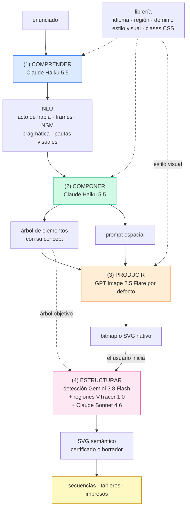
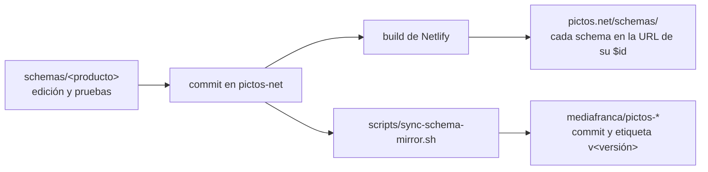

**For English Speakers**

This document is in Spanish. For a complete English version, please see [the English README](./README_en.md).


# [PICTOS](https://pictos.net)

**Pictogramas generativos para la Comunicación Aumentativa y Alternativa (CAA)**

* [](https://app.netlify.com/projects/pictos/deploys)
* 
* 

PICTOS transforma intenciones comunicativas expresadas en lenguaje natural en pictogramas mediante un pipeline de razonamiento semántico. Es parte de la investigación doctoral de [Herbert Spencer](https://herbertspencer.net/cc) en diseño para la Comunicación Aumentativa y Alternativa.

La rama de desarrollo `dev` contiene la siguiente versión:

* ver: [next.PICTOS](https://next.pictos.net)
* [](https://app.netlify.com/projects/pictos-next/deploys)

## Cómo funciona

PICTOS es un pipeline de tres fases automáticas y una cuarta que inicia el usuario. Cada fase es visible, editable y regenerable por separado; editar una fase marca como desactualizadas las siguientes.

**(1) Comprender** (Claude Haiku 5.5; alternativa GPT-6 Luna). Analiza el enunciado y produce un NLU según [pictos-nlu-schema](schemas/pictos-nlu-schema) 1.1.0: acto de habla e intención, dominio, frames semánticos con sus roles, explicaciones en los 65 primos del Metalenguaje Semántico Natural (NSM), forma lógica, pragmática y pautas visuales. Usa el contexto geográfico y el contexto de dominio de la librería.

**(2) Componer** (Claude Haiku 5.5; alternativa GPT-6 Luna). Traduce el NLU a un árbol de elementos visuales y a un prompt de articulación espacial. Cada elemento lleva un `concept` (Agent, Action, Object, Context, Element) que viaja hasta el `data-concept` del SVG final. Los nombres se escriben en el idioma de la librería. Si el usuario edita el árbol, puede regenerar solo el prompt.

**(3) Producir** (por defecto GPT Image 2.5 Flare; alternativas Nano Banana 2 Lite y la familia Recraft V4.1). Genera la imagen a partir del enunciado, el NLU, los elementos, el prompt espacial y el estilo visual de la librería. Los modelos raster entregan un bitmap; Recraft vector entrega SVG nativo.

**(4) Estructurar** (Claude Sonnet 4.6, opcional). Convierte el dibujo en un SVG semántico según [pictos-svg-schema](schemas/pictos-svg-schema): un grupo por elemento del árbol, con el NLU, la composición, los vínculos y los metadatos de accesibilidad embebidos. Sobre un bitmap, Gemini 3.8 Flash ubica primero cada entidad dibujada, VTracer 1.0 corta la imagen en regiones y una sola llamada de visión asigna cada región a una entidad. La geometría se calcula en el navegador: el modelo solo decide la pertenencia. Si el resultado cumple el esquema queda certificado; si no, queda como borrador con una lista de lo que falta, que se puede resolver sin volver a estructurar. Detalle en [docs/ESTRUCTURAR.md](docs/ESTRUCTURAR.md).

Los pictogramas certificados se usan en **secuencias** (rutinas paso a paso), **tableros de comunicación** (cuadrículas con colores Fitzgerald y audio) e **impresos** en PDF.



La arquitectura completa, con los diagramas del servidor, la persistencia, los estados y el modelo de datos, está en [docs/ARCHITECTURE.md](docs/ARCHITECTURE.md).

## Pregunta de investigación

¿Qué controles necesitan los profesionales de la comunicación para definir y expresar su experticia al crear pictogramas, y cómo deben estar diseñados? PICTOS es el instrumento con el que se explora esa pregunta en cuatro momentos: la **comprensión** (qué se quiere comunicar), la **composición** (qué se dibuja y cómo se relaciona), la **producción** (el estilo que da coherencia a una librería) y la **activación** (las secuencias, tableros y láminas donde el pictograma se usa). [docs/CONTROLES_DE_EXPERTICIA.md](docs/CONTROLES_DE_EXPERTICIA.md) describe los controles que existen hoy en cada momento y las brechas que abren preguntas de diseño.

### Configuración de una librería

| Parámetro | Fase | Descripción |
|---|---|---|
| `lang` | 1, 2, 4 | Idioma del análisis y de los nombres de los elementos |
| `uiLang` | — | Idioma de la interfaz |
| `geoContext` | 1, 4 | Región geográfica, para el análisis y los metadatos de accesibilidad |
| `domainContext` | 1, 2 | Dominio semántico de la librería (p. ej. "hospital", "trámites escolares") |
| `visualStylePrompt` | 3 | Descripción del estilo visual que se agrega al prompt de imagen |
| `svgStyleDefs`, `svgKeyframes` | 4 | Clases CSS y animaciones del SVG estructurado |
| `comprenderModel`, `componerModel`, `generationModel`, `phase5Model` | 1, 2, 3, 4 | Modelo por fase; si se omite, la librería sigue el modelo por defecto del catálogo |
| `credits`, `license` | — | Autoría y licencia de la librería |
| `recording` | — | Registro de las ediciones por fila, para investigación |

## Filosofía

Los pictogramas son más que ilustraciones: son actos comunicativos. En [MediaFranca](https://github.com/mediafranca), la iniciativa abierta a la que pertenece PICTOS, proponemos que para generar un buen pictograma hay que primero *comprender profundamente* qué se quiere comunicar, antes de decidir cómo visualizarlo.

La iniciativa nace de una convicción compartida: **la comunicación visual debe ser explicable y accesible, basada en el contexto**.

Los pictogramas generados buscan reducir barreras cognitivas, facilitar la expresión de necesidades básicas y contribuir a la autonomía de personas con diversidad funcional.


## Esquemas: dónde se trabajan y cómo se publican

Los contratos entre fases son cuatro productos independientes. **Se desarrollan aquí**, en `schemas/`, junto con el código que los usa. Cada uno tiene además un repositorio de referencia en `mediafranca`, que es una proyección de solo lectura de esta fuente: recibe cada versión, pero no se edita directamente.

| Producto | Contrato | Versión vigente | Repositorio de referencia | Licencia |
|---|---|---|---|---|
| `pictos-nlu-schema` | COMPRENDER: análisis NLU basado en NSM y FrameNet | 1.1.0 | [mediafranca/pictos-nlu-schema](https://github.com/mediafranca/pictos-nlu-schema) | CC BY-SA 4.0 |
| `pictos-composition-schema` | COMPONER: composición visual independiente del proveedor de imagen | 0.1.0 | [mediafranca/pictos-composition-schema](https://github.com/mediafranca/pictos-composition-schema) | CC BY 4.0 |
| `pictos-svg-schema` | ESTRUCTURAR: SVG semántico y autocontenido con metadatos de accesibilidad | 2.0.0-draft.1 | [mediafranca/pictos-svg-schema](https://github.com/mediafranca/pictos-svg-schema) | CC BY 4.0 |
| `pictos-api-schema` | API de máquina v1: `comprender` y `componer` | 1.1.0 | [mediafranca/pictos-api-schema](https://github.com/mediafranca/pictos-api-schema) | CC BY 4.0 |



**Reglas.**

- Una versión publicada no cambia. Si cambia un contrato, se crea una versión nueva. Los archivos registrados en `FROZEN_RELEASES.json` están fijados byte a byte.
- El `$id` de cada schema es su identificador permanente y se sirve en esa URL exacta.
- Los cambios propuestos desde fuera se revisan e incorporan aquí antes de publicarse; los espejos nunca se actualizan en sentido inverso.
- No se usan submódulos. Con ellos cada cambio exige dos commits y un ajuste de puntero, y un cambio commiteado dentro del submódulo pero nunca empujado fue lo que dejó dos versiones distintas de NLU 1.0.1 bajo un mismo `$id`.

**Nombres.** Los productos se llaman `pictos-<producto>-schema` desde el 22 de octubre de 2026. Los archivos de las versiones ya publicadas conservan su nombre y su `$id` (`pictonet-nlu-1.1.0`, `pictogram-composition-0.1.0`, `metadata-2.0.0-draft.1`); desde la próxima versión de cada producto se llamarán `pictos-<producto>-<versión>.schema.json`. Las rutas anteriores de `pictos.net/schemas/` redirigen a las nuevas.

**Sincronizar un repositorio de referencia.**

```sh
npm run test:schemas                                     # pruebas de los productos
scripts/sync-schema-mirror.sh pictos-nlu-schema          # prueba en seco: muestra el cambio
scripts/sync-schema-mirror.sh pictos-nlu-schema --push   # commit, etiqueta y push
```

El espejo recibe la instantánea del commit actual que produce `scripts/export-schema.mjs` (lista de archivos permitidos, revisión de credenciales y manifiesto con hashes), nunca el directorio sin filtrar. La sincronización se detiene si reemplazaría un release congelado, si borraría archivos que solo existen en el espejo o si reutilizaría una versión con contratos distintos. Detalle en [docs/SCHEMA_PUBLICATION.md](docs/SCHEMA_PUBLICATION.md).

## Proyectos relacionados

| Repositorio | Descripción |
|---|---|
| [PictoNet](https://github.com/mediafranca/PictoNet) | Modelo de lenguaje para escribir pictogramas vectoriales (SVG). En pausa mientras se reúnen ejemplos: las librerías de PICTOS están pensadas como su insumo de entrenamiento, sujeto a los derechos y consentimientos de cada librería |
| [ICAP](https://github.com/mediafranca/ICAP) | Marco de evaluación de pictogramas (6 dimensiones cognitivas) |
| [pictos.cl](https://pictos.cl) | Plataforma de apoyos visuales para servicios públicos (Núcleo Accesibilidad PUCV) |


## Uso

**Aplicación web**: [pictos.net](https://pictos.net)

Los pictogramas y datos se almacenan **localmente en el navegador** (localStorage + IndexedDB). Para respaldar tu trabajo usa **Exportar librería**: genera un JSON con los pictogramas, sus imágenes, el audio, las secuencias y los tableros.

Puedes compartir tu grafo exportado con comentarios a [contact@pictos.net](mailto:contact@pictos.net).


## Desarrollo local

```bash
git clone https://github.com/hspencer/pictos-net.git
cd pictos-net
cp .env.example .env        # agrega las claves de los proveedores
npm install
npm run dev                 # → http://localhost:9001 (netlify dev)
```

Claves necesarias:
- `ANTHROPIC_API_KEY`: [console.anthropic.com](https://console.anthropic.com), fases 1, 2 y 4
- `OPENAI_API_KEY`: [platform.openai.com](https://platform.openai.com), modelo de imagen por defecto y GPT-6 Luna
- `GOOGLE_SERVICE_ACCOUNT_JSON`: cuenta de servicio de Vertex AI en una línea, para Nano Banana 2 Lite y la detección de entidades
- `RECRAFT_API_KEY`: [recraft.ai](https://www.recraft.ai/api), opcional, solo modelos Recraft

Ver [docs/CONTRIBUTING.md](./docs/CONTRIBUTING.md) para instrucciones completas.

## Stack

- React 19, TypeScript 5.8, Vite 6, Tailwind CSS 3.4, Zustand (editor SVG)
- Anthropic: Claude Haiku 5.5 (fases 1 y 2) y Claude Sonnet 4.6 (fase 4)
- OpenAI: GPT Image 2.5 Flare (fase 3, por defecto) y GPT-6 Luna (fases 1 y 2, alternativa)
- Google Vertex AI: Nano Banana 2 Lite (fase 3) y Gemini 3.8 Flash (detección de entidades)
- Recraft V4.1 (fase 3, vector o raster)
- VTracer 1.0 compilado a WebAssembly (regiones en el navegador)
- Netlify Functions, Blobs e Identity
- localStorage + IndexedDB (persistencia local)

## Documentación

### Arquitectura y desarrollo

| Documento | Descripción |
|---|---|
| [docs/ARCHITECTURE.md](./docs/ARCHITECTURE.md) | Arquitectura completa con diagramas: pipeline, servidor, persistencia, datos |
| [docs/CONTROLES_DE_EXPERTICIA.md](./docs/CONTROLES_DE_EXPERTICIA.md) | La pregunta de investigación cruzada con los controles de cada momento |
| [docs/ESTRUCTURAR.md](./docs/ESTRUCTURAR.md) | Fase 4 por dentro: detección, regiones, ensamblado, certificación |
| [docs/BENCHMARK_MODELOS_2026-11.md](./docs/BENCHMARK_MODELOS_2026-11.md) | Evidencia de la elección de modelos |
| [docs/API_V1.md](./docs/API_V1.md) | API de máquina v1 |
| [docs/CONTRIBUTING.md](./docs/CONTRIBUTING.md) | Guía de desarrollo, esquemas canónicos, i18n |
| [docs/SECURITY.md](./docs/SECURITY.md) | Claves, proxies, autenticación y cuota |
| [docs/PRIVACY.md](./docs/PRIVACY.md) | Qué sale del navegador y hacia dónde |
| [docs/SCHEMA_PUBLICATION.md](./docs/SCHEMA_PUBLICATION.md) | Publicación de los esquemas |
| [docs/RELEASE_2.8.0.md](./docs/RELEASE_2.8.0.md) | Cambios de la versión actual |
| [docs/archivo/](./docs/archivo/) | Planes, migraciones y versiones anteriores, como registro histórico |

### Interfaz de usuario

| Documento | Descripción |
|---|---|
| [docs/UI_MAP.md](./docs/UI_MAP.md) | Mapa estructural de la UI: todos los IDs semánticos |
| [docs/UI_CONVENTIONS.md](./docs/UI_CONVENTIONS.md) | Convenciones de diseño: colores, tipografía, z-index |
| [docs/CSS_STYLING_ARCHITECTURE.md](./docs/CSS_STYLING_ARCHITECTURE.md) | Modelo de dos niveles para estilos SVG (clases + overrides locales) |
| [docs/WCAG_ROADMAP.md](./docs/WCAG_ROADMAP.md) | Estado de conformidad WCAG 2.1 AA y roadmap de accesibilidad |

## Comunidad

PICTOS invita a **lingüistas** a refinar el análisis NLU y NSM, **diseñadores** a mejorar la composición visual, a **educadores y sicólogos** a imaginar nuevos escenarios de uso, **investigadores** a validar métricas de calidad, y **desarrolladores** a extender las funcionalidades.

Las contribuciones son bienvenidas. Reporta bugs, propone features o abre un Pull Request en GitHub.


## Citar

```
Spencer, H. (2026). PICTOS: Pictogramas generativos para la accesibilidad cognitiva.
https://pictos.net
```

*Licencia: Apache 2.0 (código) · CC-BY-4.0 (pictogramas generados, según elección del usuario)*
