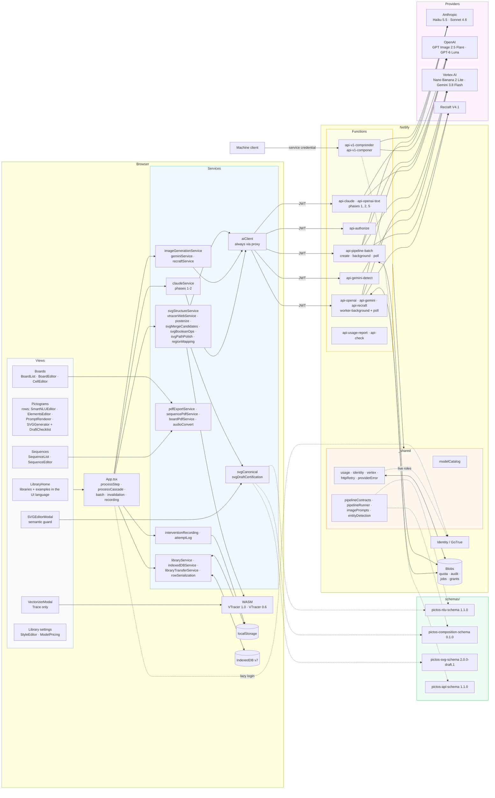
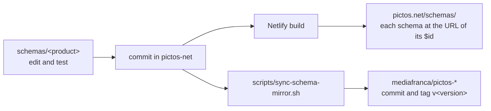

# [PICTOS](https://pictos.net)

**Generative Pictograms for Augmentative and Alternative Communication (AAC)**

* [](https://app.netlify.com/projects/pictos/deploys)
* 
* 

PICTOS transforms communicative intentions expressed in natural language into pictograms using a semantic reasoning pipeline. It is part of the doctoral research of [Herbert Spencer](https://herbertspencer.net/cc) in design for Augmentative and Alternative Communication.

The `dev` development branch contains the next version:

* view: [next.PICTOS](https://next.pictos.net)
* [](https://app.netlify.com/projects/pictos-next/deploys)

## How it works

PICTOS is a pipeline of three automatic phases and a fourth one the user starts. Each phase is visible, editable and can be regenerated on its own; editing a phase marks the later ones as outdated.

**(1) Understand** (Claude Haiku 5.5; alternative GPT-6 Luna). Analyses the utterance and produces an NLU following [pictos-nlu-schema](schemas/pictos-nlu-schema) 1.1.0: speech act and intent, domain, semantic frames and their roles, explications in the 65 primes of the Natural Semantic Metalanguage (NSM), logical form, pragmatics and visual guidelines. It uses the library's geographic and domain context.

**(2) Compose** (Claude Haiku 5.5; alternative GPT-6 Luna). Turns the NLU into a tree of visual elements and a spatial articulation prompt. Each element carries a `concept` (Agent, Action, Object, Context, Element) that reaches the `data-concept` of the final SVG. Names are written in the library's language. If the user edits the tree, they can regenerate only the prompt.

**(3) Produce** (default GPT Image 2.5 Flare; alternatives Nano Banana 2 Lite and the Recraft V4.1 family). Generates the image from the utterance, the NLU, the elements, the spatial prompt and the library's visual style. Raster models return a bitmap; Recraft vector returns native SVG.

**(4) Structure** (Claude Sonnet 4.6, optional). Turns the drawing into a semantic SVG following [pictos-svg-schema](schemas/pictos-svg-schema): one group per element of the tree, with the NLU, the composition, the bindings and accessibility metadata embedded. On a bitmap, Gemini 3.8 Flash first locates each drawn entity, VTracer 1.0 cuts the image into regions and a single vision call assigns each region to an entity. Geometry is computed in the browser: the model only decides membership. A result that meets the schema is certified; otherwise it stays a draft with a list of what is missing, which can be resolved without structuring again. Details in [docs/ESTRUCTURAR.md](docs/ESTRUCTURAR.md) (Spanish).

Certified pictograms are used in **sequences** (step-by-step routines), **communication boards** (grids with Fitzgerald colours and audio) and printed **PDF sheets**.



The diagram shows the full architecture: views, orchestration, services per phase, local storage, server functions, schemas and providers. [docs/ARCHITECTURE.md](docs/ARCHITECTURE.md) (Spanish) expands each part with diagrams of the pipeline, STRUCTURE, states, data model and persistence.

## Research question

Which controls do communication professionals need to define and express their expertise when creating pictograms, and how should those controls be designed? PICTOS is the instrument for exploring that question across four moments: **understanding** (what is meant), **composition** (what is drawn and how it relates), **production** (the style that makes a library coherent) and **activation** (the sequences, boards and sheets where the pictogram is used). [docs/CONTROLES_DE_EXPERTICIA.md](docs/CONTROLES_DE_EXPERTICIA.md) (Spanish) describes today's controls in each moment and the gaps that open design questions.

### Library configuration

| Parameter | Phase | Description |
|---|---|---|
| `lang` | 1, 2, 4 | Language of the analysis and of element names |
| `uiLang` | — | Interface language |
| `geoContext` | 1, 4 | Geographic region, for the analysis and accessibility metadata |
| `domainContext` | 1, 2 | Semantic domain of the library (e.g. "hospital", "school paperwork") |
| `visualStylePrompt` | 3 | Visual style description added to the image prompt |
| `svgStyleDefs`, `svgKeyframes` | 4 | CSS classes and animations of the structured SVG |
| `comprenderModel`, `componerModel`, `generationModel`, `phase5Model` | 1, 2, 3, 4 | Model per phase; when omitted, the library follows the catalog default |
| `credits`, `license` | — | Authorship and licence of the library |
| `recording` | — | Per-row edit log, for research |

## Philosophy

Pictograms are more than illustrations: they are communicative acts. At [MediaFranca](https://github.com/mediafranca), the open initiative PICTOS belongs to, we hold that to generate a good pictogram, one must first *deeply understand* what is to be communicated, before deciding how to visualize it.

The initiative stems from a shared conviction: **visual communication must be explainable and accessible, based on context**.

The generated pictograms aim to reduce cognitive barriers, facilitate the expression of basic needs, and contribute to the autonomy of people with functional diversity.


## Schemas: where they are developed and how they are published

The contracts between phases are four independent products. **They are developed here**, in `schemas/`, next to the code that uses them. Each one also has a reference repository under `mediafranca`, which is a read-only projection of this source: it receives every version but is never edited directly.

| Product | Contract | Current version | Reference repository | Licence |
|---|---|---|---|---|
| `pictos-nlu-schema` | UNDERSTAND: NLU analysis based on NSM and FrameNet | 1.1.0 | [mediafranca/pictos-nlu-schema](https://github.com/mediafranca/pictos-nlu-schema) | CC BY-SA 4.0 |
| `pictos-composition-schema` | COMPOSE: visual composition independent of the image provider | 0.1.0 | [mediafranca/pictos-composition-schema](https://github.com/mediafranca/pictos-composition-schema) | CC BY 4.0 |
| `pictos-svg-schema` | STRUCTURE: semantic, self-contained SVG with accessibility metadata | 2.0.0-draft.1 | [mediafranca/pictos-svg-schema](https://github.com/mediafranca/pictos-svg-schema) | CC BY 4.0 |
| `pictos-api-schema` | Machine API v1: `comprender` and `componer` | 1.1.0 | [mediafranca/pictos-api-schema](https://github.com/mediafranca/pictos-api-schema) | CC BY 4.0 |



**Rules.**

- A published version never changes. A contract change creates a new version. Files listed in `FROZEN_RELEASES.json` are pinned byte for byte.
- Each schema's `$id` is its permanent identifier and is served at that exact URL.
- Changes proposed from outside are reviewed and incorporated here before publication; mirrors are never synchronised in the other direction.
- No submodules. With them every change takes two commits and a pointer bump, and a change committed inside a submodule but never pushed is what left two different NLU 1.0.1 documents under one `$id`.

**Names.** Products are called `pictos-<product>-schema` since 22 October 2026. Files of versions already published keep their name and `$id` (`pictonet-nlu-1.1.0`, `pictogram-composition-0.1.0`, `metadata-2.0.0-draft.1`); from the next version of each product they will be named `pictos-<product>-<version>.schema.json`. Former paths under `pictos.net/schemas/` redirect to the new ones.

**Synchronising a reference repository.**

```sh
npm run test:schemas                                     # product tests
scripts/sync-schema-mirror.sh pictos-nlu-schema          # dry run: shows the change
scripts/sync-schema-mirror.sh pictos-nlu-schema --push   # commit, tag and push
```

The mirror receives the snapshot of the current commit produced by `scripts/export-schema.mjs` (file allowlist, credential scan and manifest with hashes), never the unfiltered directory. Synchronisation stops if it would replace a frozen release, delete files that exist only in the mirror, or reuse a version for different contracts. Details in [docs/SCHEMA_PUBLICATION.md](docs/SCHEMA_PUBLICATION.md).

## Related Projects

| Repository | Description |
|---|---|
| [PictoNet](https://github.com/mediafranca/PictoNet) | Language model for writing vector pictograms (SVG). On hold while examples are gathered: PICTOS libraries are intended as its training input, subject to the rights and consents of each library |
| [ICAP](https://github.com/mediafranca/ICAP) | Pictogram evaluation framework (6 cognitive dimensions) |
| [pictos.cl](https://pictos.cl) | Visual support platform for public services (PUCV Accessibility Nucleus) |


## Usage

**Web application**: [pictos.net](https://pictos.net)

Pictograms and data are stored **locally in the browser** (localStorage + IndexedDB). To back up your work, use **Export library**: it generates a JSON file with the pictograms, their images, audio, sequences and boards.

You can share your exported graph with comments to [contact@pictos.net](mailto:contact@pictos.net).


## Local Development

```bash
git clone https://github.com/hspencer/pictos-net.git
cd pictos-net
cp .env.example .env        # add the provider keys
npm install
npm run dev                 # → http://localhost:9001 (netlify dev)
```

Required keys:
- `ANTHROPIC_API_KEY`: [console.anthropic.com](https://console.anthropic.com), phases 1, 2 and 4
- `OPENAI_API_KEY`: [platform.openai.com](https://platform.openai.com), default image model and GPT-6 Luna
- `GOOGLE_SERVICE_ACCOUNT_JSON`: Vertex AI service account on one line, for Nano Banana 2 Lite and entity detection
- `RECRAFT_API_KEY`: [recraft.ai](https://www.recraft.ai/api), optional, Recraft models only
- `QUIVER_API_KEY`: [platform.quiver.ai](https://platform.quiver.ai), optional, Quiver Arrow 2 only

See [docs/CONTRIBUTING.md](./docs/CONTRIBUTING.md) for full instructions.

## Stack

- React 19, TypeScript 5.8, Vite 6, Tailwind CSS 3.4, Zustand (SVG editor)
- Anthropic: Claude Haiku 5.5 (phases 1 and 2) and Claude Sonnet 4.6 (phase 4)
- OpenAI: GPT Image 2.5 Flare (phase 3, default) and GPT-6 Luna (phases 1 and 2, alternative)
- Google Vertex AI: Nano Banana 2 Lite (phase 3) and Gemini 3.8 Flash (entity detection)
- Recraft V4.1 (phase 3, vector or raster)
- VTracer 1.0 compiled to WebAssembly (regions in the browser)
- Netlify Functions, Blobs and Identity
- localStorage + IndexedDB (local persistence)

## Documentation

Most technical documents are in Spanish.

### Architecture and Development

| Document | Description |
|---|---|
| [docs/ARCHITECTURE.md](./docs/ARCHITECTURE.md) | Full architecture with diagrams: pipeline, server, persistence, data |
| [docs/CONTROLES_DE_EXPERTICIA.md](./docs/CONTROLES_DE_EXPERTICIA.md) | The research question crossed with the controls of each moment |
| [research/README.md](./research/README.md) | Studies and benchmarks: index, how to view and rerun them (Spanish) |
| [docs/ESTRUCTURAR.md](./docs/ESTRUCTURAR.md) | Phase 4 inside: detection, regions, assembly, certification |
| [docs/BENCHMARK_MODELOS_2026-11.md](./docs/BENCHMARK_MODELOS_2026-11.md) | Evidence behind the model choices |
| [docs/API_V1.md](./docs/API_V1.md) | Machine API v1 |
| [docs/CONTRIBUTING.md](./docs/CONTRIBUTING.md) | Development guide, canonical schemas, i18n |
| [docs/SECURITY.md](./docs/SECURITY.md) | Keys, proxies, authentication and quota |
| [docs/PRIVACY_en.md](./docs/PRIVACY_en.md) | What leaves the browser and where it goes |
| [docs/SCHEMA_PUBLICATION.md](./docs/SCHEMA_PUBLICATION.md) | Schema publication |
| [docs/RELEASE_2.9.0.md](./docs/RELEASE_2.9.0.md) | Changes in the current version |
| [docs/archivo/](./docs/archivo/) | Earlier plans, migrations and releases, kept as history |

### User Interface

| Document | Description |
|---|---|
| [docs/UI_MAP.md](./docs/UI_MAP.md) | Structural map of the UI: all semantic IDs |
| [docs/UI_CONVENTIONS.md](./docs/UI_CONVENTIONS.md) | Design conventions: colors, typography, z-index |
| [docs/CSS_STYLING_ARCHITECTURE.md](./docs/CSS_STYLING_ARCHITECTURE.md) | Two-level model for SVG styles (classes + local overrides) |
| [docs/WCAG_ROADMAP.md](./docs/WCAG_ROADMAP.md) | WCAG 2.1 AA compliance status and accessibility roadmap |

## Community

PICTOS invites **linguists** to refine NLU and NSM analysis, **designers** to improve visual composition, **educators and psychologists** to imagine new use cases, **researchers** to validate quality metrics, and **developers** to extend functionalities.

Contributions are welcome. Report bugs, propose features, or open a Pull Request on GitHub.


## Citation

```
Spencer, H. (2026). PICTOS: Generative pictograms for cognitive accessibility.
https://pictos.net
```

*License: Apache 2.0 (code) · CC-BY-4.0 (generated pictograms, per user's choice)*
