# PICTOS — Arquitectura

**Pictogramas generativos para la Comunicación Aumentativa y Alternativa (CAA)**

Versión 2.9.0. Actualizado: 2026-11-12. Este documento describe el código de la rama `dev`; cuando un documento más antiguo lo contradice, prevalece este y, por encima de este, el código. Los motivos de diseño en relación con la pregunta de investigación están en [CONTROLES_DE_EXPERTICIA.md](CONTROLES_DE_EXPERTICIA.md).

## Contenido

1. [Visión general](#1-visión-general)
2. [Arquitectura completa](#2-arquitectura-completa)
3. [Pipeline](#3-pipeline)
4. [ESTRUCTURAR por dentro](#4-estructurar-por-dentro)
5. [Estados de una fila y de su SVG](#5-estados-de-una-fila-y-de-su-svg)
6. [Modelo de datos](#6-modelo-de-datos)
7. [Persistencia](#7-persistencia)
8. [Servidor: funciones, autenticación y cuota](#8-servidor-funciones-autenticación-y-cuota)
9. [Catálogo de modelos](#9-catálogo-de-modelos)
10. [Esquemas](#10-esquemas)
11. [Interfaz](#11-interfaz)
12. [Uso: secuencias, tableros e impresos](#12-uso-secuencias-tableros-e-impresos)
13. [API de máquina v1](#13-api-de-máquina-v1)
14. [Build y despliegue](#14-build-y-despliegue)
15. [Código dormido y deuda conocida](#15-código-dormido-y-deuda-conocida)

## 1. Visión general

PICTOS convierte un enunciado en un pictograma explicable, editable y portable. La tesis de diseño es que la imagen debe derivarse de una comprensión lingüística y contextual explícita, y que cada paso intermedio debe quedar a la vista de quien sabe de comunicación para que pueda corregirlo.

Principios que el código mantiene:

- **Cada fase es visible, editable y regenerable por separado.** Editar una fase marca como desactualizadas las siguientes; nada se sobrescribe sin que el usuario lo pida.
- **El modelo nunca escribe geometría.** En ESTRUCTURAR el modelo decide a qué entidad pertenece cada forma; recortar, unir, verificar y pulir se hace en el navegador.
- **Local-first.** Librerías, pictogramas, audio y registros viven en el navegador. No hay base de datos central con contenido del usuario.
- **Ninguna clave llega al navegador.** Todo proveedor se alcanza a través de Netlify Functions autenticadas.
- **Los artefactos son autocontenidos.** Un SVG certificado lleva su NLU, su composición, sus vínculos y su historia de revisiones.

| Capa | Tecnología |
|---|---|
| UI | React 19, TypeScript 5.8, Vite 6, Tailwind 3.4, Lucide, @dnd-kit |
| Estado | `App.tsx` (orquestador) + Zustand para el editor SVG |
| Persistencia | localStorage (metadatos, configuración, filas) + IndexedDB (bitmaps, SVG) |
| Servidor | Netlify Functions (Node 22, esbuild) + Netlify Blobs + Netlify Identity |
| Vectorización local | VTracer 1.0 (binding propio `lib/vtracer-web`, WASM) y VTracer 0.6 legacy (`lib/vtracer-wasm`) |
| Exportación | jsPDF, JSZip |

## 2. Arquitectura completa

Un solo diagrama con todas las piezas: vistas, orquestación, servicios por fase, almacenamiento local, funciones del servidor con sus módulos compartidos, esquemas y proveedores. Las secciones siguientes amplían cada parte.

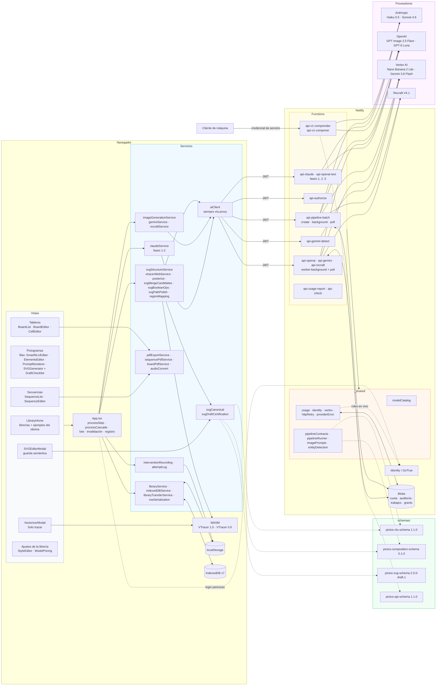

### Contexto del sistema

La misma arquitectura reducida a sus fronteras:

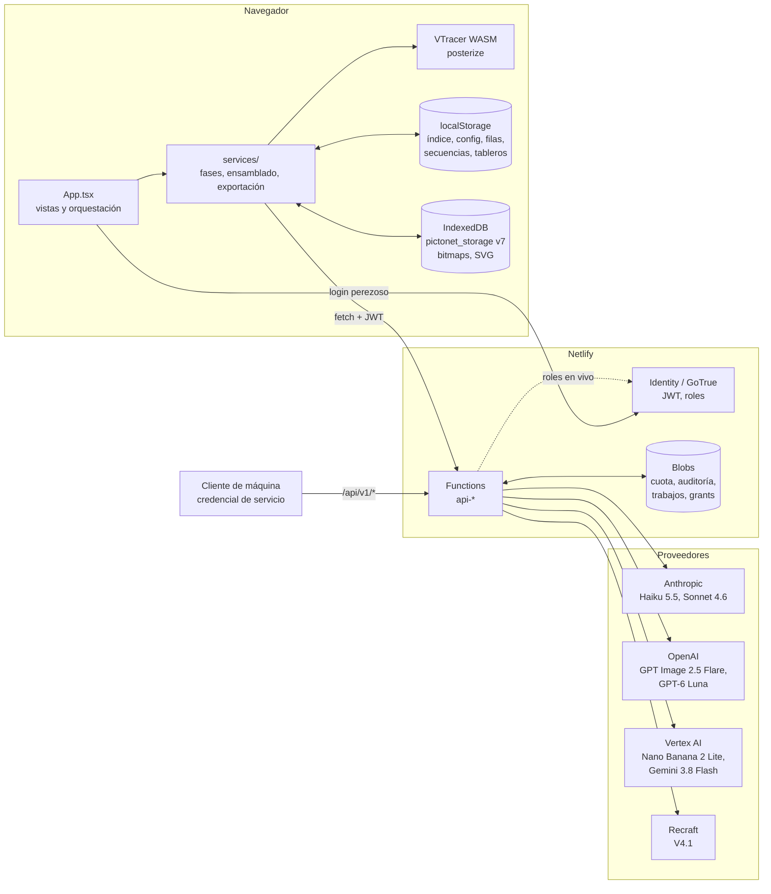

Explorar, editar y exportar contenido local no exige sesión; generar sí (`ensureAuth` en `AuthGate.tsx`).

## 3. Pipeline

Tres fases automáticas (1 → 2 → 3) y una cuarta que inicia el usuario. La UI la llama fase 4; su identificador persistido es `5` (`phase5Model`, `phases: [5]`) porque el 4 era VECTORIZAR, que ya no existe como fase.

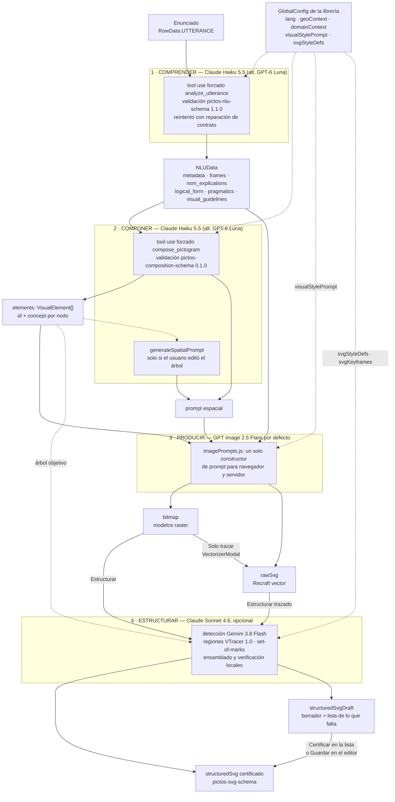

**Invalidación.** Editar el enunciado marca NLU, composición e imagen como `outdated`. Editar el NLU marca composición e imagen; editar el árbol o el prompt marca la imagen. Cualquier cambio en las fases 1 o 2 limpia `svgReference` y marca el SVG estructurado (`applySvgSafeUpdate` en `services/svgCanonical.ts`). La cascada automática no incluye ESTRUCTURAR. Cambiar la configuración de la librería no marca filas, salvo el modelo de PRODUCIR, que ofrece regenerar las filas hechas con otro modelo.

**Ejecución por lote.** "Generar en lote" (menú de la librería) envía hasta 25 filas a `api-pipeline-batch-create`; un worker en segundo plano corre 1 → 2 → 3 por fila, aísla los fallos y corta el lote si el proveedor devuelve un 429 terminal (`pipelineQuotaCircuit.js`). El cliente sondea y descarga fila por fila.

**Evidencia por fase.** Cada ejecución de las fases 1 y 2 agrega un `PhaseExecution` a la fila (modelo, hash del contrato y del prompt, instantánea de la entrada). Esa evidencia viaja al bloque `provenance` del SVG certificado. Cada intento, exitoso o no, va además al registro de diagnóstico `pictos_attempt_log` (sin contenido comunicativo).

## 4. ESTRUCTURAR por dentro

Dos entradas, un solo ensamblado. Referencia completa: [ESTRUCTURAR.md](ESTRUCTURAR.md).

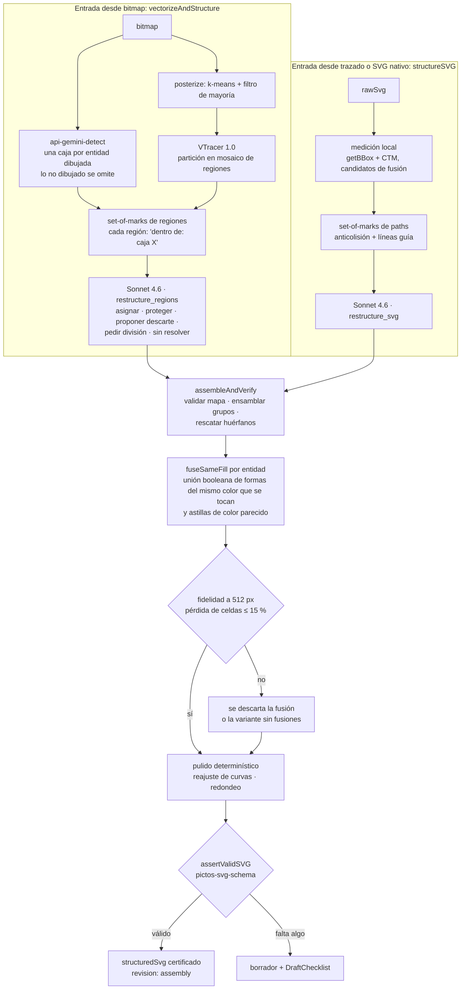

Una acción que no tiene dibujo propio y cuyo agente sí fue detectado se registra como vínculo implícito del agente. Si la detección falla, el flujo sigue como antes de 2.8.0, sin cajas.

**Lista del borrador** (`services/svgDraftCertification.ts`, `DraftChecklist` en `SVGGenerator.tsx`). Nombra cada cosa que impide certificar: campos del NLU, conceptos sin confirmar, formas fuera de los grupos, elementos sin dibujo, ids desconocidos. Ofrece selectores de concepto, "implícita de:" para acciones, "Quitar de la composición" para un elemento sin dibujo y el botón Certificar. Guardar en el editor certifica solo cuando la lista queda vacía. Ambas vías escriben una revisión `manual_edit` con el hash del padre.

**Editor SVG.** `commitSvg` aplica la guarda semántica (`components/SVGEditor/editor/semanticGuard.ts`): sobre un documento con vínculos se rechaza cualquier edición que agregue una violación (grupo vinculado borrado, renombrado o vaciado, geometría fuera de grupo). Mover formas entre grupos vinculados sí se permite.

## 5. Estados de una fila y de su SVG

Cada fase tiene un `StepStatus`: `idle`, `processing`, `completed`, `error`, `outdated` o `review`.

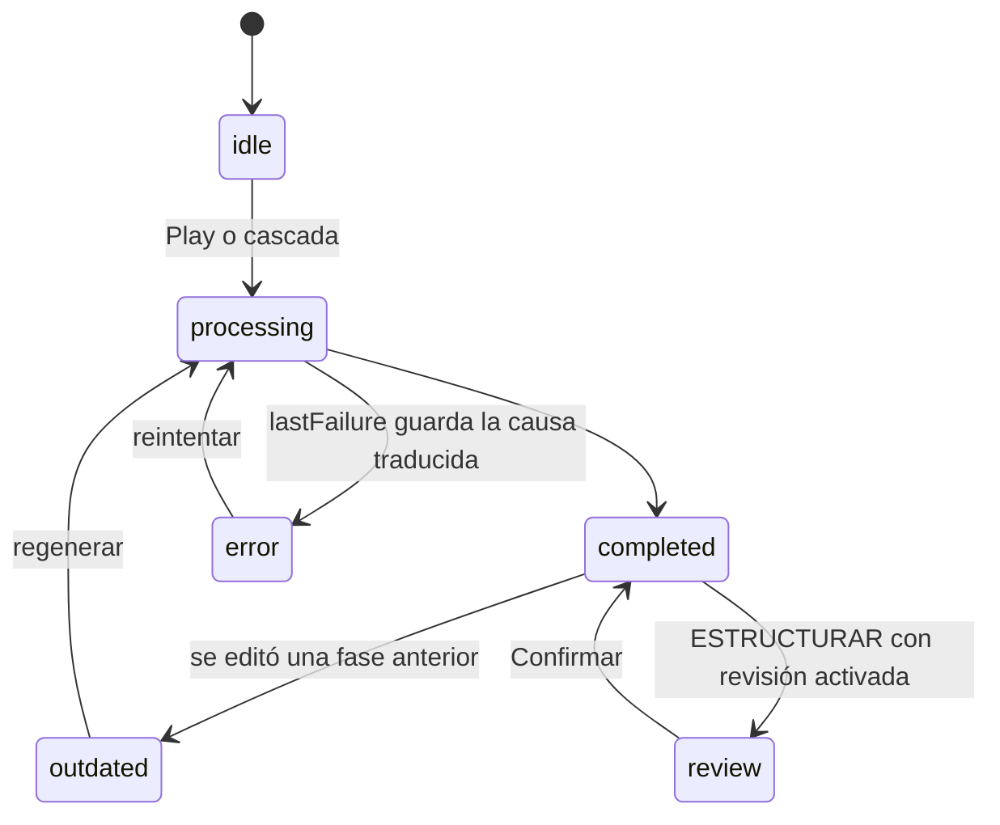

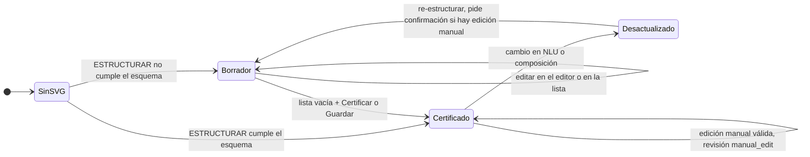

## 6. Modelo de datos

Tipos en `types.ts`.

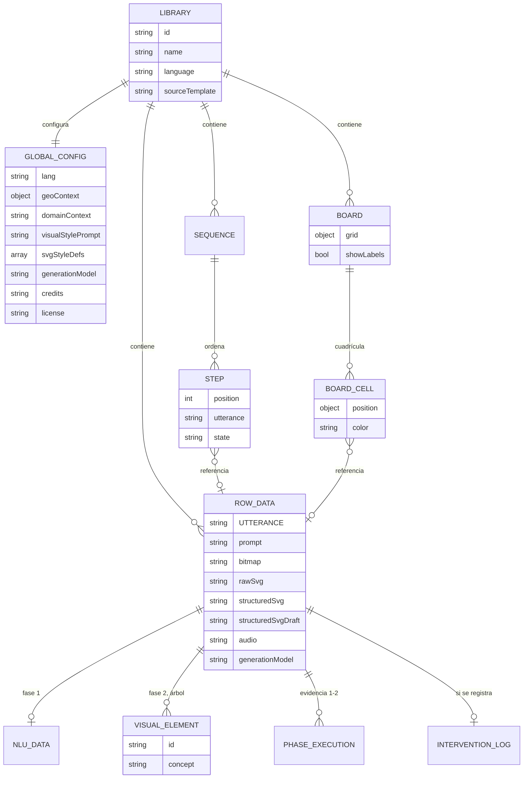

Las secuencias y los tableros referencian filas; no son dueños de ellas. El audio pertenece a la fila, así que todas las celdas que apuntan a la misma fila suenan igual.

`GlobalConfig` (`types.ts:417`) agrupa: idioma y lugar (`lang`, `uiLang`, `geoContext`), contexto de dominio (`domainContext`), modelos por fase (`comprenderModel`, `componerModel`, `generationModel`, `openaiImageQuality`, `phase5Model`), estilo (`visualStylePrompt`, `svgStyleDefs`, `svgKeyframes`, `paletteColors`, `recraftStyleId`), atribución (`name`, `credits`, `license`) y registro (`recording`). `saveLibraryConfig` no guarda un modelo igual al de su fase por defecto, de modo que una librería sigue al catálogo cuando cambia el default. Toda configuración que entra a la app pasa por `libraryConfigMigration.js`.

## 7. Persistencia

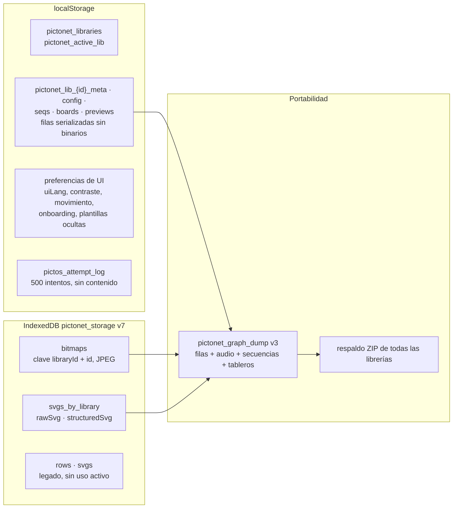

Las librerías de ejemplo (`public/libraries/`) son graph dumps planos con sufijo `.en.json` para inglés; `index.json` y `thumbs/` salen de `npm run generate-index`. Al cargar una fila, `sanitizeRow` aplica en silencio la reparación segura del NLU (`_shared/nluMigration.js`) y guarda los originales en `row.nluMigration`.

## 8. Servidor: funciones, autenticación y cuota

Las funciones síncronas leen el usuario de `context.clientContext`, que Netlify ya verificó. Las funciones en segundo plano no pueden verificar un JWT: consumen un permiso de un solo uso (`consumeAuthGrant`) que escribió antes `api-authorize` o una función "create". Los roles se leen en vivo en GoTrue (`fetchFreshRoles`) en los puntos de decisión de cuota.

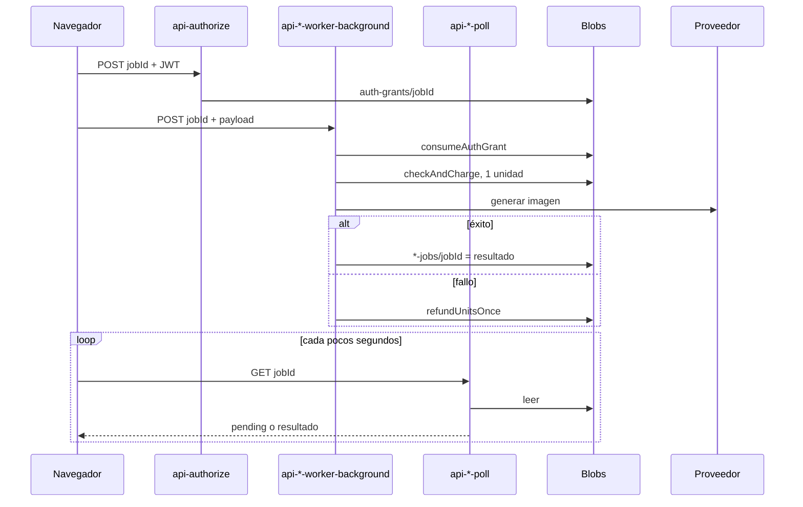

| Función | Rol | Unidades |
|---|---|---|
| `api-claude` | fases 1, 2 y 5 con Claude | 0 |
| `api-openai-text` | fases 1 y 2 con GPT-6 Luna | 0 |
| `api-gemini-detect` | detección de entidades antes de ESTRUCTURAR | 0 |
| `api-authorize` | permiso de un solo uso para un worker | 0 |
| `api-openai-worker-background` + `api-openai-poll` | PRODUCIR con GPT Image | 1, reembolso si falla |
| `api-gemini-worker-background` + `api-gemini-poll` | PRODUCIR con Nano Banana 2 Lite | 1, reembolso si falla |
| `api-recraft-worker-background` + `api-recraft-poll` | PRODUCIR con Recraft V4.1 | 1, reembolso si falla |
| `api-quiver-worker-background` + `api-quiver-poll` | PRODUCIR con Quiver Arrow 2 (SVG nativo; estilo en `instructions`, `viewBox` 512) | 1, reembolso si falla |
| `api-pipeline-batch-create` / `-background` / `-poll` | lote 1 → 2 → 3, hasta 25 filas | 1 por fila al crear |
| `api-check` | prueba de conectividad por proveedor | 0 |
| `api-usage-report` | resumen diario para administración | — |
| `api-v1-comprender`, `api-v1-componer` | API de máquina | cuota por credencial |

La cuota diaria viene de `DAILY_LIMIT_PER_USER` (50 por defecto y en producción, 100 en preview); el rol `superuser` la omite. `_shared/usage.js` guarda cuota (`quota/{email}/{fecha}`) y auditoría (`audit/{fecha}/…`) en el store `pictonet-usage`. Vertex usa OAuth de cuenta de servicio (`_shared/vertex.js`); el proyecto es distinto por sitio.

Stores de Blobs: `pictonet-usage`, `auth-grants`, `openai-jobs`, `gemini-jobs`, `recraft-jobs`, `quiver-jobs`, `pipeline-jobs`, `batch-jobs`, `gemini-structure-jobs`, `openai-text-jobs`, `structure-inputs`, `api-idempotency`, `service-credentials`.

## 9. Catálogo de modelos

`netlify/functions/_shared/modelCatalog.js` es la única fuente de lo que cada fase ofrece y de lo que cada función admite. Estados: `workshop` (el recomendado para talleres), `active`, `experimental` (se ofrece con advertencia) y `retired` (no se ofrece ni se admite; se conserva para mostrar el nombre en configuraciones guardadas). `modelAdmission.test.mjs` falla si una función declara su propia lista.

| Fase | Por defecto | Alternativas |
|---|---|---|
| 1 COMPRENDER | `claude-haiku-5-5` | `gpt-6-luna` |
| 2 COMPONER | `claude-haiku-5-5` | `gpt-6-luna` |
| 3 PRODUCIR | `gpt-image-2.5-flare` | `gemini-3.1-flash-lite-image`; Recraft V4.1 vector y raster en Standard, Utility, Pro y Utility Pro |
| 4 ESTRUCTURAR (id 5) | `claude-sonnet-4-6` | ninguna |
| detección | `gemini-3.8-flash` | ninguna |

La evidencia de cada elección está en [BENCHMARK_MODELOS_2026-11.md](BENCHMARK_MODELOS_2026-11.md), `research/2026-11-06_benchmark-producir/` y `research/2026-11-07_segmentacion-semantica/`.

## 10. Esquemas

PICTOS es la fuente canónica; los paquetes se publican en un solo sentido a `mediafranca/*` ([SCHEMA_PUBLICATION.md](SCHEMA_PUBLICATION.md)).

| Paquete | Versión | Valida |
|---|---|---|
| `schemas/pictos-nlu-schema` | 1.1.0 (perfil de generación aparte; 1.0.1 congelado) | `NLUData` |
| `schemas/pictos-composition-schema` | 0.1.0 | árbol de elementos y prompt |
| `schemas/pictos-svg-schema` | 2.0.0-draft.1 (1.0 congelado) | metadatos del SVG estructurado, vínculos, revisiones |
| `schemas/pictos-api-schema` | 1.1.0 (peticiones 1.1.0, resto 1.0.0; producir y estructurar en 0.1.0-draft) | API de máquina v1 |

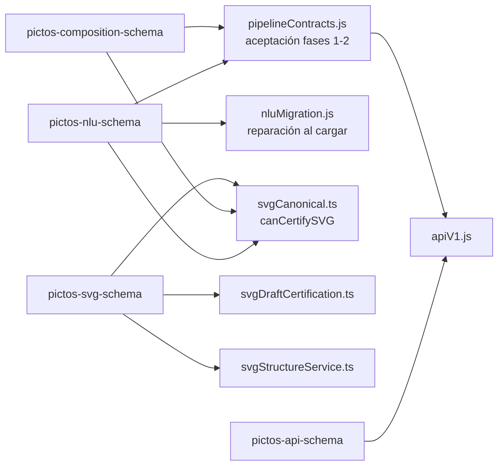

`postinstall` copia los `*.schema.json` públicos a `public/schemas/`; `netlify.toml` redirige las rutas antiguas (`nlu-schema`, `pictogram-composition-schema`, `mf-svg-schema`).

## 11. Interfaz

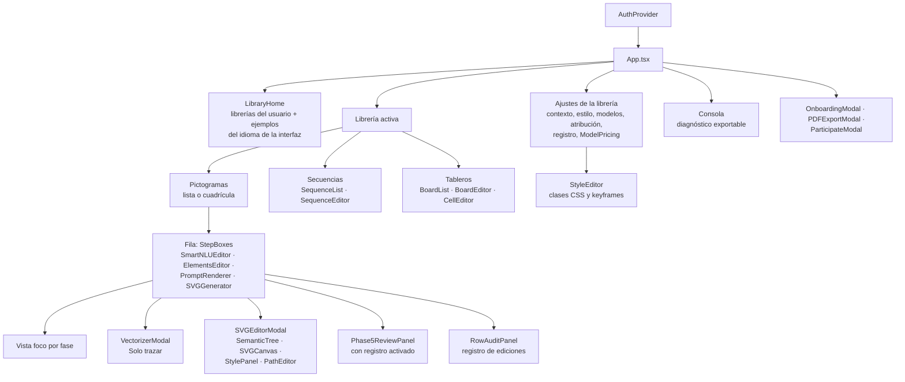

Interfaz bilingüe `es-419` / `en-GB` (`locales/`, `useTranslation`); los IDs semánticos de la UI están en [UI_MAP.md](UI_MAP.md) y las reglas visuales en [UI_CONVENTIONS.md](UI_CONVENTIONS.md).

## 12. Uso: secuencias, tableros e impresos

- **Secuencias.** Pasos ordenados; cada paso busca un enunciado existente o genera una fila nueva. Se imprimen con el mismo motor del PDF de la librería (`sequencePdfService` → `pdfExportService`) con número de paso, o se descargan como ZIP de SVG.
- **Tableros.** Cuadrícula fija de celdas con color Fitzgerald (7 colores), vínculo a una fila y audio grabado. Modo editar y modo usar (pantalla completa, toca y suena). PDF Carta o Tabloide (`boardPdfService`).
- **Impresos de la librería.** "Descargar imprimibles" genera el PDF de todos los pictogramas; "Descargar pictogramas", el ZIP de SVG.
- **Portabilidad.** JSON de la librería (graph dump v3), frases en `.txt`, respaldo ZIP de todas las librerías, copia de una fila al portapapeles con su contexto.

## 13. API de máquina v1

`/api/v1/comprender` y `/api/v1/componer` (redirecciones forzadas en `netlify.toml`) son capas delgadas sobre `_shared/apiV1.js`, que reutiliza `runPhase1` / `runPhase2` del mismo `pipelineRunner.js` que usa el lote. Credenciales de servicio revocables `pk_<keyId>_<secret>` con alcances (`scripts/service-credentials.mjs`), `Idempotency-Key` de 24 h y límite diario por credencial. PRODUCIR y ESTRUCTURAR existen solo como contratos en borrador. Referencia: [API_V1.md](API_V1.md).

## 14. Build y despliegue

```bash
npm run dev           # copy-schemas + optimize-thumbs + netlify dev → http://localhost:9001 (Vite en 3000)
npm run build         # copy-schemas + optimize-thumbs + vite build → dist/
npm test              # node --test: funciones *.test.mjs y services/utils *.test.ts
npm run typecheck     # tsc --noEmit
npm run validate-i18n # paridad de catálogos y claves usadas en el código
npm run generate-index # índice y miniaturas de public/libraries
```

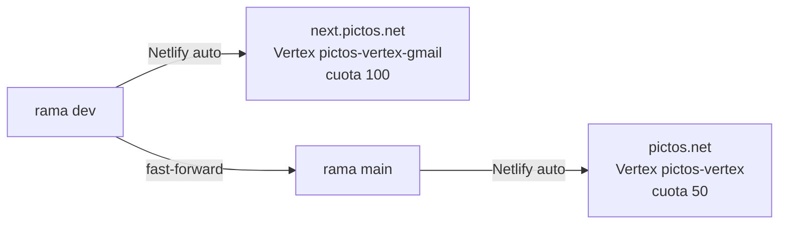

`netlify.toml`: Node 22, bundler esbuild con `@anthropic-ai/sdk` y `google-auth-library` externos, encabezados de seguridad y CSP (incluye `wasm-unsafe-eval`), CORS abierto en `/libraries/*`, SPA `/* → /index.html`. Variables necesarias: `ANTHROPIC_API_KEY`, `OPENAI_API_KEY`, `RECRAFT_API_KEY`, `GOOGLE_SERVICE_ACCOUNT_JSON`; ver [SECURITY.md](SECURITY.md).

## 15. Código dormido y deuda conocida

Existe y se conserva, pero hoy no lo alcanza ningún flujo:

- **Vertex Batch** (`api-batch-create`, `api-batch-collect-background`): todos los modelos con `vertexBatch` están retirados, así que `batchModelIds()` es vacío. La app solo sigue sondeando trabajos antiguos (`api-batch-status`).
- **ESTRUCTURAR con Gemini u OpenAI** (`api-structure-stage`, `api-gemini-structure-background`, `api-openai-text-background` y sus poll): sin modelo admitido; quedan para un modelo futuro. `api-gemini-structure` (síncrona) no tiene llamador.
- **`api-gemini-nlu`**: ningún modelo Gemini de fases 1-2 sigue activo.
- **`share-pictogram`**: sin llamador en el cliente.
- **IndexedDB `rows` y `svgs`**: stores legados.

Deuda menor: `netlify.toml` declara un timeout para `api-recraft`, que ya no existe; `api-check` usa `gemini-2.5-flash-image` (retirado) como modelo de prueba; `identity.js` exporta `verifyIdentityUser` sin uso. Los errores de tipos preexistentes están listados en `CLAUDE.md`.
