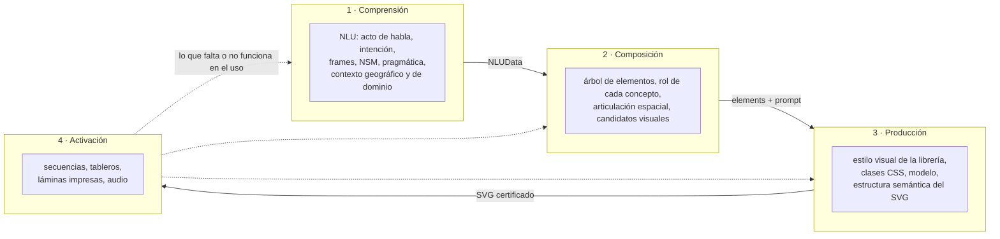
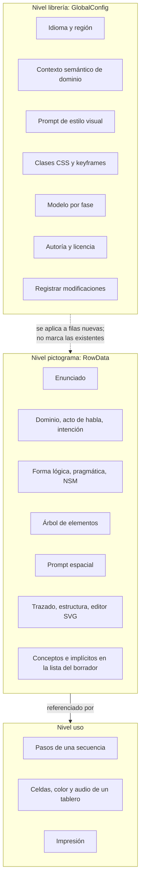
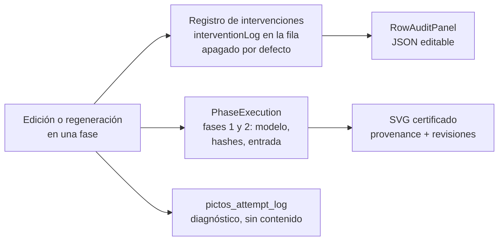

# Controles de experticia en PICTOS

Actualizado: 2026-11-08 (versión 2.8.0). Este documento cruza la pregunta de investigación con lo que el código ofrece hoy. Describe los controles que existen, los datos que el sistema produce pero nadie puede corregir, y las brechas que abren preguntas de diseño. La arquitectura técnica está en [ARCHITECTURE.md](ARCHITECTURE.md).

## La pregunta

Formulación de trabajo, para ajustar:

> ¿Qué controles necesitan los profesionales de la comunicación para definir y expresar su experticia al crear pictogramas, y cómo deben estar diseñados esos controles?

La pregunta tiene dos partes. **Qué controles** pregunta qué decisiones deben quedar en manos de las personas expertas y no del modelo. **Cómo deben estar diseñados** pregunta en qué nivel (la librería entera o un pictograma), con qué forma (texto libre, vocabulario cerrado, árbol, elección entre candidatos, ejemplo), con qué consecuencias para lo que viene después y con qué registro.

Los profesionales en cuestión son quienes cuidan el sentido de un pictograma: fonoaudiólogas y fonoaudiólogos, diseñadores de pictogramas, docentes de educación diferencial, familias y las propias personas usuarias de CAA. Cada perfil sabe cosas distintas, y la herramienta tiene que dejar que cada uno diga lo que sabe en el momento en que eso importa.

## Cuatro momentos

Los tres primeros momentos corresponden a las fases del pipeline (COMPRENDER, COMPONER, PRODUCIR + ESTRUCTURAR). El cuarto está fuera del pipeline y es donde el pictograma prueba su sentido: en una secuencia, un tablero o una lámina, frente a una persona. La flecha de vuelta es la hipótesis central del cuarto momento: el uso revela lo que hay que corregir en los anteriores, y hoy la herramienta no la recorre (ver [Activación](#4-activación-interacción-y-uso)).

## Cómo se describe un control

Cada control se lee con las mismas seis preguntas:

| Dimensión | Pregunta |
|---|---|
| Decisión | ¿Qué decide la persona experta? |
| Nivel | ¿La librería entera, un pictograma o un uso concreto? |
| Forma | ¿Texto libre, vocabulario cerrado, estructura, elección entre candidatos, ejemplo? |
| Vocabulario | ¿El valor está restringido por un esquema? ¿La interfaz respeta esa restricción? |
| Propagación | ¿Qué pasa con lo que ya existe aguas abajo? |
| Huella | ¿Queda registrado quién decidió qué, y es legible después? |

## 1. Comprensión

**Qué experticia entra aquí.** Saber qué quiere hacer quien comunica (pedir, rechazar, saludar, preguntar), en qué situación y con qué fuerza. Es el saber de la fonoaudiología y de quien conoce a la persona usuaria: el mismo "agua" es un pedido urgente en un contexto y un comentario en otro.

**Lo que el sistema produce.** `NLUData` según pictos-nlu-schema 1.1.0: `metadata` (acto de habla, intención), `domain`, `frames` con sus roles, `nsm_explications` en primos del Metalenguaje Semántico Natural, `logical_form`, `pragmatics` y `visual_guidelines`.

**Controles actuales.**

| Control | Nivel | Forma | Vocabulario | Propagación | Huella |
|---|---|---|---|---|---|
| Enunciado | fila | texto libre | libre | marca NLU, composición e imagen | evento `utterance` |
| Idioma | librería | selector | es-419 / en-GB | ninguna sobre filas | no |
| Región | librería | autocompletar (Nominatim) | libre | ninguna sobre filas | no |
| Contexto semántico de dominio | librería | texto libre | libre | ninguna sobre filas | no |
| Dominio | fila | selector | enum del esquema | marca composición e imagen | evento `nlu` |
| Acto de habla, intención | fila | selector | enum del esquema, con los valores en inglés | ídem | evento `nlu` |
| Forma lógica, pragmática | fila | un campo de texto por clave | el esquema define enums; la interfaz ofrece texto libre | ídem | evento `nlu` |
| Explicaciones NSM | fila | texto libre por clave | los 65 primos no se ofrecen en la interfaz | ídem | evento `nlu` |
| Regenerar | fila | botón | — | reemplaza el NLU | evento `discard` + `PhaseExecution` |

**Sin control.** `visual_guidelines` completo (actor en foco, saliencia, núcleo de acción y de objeto, contexto, tiempo), aunque PRODUCIR lo usa en el prompt de imagen. Los roles de cada frame se muestran pero no se editan. La reparación automática del NLU al cargar (`nluMigration`) no se muestra.

**Brechas.**

- El esquema define vocabularios cerrados (cortesía, formalidad, respuesta esperada, urgencia, aspecto, tiempo) y la interfaz los ofrece como texto libre. El experto puede escribir algo que el esquema rechaza, y la certificación lo detecta mucho después, en ESTRUCTURAR.
- Los valores de acto de habla e intención aparecen en inglés técnico (`request`, `directive`) en una interfaz en español.
- El contexto de dominio y la región se fijan para la librería entera y no tienen efecto visible sobre las filas que ya existen.
- No hay manera de decir "este análisis está bien" o "esto no es lo que la persona quiso decir": solo editar o regenerar.

**Preguntas de diseño.** ¿Qué parte del NLU debe ser visible para una fonoaudióloga y cuál es interna? ¿Se edita el análisis o se edita la intención y el sistema reanaliza? ¿Los primos NSM son un vocabulario que el experto debe manejar, o una herramienta interna que solo se muestra como explicación?

## 2. Composición

**Qué experticia entra aquí.** Decidir qué se dibuja para que el concepto se entienda: qué entidades, con qué rol, en qué relación espacial. Es donde vive el saber del diseño de pictogramas: los blends visuales (manos más objeto para "dar", una flecha para el movimiento), qué se deja implícito, qué convención se respeta en una comunidad.

**Lo que el sistema produce.** Un árbol de `VisualElement` (id y `concept`: Agent, Action, Object, Context, Element) y un prompt de articulación espacial, según pictos-composition-schema 0.1.0.

**Controles actuales.**

| Control | Nivel | Forma | Vocabulario | Propagación | Huella |
|---|---|---|---|---|---|
| Elementos jerárquicos | fila | árbol: renombrar, agregar hijo o raíz, borrar, arrastrar | ids libres | marca la imagen | evento `elements` con `add`, `remove`, `rename`, `reorder` |
| Regenerar prompt espacial | fila | botón, aparece tras editar el árbol | — | marca imagen y SVG | evento `discard` |
| Lógica de articulación espacial | fila | texto libre con los elementos resaltados | libre | marca la imagen | evento `prompt` |
| Modelo de COMPONER | librería | selector | catálogo | ninguna | no |

**Sin control.** El rol de cada elemento (`concept`) no se puede editar en el árbol; solo aparece más tarde, en la lista del borrador de ESTRUCTURAR, para filas que no lo tienen. La evidencia de cada ejecución (`phaseExecutions`) no se muestra.

**Brechas.**

- **No hay candidatos.** El modelo devuelve una sola composición. El momento en que un diseñador elige entre alternativas, que es el centro de su oficio, no existe en la herramienta: solo se acepta, se edita o se regenera a ciegas.
- **El rol semántico llega tarde.** Que algo sea Agente u Objeto es una decisión de composición, pero se pide en producción, cuando ya hay un dibujo.
- **Los nombres del árbol son libres.** El esquema prohíbe espacios y comillas; el editor no lo controla.
- **No hay memoria de convenciones.** Si un equipo decide que "comer" siempre lleva cuchara, esa decisión no se puede guardar ni reutilizar en otras filas.

**Preguntas de diseño.** ¿Cómo se presentan candidatos sin que elegir se vuelva una carga? ¿El blend se describe con palabras, con un boceto o señalando pictogramas existentes de la librería? ¿Las convenciones son de la librería (como el estilo) o de cada fila?

## 3. Producción

**Qué experticia entra aquí.** La coherencia visual de una librería: grosor, paleta, nivel de detalle, cómo se dibuja una persona. Es lo que hace que cien pictogramas parezcan de una misma familia y que una persona usuaria los reconozca como sistema. También entra el saber de la estructura: qué forma pertenece a qué entidad, para que el SVG se pueda animar, recolorear o leer en voz alta.

**Lo que el sistema produce.** Un bitmap o un SVG nativo (PRODUCIR) y, a pedido, un SVG estructurado con grupos semánticos, vínculos al NLU y a la composición, y metadatos de accesibilidad (ESTRUCTURAR, pictos-svg-schema).

**Controles actuales.**

| Control | Nivel | Forma | Propagación | Huella |
|---|---|---|---|---|
| Prompt de estilo visual | librería | texto libre; presets en la bienvenida | ninguna sobre filas | no |
| Editor de estilos | librería | clases CSS y keyframes: crear, editar, borrar si no están en uso | se aplica al estructurar; no actualiza SVG existentes | no |
| Modelo de PRODUCIR | librería | selector del catálogo | ofrece regenerar las filas hechas con otro modelo | la fila guarda su modelo |
| Calidad OpenAI, estilo Recraft | librería | selector, texto libre | ninguna | no |
| Producir / regenerar | fila | botón | marca el SVG estructurado | `discard` |
| Solo trazar / Re-trazar | fila | VectorizerModal: presets y ajustes de VTracer | marca el SVG estructurado | los parámetros no se guardan |
| Estructurar | fila | botón; pide confirmación si hay edición manual | reemplaza el borrador | revisión `assembly` |
| Lista del borrador | fila | conceptos, "implícita de:", "Quitar de la composición", Certificar | certifica | revisión `manual_edit` con hash del padre |
| Revisar estructura | fila | casillas y nombres por grupo; solo con registro activado | confirma la estructura | las elecciones no se guardan |
| Editor SVG | fila | árbol, lienzo, nodos, estilos, booleanas; la guarda semántica impide romper la estructura | revalida contra el esquema al guardar | evento `svg_*` con métricas, sin contenido |

**Sin control.** `paletteColors` (se envía a Recraft) no tiene interfaz. El estado de revisión de los metadatos del SVG está fijado en `unreviewed`: no hay forma de que un experto declare "revisado".

**Brechas.**

- **El estilo es texto.** La coherencia de una librería se expresa en un párrafo para el modelo de imagen. No hay forma de mostrar un pictograma de referencia ("como este") ni de fijar una paleta de manera visible.
- **El estilo no se propaga.** Cambiar el prompt o las clases CSS no marca nada. Una librería puede quedar con pictogramas de dos estilos sin que la herramienta lo diga.
- **La revisión humana no deja huella.** Lo que se elige en "Revisar estructura" se pierde, y el esquema no tiene un estado "revisado por una persona" que se pueda alcanzar.
- **La certificación es técnica, no experta.** Un SVG queda certificado cuando cumple el esquema, no cuando alguien con criterio lo aprobó. Las dos cosas son distintas y hoy solo existe la primera.

**Preguntas de diseño.** ¿El estilo se define con palabras, con ejemplos o con parámetros? ¿Quién puede declarar que un pictograma está listo, y qué significa eso para una librería compartida? ¿Cuánto del editor vectorial necesita un diseñador y cuánto le estorba a una docente?

## 4. Activación, interacción y uso

**Qué experticia entra aquí.** Saber cómo se usa un pictograma con una persona concreta: en qué orden se presenta una rutina, qué vocabulario va en un tablero, de qué tamaño se imprime, qué color Fitzgerald le corresponde, con qué voz suena. Es el saber de la docente, de la familia y de la terapeuta en sesión.

**Lo que el sistema ofrece.**

| Control | Forma | Detalle |
|---|---|---|
| Secuencias | pasos ordenados; cada paso busca un enunciado existente o genera una fila nueva | arrastrar, agregar, borrar; imprimir con número de paso; descargar SVG |
| Tableros | cuadrícula de filas por columnas, mostrar u ocultar texto | modos editar y usar (pantalla completa, toca y suena) |
| Celda de tablero | color Fitzgerald (7), pictograma de la librería, audio grabado | el color parte en gris; el audio pertenece a la fila y suena igual en todos los tableros |
| Impresos | PDF de la librería, de una secuencia, de un tablero (Carta o Tabloide) | sin opciones de diagramación |
| Portabilidad | JSON de la librería, frases en `.txt`, respaldo ZIP | — |

**Brechas.**

- **El uso no vuelve al pipeline.** Si en una sesión un pictograma no se entiende, no hay dónde decirlo. La flecha de vuelta del diagrama inicial no existe en el código.
- **El color Fitzgerald es manual.** El NLU ya sabe si algo es un verbo, una persona o un objeto, pero el tablero no lo usa: toda celda empieza en gris.
- **No hay voz sintética.** El audio se graba a mano por fila; no hay síntesis de voz ni elección de voz por librería.
- **Nada del uso se registra.** El registro de intervenciones cubre las fases del pipeline, no las secuencias ni los tableros.
- **Imprimir es todo o nada.** No se elige tamaño de celda, márgenes ni qué texto acompaña al pictograma.
- **La evaluación está a medio camino.** El catálogo de textos tiene cadenas para una evaluación ICAP de seis ejes y para compartir pictogramas bien evaluados, pero ninguna función las usa.

**Preguntas de diseño.** ¿Cómo se registra que un pictograma funcionó o no con una persona, sin exponer datos de esa persona? ¿El tablero es un producto final o un instrumento para corregir la librería? ¿Qué decisiones de uso deberían subir a la librería (vocabulario central, colores, voz)?

## Transversal: la huella de la experticia

Si la pregunta es qué controles expresan experticia, la herramienta tiene que poder mostrar después qué expresó cada quien. Lo que existe hoy:

- **Registro de intervenciones** (`services/interventionRecording.ts`, `specs/intervention-recording.allium`). Con "Registrar modificaciones" activado, cada fila guarda sesiones con eventos `edit` y `discard` por fase, operaciones sobre el árbol y métricas del SVG sin su contenido. Es el instrumento de investigación más directo que tiene la herramienta.
- **Límites del registro.** No guarda quién hizo cada cambio ni con qué rol: la atribución es de la librería entera (`credits`). No hay campo para el motivo de un cambio. El panel de auditoría permite reescribir el JSON a mano, así que el registro no es evidencia inalterable. No cubre la configuración de la librería ni el uso.
- **Procedencia del SVG.** Un SVG certificado lleva la ejecución de las fases 1 y 2 y su cadena de revisiones (`assembly`, `manual_edit`, con el hash del padre). Permite reconstruir de dónde viene un pictograma, pero no qué decidió una persona.

## Resumen de brechas

| Momento | Brecha principal | Tipo |
|---|---|---|
| Comprensión | vocabularios del esquema ofrecidos como texto libre; `visual_guidelines` sin control | forma del control |
| Composición | una sola composición, sin candidatos; el rol del concepto se pide en producción | control ausente |
| Producción | el estilo es un párrafo y no se propaga; la aprobación experta no existe como estado | forma y huella |
| Activación | el uso no vuelve a corregir la librería; el color Fitzgerald no usa el NLU | control ausente |
| Transversal | el registro no tiene autoría ni motivo, y es editable | huella |

Estas brechas no son errores del código: son el lugar donde la pregunta de investigación toca el diseño. Cada una puede convertirse en una pregunta para un taller con profesionales antes de convertirse en una función.
