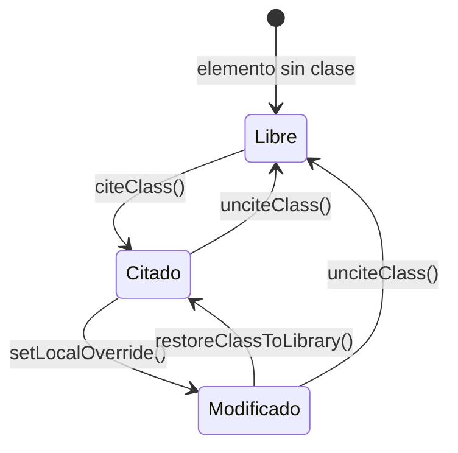
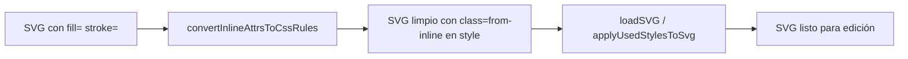

# CSS Styling Architecture — SVG Editor

Documento técnico que describe el modelo de dos niveles para la gestión de estilos en el Editor SVG.

Última actualización: 2026-11-08

## Regla central

**Cero atributos de presentación inline.** Ningún elemento SVG puede llevar `fill`, `stroke`, `stroke-width`, `opacity` ni `style` como atributos del elemento. Todo estilo vive en el bloque `<style>` del propio SVG.

## Los dos niveles

El bloque `<style>` tiene dos secciones ordenadas:

```xml
<style>
  /* Nivel 1 — Reglas de librería (generadas automáticamente) */
  .main { fill: #1a1a1a; stroke: #ffffff; stroke-width: 3pt; }
  .red  { fill: #FF3B30; stroke: #CC2D25; }

  /* --- local overrides --- */

  /* Nivel 2 — Overrides locales por elemento (editados por el usuario) */
  #el-abc123.red  { fill: #FF6600; }
  #cabeza.main    { stroke: none; }
</style>
```

### Nivel 1: Reglas de librería

- Selector de clase pura: `.nombre-clase { ... }`
- Generadas por `applyUsedStylesToSvg()` en `stores/svgEditorStore.ts`
- Solo incluyen las clases realmente usadas en el documento (garbage collection automático)
- No se editan directamente; se gestionan a través de la acción `citeClass` / `unciteClass`

### Nivel 2: Overrides locales

- Selector compuesto: `#element-id.nombre-clase { ... }`
- Especificidad `(1,1,0)` — siempre supera al nivel 1 `(0,1,0)` sin necesidad de `!important`
- Escritos por `setOverrideRule()` en `utils/styleUtils.ts`
- Leídos y parseados por `parseOverrideRules()` en `utils/styleUtils.ts`
- El id puede llevar acentos (`#mamá-1.main`): los ids de las formas derivan de los nombres de las entidades

### Reglas preservadas

Hay reglas que no son de librería ni overrides y que la reconstrucción del `<style>` conserva tal cual (`extractPreservedRules()` en `utils/styleUtils.ts`):

- **Colores por forma** que escribe ESTRUCTURAR, `#mamá-1 { fill: #505052; }`: el color exacto de cada región o path original. Siguen al elemento si se renombra.
- **Estilo de foco de accesibilidad**, `g[role="group"]:focus { … }`.

Hasta el 30 de octubre de 2026 el editor las descartaba al cargar un SVG estructurado, así que guardar una edición recoloreaba el pictograma con los colores genéricos de la paleta.

## Origen del `<style>` en ESTRUCTURAR

El SVG estructurado nace con este modelo ya aplicado (`services/svgStructureService.ts`):

1. `generateStylesheet(config)` toma la paleta de la librería (`config.svgStyleDefs` + `config.svgKeyframes`, serializada con `generateCssString`); si la librería no tiene paleta propia, usa `SVG_STYLESHEET` de `services/svgStyles.ts`, la hoja canónica de clases semánticas (`.main`, `.secondary`, `.accent`…), utilidades de trazo, keyframes y la regla de foco.
2. `buildFilteredCSS()` conserva solo las reglas cuyas clases usa el documento, los keyframes que esas reglas animan y, siempre, la regla `g[role="group"]:focus`.
3. Se agregan los colores por forma, `#id { fill: … }` bajo el comentario `/* Original path fills */`, para cada path cuyo color no venga ya de una clase, y las reglas propias del SVG de entrada bajo `/* User-defined styles */`.

El modelo de visión solo asigna clases de la paleta por grupo; el prompt le prohíbe colores inline. La geometría y los colores exactos los pone el ensamblaje local.

## Ciclo de vida completo



### CITAR (`citeClass`)

1. Agrega `className` al atributo `class` del elemento
2. Llama a `applyUsedStylesToSvg()` — la clase aparece en el bloque `<style>` nivel 1
3. Elimina cualquier atributo inline residual del elemento
4. Sincroniza `overrideMap` en el store

### INSTANCIAR

Ocurre automáticamente dentro de `applyUsedStylesToSvg()`. Si la clase ya existe en la librería (`styleDefinitions`), su regla CSS se copia al `<style>` del SVG. Si la clase no está en la librería, no se instancia (el selector queda vacío o ausente).

### MODIFICAR (`setLocalOverride`)

1. Llama a `setOverrideRule(svgDocument, elementId, className, declarations)` en `styleUtils.ts`
2. Parsea el `<style>` actual con `parseOverrideRules()`
3. Fusiona las declaraciones en el mapa de overrides
4. Reconstruye el `<style>` con `rebuildStyleBlock()`: nivel 1 intacto + nivel 2 actualizado
5. Sincroniza `overrideMap` en el store

### DESCITAR (`unciteClass`)

1. Elimina `className` del atributo `class` del elemento
2. Llama a `removeOverrideRule()` — borra el override `#id.class` si existe
3. Llama a `applyUsedStylesToSvg()` — si ningún elemento usa ya la clase, su regla de nivel 1 desaparece (garbage collection)
4. Sincroniza `overrideMap` en el store

### RECOLECTAR (Garbage Collection)

Se ejecuta automáticamente en cada llamada a `applyUsedStylesToSvg()`:

1. `citedClassNames()` (`utils/styleUtils.ts`) — escanea todos los atributos `class` del documento
2. `styleIsCited()` — filtra `styleDefinitions` a solo las clases en uso
3. Solo las clases en uso se regeneran en el bloque `<style>` nivel 1

## Estilos de la librería desde el editor

Una clase creada en el editor ("Definir", "Convertir en clase" o "Definir nueva clase" en la paleta) es una clase de la librería: `saveStyleDefinition()` la aplica al documento y la escribe en la paleta de la librería abierta (`config.svgStyleDefs`). Cada clase citada tiene "Editar", que abre su definición para cambiar o agregar propiedades; el cambio se ve de inmediato en el documento y queda en la librería. Al editar se conservan los selectores, porque renombrar una clase citada dejaría huérfanos a los elementos que la citan.

Una clase que ningún pictograma de la librería cita (ni el documento abierto) puede quitarse de la paleta: con la papelera en la paleta del editor, con "Eliminar" en el editor de estilos, o con "Quitar sin uso" para todas a la vez. Una clase en uso no se puede eliminar, y el editor lo explica. Esto vale también para las clases base: cada librería puede quedarse con un stock menor, toda librería nueva parte del conjunto base completo, y "Restaurar defaults" lo devuelve.

El anfitrión (`SVGEditorModal`) instala en el store la paleta de la librería (`setLibraryPalette`: guardar, quitar y saber si una clase está en uso). App calcula las clases en uso a partir de los SVG visibles de las filas (estructurado, borrador y trazado), excluida la fila abierta, cuyo documento vivo cuenta en su lugar.

## Pipeline Cleanup (on load)

Los SVG que no pasaron por ESTRUCTURAR (trazados de VTracer, SVG nativos de PRODUCIR, archivos externos) pueden traer atributos inline. Al abrir el editor, `SVGEditorModal` los limpia antes de cargarlos:



`convertInlineAttrsToCssRules()` en `utils/styleUtils.ts`:
1. Detecta elementos con `fill`, `stroke`, `stroke-width`, `opacity` o `style`
2. Convierte sus valores a reglas `#id.from-inline { ... }` en el `<style>`
3. Elimina los atributos inline del elemento
4. Es idempotente — seguro llamarlo sobre SVGs ya limpios

Los overrides `from-inline` aparecen en el panel derecho como una sección especial en amber, distinguible de las clases de librería.

## Estructura de datos

### `OverrideMap`

```typescript
// utils/styleUtils.ts
type OverrideMap = Map<
  string,                          // elementId
  Map<
    string,                        // className (o 'from-inline')
    Record<string, string>         // property → value
  >
>;
```

### `libraryValues`

```typescript
// stores/svgEditorStore.ts
// className → { property: value }
Map<string, Record<string, string>>
```

Construido por `buildLibraryValuesMap(styleDefinitions)`. Usado por `StylePanel` para detectar drift entre el valor de librería y el override local.

### Detectar drift

```typescript
const isOverridden = (elementId, className, property) =>
  overrideMap.get(elementId)?.get(className)?.[property] !== undefined;
```

Si el override existe, el valor ha sido modificado respecto a la librería. El panel derecho muestra un asterisco `*` junto a la propiedad y activa el botón "Restaurar".

## Archivos relevantes

| Archivo | Responsabilidad |
|---------|----------------|
| `utils/styleUtils.ts` | `parseOverrideRules`, `serializeOverrideRules`, `setOverrideRule`, `removeOverrideRule`, `extractLibraryRules`, `rebuildStyleBlock`, `convertInlineAttrsToCssRules` |
| `stores/svgEditorStore.ts` | `citeClass`, `unciteClass`, `setLocalOverride`, `restoreClassToLibrary`, `getResolvedClassValues`, `cleanupInlineAttrs`; fix en `applyUsedStylesToSvg` para preservar overrides |
| `components/SVGEditor/StylePanel.tsx` | Panel derecho: sección A (citar/descitar), sección B (overrides locales con drift detection) |
| `components/SVGEditor/SVGEditorModal.tsx` | Llama a `convertInlineAttrsToCssRules` antes de `loadSVG` |
| `services/svgStyles.ts` | `SVG_STYLESHEET`: hoja canónica de respaldo cuando la librería no tiene `svgStyleDefs` |
| `services/svgStructureService.ts` | `generateStylesheet`, `buildFilteredCSS` y reglas `#id { fill }` del SVG estructurado |

## SVG resultante esperado

```xml
<svg viewBox="0 0 500 500">
  <style>
    .main { fill: #1a1a1a; stroke: #ffffff; stroke-width: 3pt; }
    .red  { fill: #FF3B30; stroke: #CC2D25; stroke-width: 2; }

    /* --- local overrides --- */

    #el-abc123.red { fill: #FF6600; }
  </style>
  <g id="el-root" class="main">
    <path id="el-abc123" class="red" d="M..." />
  </g>
</svg>
```

Ningún elemento tiene atributos `fill`, `stroke`, `stroke-width`, `opacity` ni `style`.
El SVG exportado es autocontenido: sus estilos viajan dentro del propio archivo.
