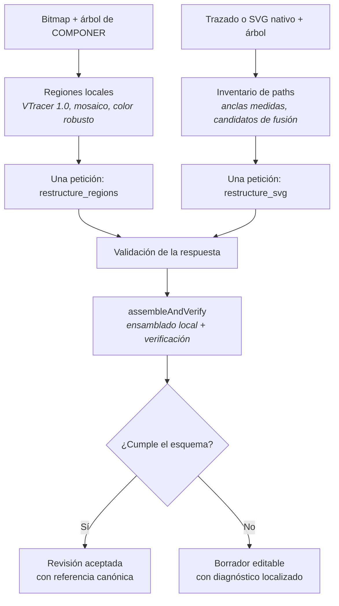

# ESTRUCTURAR — del bitmap o el trazado al SVG semántico

Documento de referencia de la fase 4 del pipeline (opcional, iniciada por el usuario). Actualizado el 30 de octubre de 2026 con la operación conjunta VECTORIZAR+ESTRUCTURAR, las correcciones de preservación del ensamblado y la frontera con el editor. Conserva el enfoque de julio 2026 para estructurar un trazado existente.

Implementación:

| Pieza | Archivo |
|---|---|
| Orquestación, ensamblado, verificación | `services/svgStructureService.ts` |
| Validación de la respuesta del modelo | `services/svgMappingValidation.ts` |
| Contrato de regiones (`restructure_regions`) | `services/regionMapping.ts` |
| Trazado por regiones (VTracer 1.0) | `services/vtracerWebService.ts`, `lib/vtracer-web/` |
| Candidatos de fusión, pulido | `services/svgMergeCandidates.ts`, `services/svgPathPolish.ts` |
| Booleanas | `services/svgBooleanOps.ts` |
| Contrato del artefacto | `specs/svg-structuring.allium`, `schemas/pictos-svg-schema/` |

Plan y evaluación: [Optimización conjunta de VECTORIZAR y ESTRUCTURAR](PLAN_VECTORIZAR_ESTRUCTURAR_2026-10-29.md) (estado por entrega, piloto de 10 casos de ICAP en `docs/eval/`).

## Principios

1. **La geometría nunca la escribe el modelo.** El modelo de visión asigna regiones o paths a nodos semánticos; toda manipulación de coordenadas (trazado, uniones booleanas, simplificación, redondeo) se calcula en el navegador. Esto elimina la varianza destructiva que retiró al modo redibujo[^1].
2. **El DOM resultante es congruente con COMPRENDER y COMPONER.** Cada `<g>` corresponde a un nodo del árbol `VisualElement` de la fase 2, y su `data-concept` proviene de los roles de frame del NLU.
3. **Preservar es la prioridad.** Ante la duda, la geometría se conserva. Perder un elemento visible es un error grave; dejar una mota es tolerable. En una partición por regiones nada se borra: borrar perfora el dibujo.
4. **La duda queda visible.** Una región ambigua no se fuerza al nodo más parecido: queda sin asignar en un borrador con su diagnóstico localizado.
5. **Todo lo que pueda calcularse localmente, se calcula localmente.** El modelo recibe evidencia pre-digerida y decide solo lo que requiere juicio visual.
6. **El SVG estructurado es la fuente de verdad del pipeline.** Lleva dentro el NLU, la composición, los enlaces entre nodos y grupos, y la procedencia. El esquema `pictos-svg-schema` decide si un resultado puede certificarse; nada lo certifica por haberse producido.

## Dos entradas, un ensamblado

| Entrada | Cuándo | Qué recibe el modelo | Herramienta |
|---|---|---|---|
| **Estructurar** (desde el bitmap; principal en un bitmap con árbol) | La fila tiene bitmap y elementos de COMPONER | Bitmap, regiones numeradas, árbol, paleta | `restructure_regions` |
| **Estructurar trazado** | La fila ya tiene un trazado o un SVG nativo (modelos vectoriales) | Bitmap de referencia si existe, paths numerados, árbol, paleta | `restructure_svg` |

Con solo bitmap, la UI ofrece "Estructurar" como acción principal y "Solo trazar" como secundaria (SVG sin estructurar). Con un trazado existente, "Estructurar trazado" y, como secundaria, "Estructurar desde el bitmap" (que reemplaza el trazado). Internamente la primera ruta es `vectorizeAndStructure` y la segunda `structureSVG`. Ambas entradas terminan en el mismo `assembleAndVerify`, de modo que el resultado inmediato y el revisado (modo de registro) pasan por el mismo ensamblado y la misma verificación.

## Estructurar desde el bitmap

### Regiones

El bitmap (lado mayor hasta 1024 px) se segmenta con el núcleo VTracer 1.0 (`1.0.0-alpha.4`, commit `2500df7`) a través del binding propio `lib/vtracer-web`:

- **Mosaico por defecto**: una partición visible, sin rendijas, con fronteras compartidas y huecos reales. A diferencia del trazado apilado, reagrupar no puede cambiar el orden de pintura.
- **Procedencia explícita**: cada path nombra su región (`r<id>`, islas `r<id>_<n>`). Las regiones nunca se fusionan por color a espaldas del ensamblado (`Identity` como ajuste de color, `merge_diff = -1`).
- **Color robusto**: cada región se pinta con la mediana de los píxeles que realmente muestra; una región fina sin interior toma el núcleo de la línea, no su mezcla con el fondo.
- **Papel**: una región clara que abarca todo el lienzo es el fondo y no se emite.
- **Astillas**: una región de menos de 64 px (a 1024²) no se numera; se adjunta a la región que la contiene (`r<padre>_a<hija>`) y sigue su decisión. En bitmaps JPEG, entre el 60 y el 80 % de las regiones son astillas de antialias.

Parámetros fijos, en las unidades del núcleo: `colorPrecision 6`, `layerDifference 16`, `filterSpeckle 2`, `simplify 1`. No se exponen en la configuración de la biblioteca.

### Contrato de regiones

La respuesta de `restructure_regions` puede:

| Campo | Efecto |
|---|---|
| `groups[].regions` | Asigna regiones (o números de marca) a un nodo existente |
| `protected` | Regiones con significado que no deben eliminarse, aunque sean pequeñas |
| `discardProposals` | Ruido propuesto: nada se borra; se absorbe como todo lo que queda fuera de los grupos (abajo) |
| `splitRequests` | Una región que contiene varios nodos va a su ancestro común más profundo: un nodo y su descendiente, al nodo; dos hermanos, a su padre. Solo si no tienen ancestro común (dos figuras de nivel superior) queda sin asignar |
| `unresolved` | Regiones de pertenencia dudosa; se absorben como todo lo que queda fuera de los grupos |

Todo path que queda fuera de los grupos (ruido propuesto, sin resolver, separación sin ancestro común o simplemente no mencionado) se absorbe en la región asignada más pequeña que sea mayor que él y cuya caja contenga su centro (un ojo dentro de una cabeza). Si ninguna lo contiene, queda sin asignar y el resultado es un borrador. La petición se hace con temperatura 0, para que corridas repetidas sobre la misma entrada coincidan.

La petición no incluye el NLU completo, el enunciado ni el prompt de composición: bastan el bitmap, las regiones, el árbol y la paleta. Con regiones en vez de código SVG, la entrada usa aproximadamente la mitad de tokens que la ruta de trazado.

## Estructurar un trazado existente

Es el enfoque de julio 2026, con las correcciones de octubre.

### Medición de anclas y marcas

1. El SVG se monta en un host oculto (`visibility:hidden`, nunca `display:none`, porque `getBBox` requiere layout).
2. Cada `path[id]` se mide con `getBBox()` y se lleva al espacio del viewBox por la cadena CTM completa.
3. Si el centro cae fuera del relleno (formas en C, anillos), una grilla de 7×7 con `isPointInPath` elige el punto interior más cercano al centro.
4. Las marcas que colisionan se separan por relajación iterativa; las desplazadas dibujan una línea guía hasta su ancla.

### Candidatos de fusión

Los contornos dobles (borde interno y externo de una misma línea) se detectan antes de la llamada: IoU de bbox ≥ 0,7, razón de áreas ≥ 0,4, mismo `fill-role` **y misma pintura**, agrupados por union-find. El modelo confirma o rechaza en `merge.sources`. La unión se calcula localmente y solo si todas las fuentes tienen la misma pintura (color, regla de relleno, opacidad): compartir el rol "accent" no basta.

## Ensamblado común

- **Validación de la respuesta** (`validateStructuringMapping`): ids de path desconocidos y nodos inexistentes se descartan con diagnóstico; un path reclamado dos veces se emite una sola; los números de marca se resuelven al path correspondiente. Una respuesta malformada falla; no se repara inventando semántica.
- **Fusiones**: la unión reemplaza solo a sus fuentes; los demás paths del grupo se emiten igual. El path unido conserva el id, la clase y la pintura de su primera fuente. Las transformaciones de los ancestros se hornean completas (no solo traslaciones) y los huecos se derivan de la regla de relleno de la fuente.
- **Huérfanos**: un `parentId` que apunta a un nodo inexistente se reparenta al nivel superior.
- **Descartes sospechosos**: en la ruta de trazado, un descarte que no es micro-mancha se revierte. En la ruta de regiones ningún descarte borra geometría.
- **Geometría sin asignar**: va al grupo `unclassified`, sin concepto inventado. Su presencia impide certificar y produce un borrador.
- **Post-proceso**: CSS filtrado a las clases usadas, metadata canónica (`mf-accessibility`), `deriveChildIds` (los paths toman el nombre de su entidad: una forma sola es `lugar-forma` y varias se numeran `mamá-1`, `mamá-2`…, porque el id de la entidad ya lo lleva su grupo; también en borradores, y las reglas `#id` del CSS los siguen), `polishGeometry`.

### Verificación de fidelidad

`verifyFidelity` compara el resultado con el trazado del que deriva, rasterizado a 512 px:

| Medida | Uso |
|---|---|
| Tinta añadida y perdida | Falla sobre 5 % del área dibujada |
| Peor pérdida local (grilla 16×16) | Falla si una celda pierde la mitad de su tinta: un detalle pequeño no se diluye en el total |
| Color cambiado en el interior | Se reporta, no falla: una paleta de librería puede recolorear a propósito |

Si no se puede medir, el resultado es desconocido, nunca un acierto ficticio. Los borradores también se verifican. Un trazo de estilo de la librería (por ejemplo el contorno blanco de 3 pt de `.main`) no se cuenta como pérdida cuando el trazado no tiene trazos propios. Si la verificación falla, se ensambla también la variante sin fusiones y se entrega la que altera menos el dibujo. La verificación nunca bloquea: el aviso queda en el registro.

### Pulido geométrico

`polishGeometry` refitea a curvas solo los paths con firma de ruido de trazado (≥ 24 segmentos y ≥ 60 % de rectas) y redondea coordenadas a 1 decimal. Cada `d` reescrito se valida; ante cualquier fallo se conserva el original.

## Borrador y certificación

El ensamblado produce siempre un borrador cuando puede renderizar algo. Para **certificar** (revisión aceptada con referencia canónica), el resultado debe cumplir `pictos-svg-schema` y coincidir con la fila actual:

- raíz con `role="img"`, `title` y `desc` referenciados y coherentes con el NLU;
- un único bloque `metadata#mf-accessibility` con NLU, composición, enlaces y procedencia;
- cada elemento del árbol de COMPONER enlazado a un `<g>` único con `data-concept`, `role="group"`, `tabindex="0"` y `aria-label`, y con geometría;
- ningún grupo semántico desconocido y ninguna geometría visible fuera de un grupo enlazado;
- NLU, enunciado y composición idénticos a los de la fila.

Un NLU histórico que no cumple el perfil vigente, un enlace faltante o geometría sin asignar dejan el borrador visible, editable y descargable, con el motivo localizado. Un borrador nunca reemplaza la revisión aceptada anterior.

## Edición posterior en el editor

El editor cambia el dibujo, no la estructura semántica. Dos protecciones, en este orden:

1. **Guardián semántico** (`components/SVGEditor/editor/semanticGuard.ts`): en un SVG con enlaces en su metadata, cada cambio se compara con el documento anterior antes de aplicarse. Si introduce una violación nueva (un grupo enlazado eliminado, renombrado o sin geometría, sus atributos semánticos alterados, o geometría fuera de todo grupo enlazado), el cambio no se aplica ni entra al historial, y el editor muestra qué grupo rompería. Mover formas entre grupos enlazados está permitido, y en un borrador se puede mover geometría sin clasificar a un grupo. Cargar, deshacer y rehacer no pasan por el guardián; un SVG sin enlaces (un trazado) no está protegido.

2. **Validación al guardar.** El editor se cierra solo cuando el guardado termina bien. Si no, queda abierto con la edición y un aviso que dice por qué y dónde quedó guardado lo editado. Al guardar un SVG estructurado, `prepareSvgEditorUpdate` → `reviseSVG`:

1. valida el SVG editado contra el esquema;
2. comprueba que NLU, enunciado y composición siguen siendo los de la fila;
3. crea una revisión nueva (`operation: manual_edit`, con el hash del SVG padre, `review: unreviewed`) y su referencia canónica.

Si algo falla, lo editado se guarda como borrador con el diagnóstico y la revisión aceptada no se toca.

Verificado el 30 de octubre de 2026 sobre un SVG certificado por la operación conjunta:

| Edición | Resultado |
|---|---|
| Mover y redimensionar formas dentro de sus grupos, guardar | Aplicada; al guardar, revisión `manual_edit` con padre; NLU, composición y enlaces intactos |
| Borrar una forma de un grupo que conserva otras | Aplicada |
| Mover una forma de un grupo enlazado a otro | Aplicada; sigue válido |
| Unión booleana dentro de un mismo grupo | Aplicada; el resultado queda en el grupo (ancestro común de los operandos) |
| Renombrar un path | Aplicada |
| Borrar toda la geometría de un grupo, o el grupo | Bloqueada: grupo sin dibujo / grupo eliminado |
| Unión booleana entre formas de dos grupos | Bloqueada: el resultado quedaría fuera de los grupos |
| Sacar una forma de su grupo hacia la raíz | Bloqueada: dibujo fuera de los grupos semánticos |
| Desagrupar, renombrar o quitar `data-concept` a un grupo enlazado | Bloqueada |

Cambiar qué entidades tiene el pictograma requiere volver a ESTRUCTURAR.

Correcciones del 30 de octubre de 2026, tras un reporte de "edité, guardé y no se aplicó":

- El botón "Guardar Cambios" cerraba el editor sin esperar el resultado del guardado. Si la certificación fallaba, lo editado acababa en un borrador, el error iba solo a la consola y en pantalla seguía la versión anterior.
- El editor descartaba los colores por forma (`#id { fill }`) al cargar un SVG estructurado; guardar recoloreaba el pictograma. Ahora esas reglas se conservan (ver `docs/CSS_STYLING_ARCHITECTURE.md`).
- Si un gesto no llegaba al documento (elemento ausente o rechazo del guardián), la vista previa quedaba en pantalla: la forma se veía movida y el guardado guardaba lo anterior. Ahora la pantalla se revierte.
- Presionar sobre una forma no seleccionada la selecciona y la mueve en el mismo gesto; antes había que seleccionarla primero, y un arrastre directo no movía nada. Hasta el 30 de octubre las uniones booleanas dejaban siempre el resultado en la raíz del SVG; ahora siguen el spec y lo dejan en el ancestro común de los operandos cuando no hay transformaciones.

## Configuración y valores por defecto

- **Modelo**: `phase5Model`, por defecto `claude-sonnet-4-6`. El selector "Fase 4: ESTRUCTURAR" de la configuración avanzada vale para ambas entradas. El identificador interno de la fase sigue siendo 5.
- **Presupuesto de la llamada a Claude**: 50 s para las herramientas de la fase 5 (30 s para las demás fases), dentro del límite síncrono de 60 s. El pictograma más complejo del piloto (158 regiones) necesitó 25 s.
- **Bibliotecas**: una plantilla no declara modelos y una biblioteca no guarda un modelo igual a su valor por defecto, así que sigue los defaults de la versión que la abre. Un modelo retirado o desconocido se quita al cargar (con aviso en el registro). Ver `netlify/functions/_shared/libraryConfigMigration.js`.

## Evaluación

El piloto de 10 casos de ICAP 50 V2 (`docs/eval/`, arnés `scripts/eval/vectorizarEstructurarEval.ts`) comparó el trazado antiguo más ESTRUCTURAR con la operación conjunta, con el mismo modelo y medido contra el bitmap:

- **Píxeles erróneos**: 1,0 % de media en la operación conjunta frente a 4,7 % en la ruta antigua. La ruta antigua empeoró su propio trazado en 4 de 10 casos porque reagrupar un trazado apilado cambia el orden de pintura (personas recoloreadas, un corazón pintado de negro, una figura oculta bajo un halo).
- **Tokens y tamaño**: la mitad de tokens de entrada y un SVG un 64 % más liviano.
- **Tiempo**: 2 s más lenta en promedio.
- **Variabilidad**: la parte semántica varía mucho entre corridas con el mismo prompt (cobertura de nodos entre 51 y 55 de 57). Evaluarla requiere varias corridas por caso.

El tiempo humano de retoque no se ha medido.

## Modo redibujo (experimental, retirado como default)

`redrawSVG` pide al modelo autorar un SVG limpio desde la imagen de referencia. Quedó retirado por alta varianza: funciona en formas triviales pero destruye pictogramas de varios elementos[^1].

## Pendientes

1. **Variabilidad semántica**: varias corridas por caso del piloto; media y dispersión de cobertura y regiones sin asignar.
2. **Corpus VE0 completo**: 50 casos (30 de ajuste, 20 reservados) y protocolo de tiempo humano.
3. **Geometría (VE4)**: ancho de líneas finas (≈1 px menor que el original), selección de tolerancias contra el bitmap, fusión de regiones de igual pintura y entidad (evita las costuras blancas del estilo con contorno), degradados.
4. **Separación de regiones (VE7)**: resolver `splitRequests` con máscaras, sin otra llamada general.
5. **Acciones implícitas**: una acción del árbol sin dibujo propio (p. ej. "ubicación" en "¿Dónde está mamá?") solo se certifica con un enlace implícito suministrado (`implicitBindings`: la acción y quien la realiza), y hoy nada en la app lo produce. Esos casos quedan como borrador con `bindingsNeedReview`.
6. **Artefacto de distribución**: separar el SVG de trabajo del SVG final para AAC (Experimento E del roadmap histórico[^2]).

[^1]: La decisión y su justificación están comentadas en `redrawSVG` (`services/svgStructureService.ts`).
[^2]: `docs/ROADMAP_ESTRUCTURAR.md` es el plan de marzo 2026, anterior a la migración a Recraft; su Experimento E sigue vigente.
