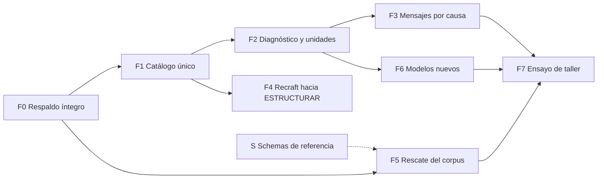

# Plan de trabajo: fiabilidad y fluidez de la generación

Rama de trabajo: `dev`. Base: `4c9a49f` (2.6.3). Fuente: [DIAGNOSTICO_GENERACION_2026-10-22.md](DIAGNOSTICO_GENERACION_2026-10-22.md).

Este plan convierte el diagnóstico en tareas de ingeniería ancladas en el código actual. Cada hallazgo usado aquí se volvió a comprobar en el repositorio el 22 de octubre de 2026; los que dependen de llamadas a proveedores se toman del diagnóstico sin repetirlas.

## Objetivo

Que una persona facilitadora pueda conducir un taller con un perfil de modelos fijo, sabiendo que un fallo se presenta con su causa real, que no obliga a repetir fases ya resueltas y que no consume unidades sin entregar resultado. Los datos existentes no se pierden en ningún paso.

Criterio de cierre global, tomado del diagnóstico: al menos 95 % de recorridos completos al primer intento en el ensayo de taller, cero pérdida de datos, cero cobros internos sin entrega y P95 de duración por recorrido igual o menor a 60 s.

## Hallazgos verificados en el código

| Hallazgo | Ubicación | Consecuencia |
|---|---|---|
| Siete listas de modelos admitidos, independientes del catálogo | `api-claude.js:25`, `api-gemini-nlu.js:21`, `api-gemini-structure.js:20`, `api-gemini-structure-background.js:21`, `api-gemini-worker-background.js:16`, `api-batch-create.js:26`, `services/batchService.ts:28` | Retirar un modelo exige tocar siete sitios; por eso Gemini 2.5 Pro sigue admitido pese a su 404. |
| El catálogo no tiene estado de ciclo de vida | `netlify/functions/_shared/modelCatalog.js` (`MODEL_CATALOG`) | No hay forma de marcar «retirado» o «experimental» ni de derivar el selector de esa marca. |
| El lote admite el modelo de imagen que falla | `api-batch-create.js:26`, `batchService.ts:28`: solo `gemini-2.5-flash-image` y `gemini-3.1-flash-image` | El lote ofrece Gemini 3.1 Flash Image, con 9 de 38 respuestas sin imagen. |
| Respuesta sin imagen: se cobra, no se reembolsa y se pierde la causa | `api-gemini-worker-background.js:115-125` | Registra `units_charged: 1`, sale con `return` antes del `catch` (que solo reembolsa 429) y descarta `finishReason`, `finishMessage` y `promptFeedback`. |
| El razonamiento de Gemini usa una regla de la familia 2.5 | `_shared/geminiTranslate.js:94` (`thinkingBudgetFor`), `:125` | Gemini 3.8 exige `thinkingLevel`; no se habilita cambiando el nombre. |
| Los endpoints de texto registran éxito antes de la validación del contrato | `api-claude.js:170`, `api-gemini-nlu.js:134`, `api-openai-text.js:28`, `api-openai-text-background.js:40` | El informe administrativo cuenta como `ok` respuestas que el navegador rechaza después. |
| COMPONER valida el NLU antes de llamar al proveedor | `_shared/pipelineContracts.js:204-205`, `:248` | Con 826 de 829 filas históricas incompatibles, ningún cambio de modelo desbloquea COMPONER. |
| Exportar y duplicar desde la portada omiten los binarios | `services/libraryService.ts:138` (`duplicateLibrary`), `:229` (`exportLibraryJson`), ambos sobre `getLibraryRows` | Leen solo los metadatos de localStorage; bitmaps y SVG viven en IndexedDB. |
| El SVG de Recraft se rechaza antes de ESTRUCTURAR sin decir por qué | `inspectPassiveSVG` en `schemas/pictos-svg-schema/index.js:86`, llamado desde `services/svgCanonical.ts:37` | El inspector lanza un motivo de categoría (por ejemplo `Unsupported or active SVG element`) sin nombrar el elemento o atributo, y la interfaz lo reduce a un mensaje genérico. |
| Los `$id` de tres familias de schemas no resuelven | `https://pictos.net/schemas/pictonet-nlu-1.1.0.schema.json` devuelve el `index.html` de la SPA | `copy-submodule-data.sh` publica en `/schemas/<producto>/`, pero los `$id` apuntan a `/schemas/`. Solo `pictos-api` resuelve. |

## Secuencia

F0 va primero porque la migración del corpus (F5) toca datos que hoy no tienen una copia de seguridad fiable. F1 es la base de F2, F4 y F6: sin un catálogo único, cada cambio de modelo vuelve a abrir siete listas. El frente S es independiente y puede avanzar en paralelo.

## F0. Respaldo íntegro de librerías

**Problema.** `exportLibraryJson` y `duplicateLibrary` leen `getLibraryRows`, que solo devuelve metadatos. La única ruta que reúne binarios es `exportProject` desde la librería abierta (`createGraphDump`).

**Tareas.**

1. Hacer que `exportLibraryJson` y `duplicateLibrary` hidraten bitmap, `rawSvg` y `structuredSvg` desde IndexedDB, reutilizando la hidratación que ya usa `openLibrary` en lugar de escribir una nueva.
2. `duplicateLibrary` debe copiar también los registros de IndexedDB bajo el nuevo ID de librería.
3. Prueba de regresión con una librería cuyos medios existen solo en IndexedDB, sin plantilla remota de respaldo: exportar, importar en un ID distinto y comparar número de filas, frases y hash de cada medio.

**Cierre.** La exportación desde la portada y desde la librería abierta producen el mismo inventario de medios. Ningún paso posterior se ejecuta sobre una librería sin una exportación verificada.

**Estado: cumplido el 22-10-2026 (`2e9eb99`).**

- Exportar, respaldar en ZIP, importar y duplicar desde la portada transportan los binarios (`getLibraryRowsWithMedia`, `mergeLibraryMedia`). El respaldo ZIP (`backupAllLibraries`) tenía el mismo defecto y no figuraba en el diagnóstico.
- Causa de fondo: el almacén de SVG usaba como clave solo el ID de fila. Dos librerías con los mismos IDs (una plantilla cargada dos veces, un duplicado o un respaldo restaurado) se sobrescribían los SVG, y borrar uno en una de ellas lo borraba en la otra. IndexedDB v7 crea `svgs_by_library` con clave `['libraryId', 'id']`, copia las entradas con un cursor dentro del upgrade y deja intacto el almacén anterior como respaldo. Así se conservan los IDs de fila y las referencias de secuencias y tableros.
- Verificado en Chrome en un origen aislado: una base v6 construida a mano migra en 4 ms con todas sus entradas, y `scripts/check-library-media.browser.js` pasa sus seis comprobaciones (hashes idénticos tras importar y duplicar, original intacto, borrado aislado, ZIP con todas las copias).

## F1. Catálogo único con ciclo de vida

**Problema.** Siete listas de admisión independientes y un catálogo sin estado.

**Tareas.**

1. Agregar a cada entrada de `MODEL_CATALOG` un campo `status` con cuatro valores: `workshop` (perfil de taller), `active`, `experimental` y `retired`, con `retiredAt` y `replacement` cuando corresponda.
2. Exportar desde `modelCatalog.js` una función `allowedModels({ phase, provider, includeExperimental })` y reemplazar con ella las siete listas. `services/batchService.ts` debe consumir el mismo catálogo, no una constante propia.
3. Estados iniciales, según el diagnóstico:

| Modelo | Estado | Motivo |
|---|---|---|
| `claude-haiku-4-5-20251001` | `workshop` | Fases 1 y 2 verificadas; 154 llamadas sin error. |
| `claude-sonnet-4-6` | `active` | Recorrido completo verificado; latencia de COMPRENDER 26 s. |
| `claude-opus-4-6` | `active` | Solo ESTRUCTURAR; sin prueba funcional. |
| `gemini-2.5-pro` | `retired` | 404 reproducido; retiro publicado. |
| `gemini-2.5-flash` | `retired` | Retiro publicado el 20-10-2026, aunque hoy respondió. |
| `gpt-5.6-luna` | `experimental` | Fases 1 y 2 verificadas; visión no. |
| `gpt-5.6-terra`, `gpt-5.6-sol` | `experimental` | Sin prueba. |
| `gemini-2.5-flash-image` | `workshop` | 34 llamadas sin error; retiro anunciado para 15-03-2027. |
| `gpt-image-2` | `active` | Recorrido completo en 32 s, calidad baja. |
| `gemini-3-pro-image` | `active` | Recorrido completo en 57,3 s; cuota diaria baja. |
| `gemini-3.1-flash-image` | `experimental` | 9 de 38 sin imagen; sale del lote. |
| `recraftv4_1_vector` | `active` | PRODUCIR verificado en producción: SVG de unos 32 KB en 16,7 s. Su paso a ESTRUCTURAR es F4. |
| Otras siete variantes `recraftv4_1*` | `experimental` | Sin prueba en el diagnóstico. Pasan a `active` con una muestra satisfactoria de cada una. |

4. Configuraciones guardadas: si `GlobalConfig` referencia un modelo `retired`, el selector lo muestra como retirado y pide un reemplazo antes de la próxima generación. No se sustituye en silencio ni se reescribe la procedencia de filas ya generadas.
5. El selector de fase 3 del lote deja de ofrecer `gemini-3.1-flash-image` por defecto.

**Cierre.** Una prueba recorre cada endpoint y confirma que acepta exactamente los modelos que el catálogo admite para su fase. Retirar un modelo pasa a ser un cambio de una línea.

**Estado: cumplido el 22-10-2026 (`51e581c`).**

- `status` en cada entrada del catálogo; `modelIdsForPhase` y `modelSupportsPhase` excluyen los retirados, y los endpoints admiten con `modelAllowed`. El lote usa `batchModelIds()`, que exige la capacidad `vertexBatch` y estado `workshop` o `active`. `modelAdmission.test.mjs` recorre los endpoints síncronos con todos los modelos y falla si un endpoint vuelve a declarar su propia lista.
- `processCascade` llamaba a los servicios sin pasar por `processStep`, así que un control solo en `processStep` no bastaba. Ahora la guarda `assertModelAvailable` está en los servicios de cada fase (`callNluModel`, `generateImage`, `structureSVG`), y la cascada comprueba las fases 1 a 3 antes de gastar la primera. Verificado en Chrome: con COMPRENDER en Gemini 2.5 Pro no sale ninguna llamada y se muestra el mensaje traducido.
- El chequeo de conexión de Gemini para modelos de imagen hacía un ping de texto a `gemini-2.5-flash`; ahora usa `countTokens` sobre el modelo elegido.
- `INOPERATIVE_GENERATION_MODELS` se eliminó: lo reemplaza el estado del catálogo.
- El schema publicado `pictos-api-comprender-request-1.0.0` conserva en su enum los modelos retirados. Un contrato publicado no cambia; la admisión en tiempo de ejecución es más estrecha. La próxima versión de la API debería retirarlos del enum.

## F2. Diagnóstico de intentos y unidades coherentes

**Tareas.**

1. **Respuesta sin imagen** en `api-gemini-worker-background.js:115`: conservar `candidates[0].finishReason`, `finishMessage`, `promptFeedback.blockReason` y la lista de tipos de partes recibidas, sin guardar la imagen ni el texto. Reembolsar con `refundUnitsOnce(email, 1, 'gemini:${jobId}', 'no_image')`, que ya es idempotente. Aplicar el mismo tratamiento a los workers de OpenAI.
2. **Separar éxito del proveedor y éxito de la tarea.** El registro de texto pasa de `ok` a dos campos: `provider_ok` (HTTP correcto con herramienta invocada) y `contract_ok` (validación canónica aprobada). El navegador informa el resultado de la validación con el mismo `request_id`, o la validación se mueve al servidor, que ya la tiene disponible en `pipelineContracts.js`. Lo segundo es más simple y evita una llamada extra; es la opción recomendada.
3. **Registro de intento exportable**, sin contenido comunicativo: ID de ejecución, fase, modelo solicitado y devuelto, hash del prompt y del contrato, HTTP, duración, reintentos, `finishReason` y resultado de validación. Botón de exportación en la consola para la persona facilitadora.
4. Unificar la numeración de ESTRUCTURAR: la interfaz dice fase 4 y los registros usan fase 5.

**Cierre.** Ante cada fallo de la ventana del diagnóstico, el registro permite distinguir bloqueo de seguridad, finalización distinta de `STOP`, contrato inválido, indisponibilidad del modelo y error local. Ningún intento sin entrega queda con una unidad cobrada.

**Estado de la tarea 1: cumplida el 22-10-2026 (`ea4f6f5`).** La respuesta de Gemini sin imagen reembolsa de forma idempotente, registra el uso real cuando el proveedor lo informa y conserva `finishReason`, `finishMessage` truncado, `blockReason` y los tipos de partes, sin guardar texto ni imagen. OpenAI ya reembolsaba este caso; ahora además registra su fuente y su uso.

**Tareas 2 a 4: cumplidas el 22-10-2026 (`10ce8b4`).** Los endpoints de texto registran `provider_ok`, `contract_ok` y las rutas incumplidas, y el informe cuenta `contract_errors` por modelo. `services/attemptLog.ts` guarda un intento por fase, con la duración de la fase que falla, sin contenido comunicativo, y se exporta desde la consola. ESTRUCTURAR sigue siendo la fase interna 5 porque `phase5Model` está en configuraciones guardadas; cada entrada lleva `phaseName`.

**Decisión pendiente para el cierre de F2.** El worker de Gemini sigue cobrando cualquier otro fallo del proveedor que no sea 429 (por ejemplo un 400 o un 500), mientras que Recraft y OpenAI reembolsan todo fallo posterior al cobro. Igualarlos cumple el criterio de que ningún intento sin entrega cobre, pero un fallo reiterado deja de consumir cupo y el costo de esas llamadas lo asume la cuenta del proyecto.

## F3. Mensajes por causa y recuperación por fase

**Tareas.**

1. Mensajes i18n distintos para: modelo no disponible, respuesta sin imagen (con `finishReason` traducido), datos guardados que requieren revisión (con las rutas incompatibles), SVG no admitido por el estructurador y tiempo agotado. Cada uno ofrece una acción concreta.
2. Un fallo en PRODUCIR conserva el NLU y la composición y ofrece reintentar solo PRODUCIR, o reintentar con el modelo de respaldo del perfil.
3. El estado de error persiste tras recargar. Ensayar cambio de librería, pérdida de conexión, sesión caducada y cierre de pestaña a mitad de una fase.

**Cierre.** Ningún mensaje de error de generación queda sin causa ni sin acción. Ninguna fase ya resuelta se repite por un fallo posterior.

**Estado: cumplido el 22-10-2026 (`42fe4af`).** `services/errorMessages.ts` da un mensaje traducido con acción por causa y reemplaza los textos fijos en español e inglés. La reanudación solo en PRODUCIR ya existía (`canRetryPhase3Only`). La causa queda en la fila (`lastFailure`) y se ve en los indicadores de fase tras recargar. Verificado en Chrome. Cambio de librería, pérdida de conexión y cierre de pestaña tienen mensaje propio o la guarda de estados huérfanos ya existente, pero no se ensayaron uno por uno en el navegador.

## F4. Recraft hacia ESTRUCTURAR

Recraft se mantiene en PRODUCIR (decisión del 22-10-2026, que revoca el retiro propuesto en el diagnóstico). Es la única ruta que entrega SVG nativo, sin pasar por VTracer, así que su valor depende de que ese SVG pueda estructurarse.

**Problema.** Recraft V4.1 Vector completó PRODUCIR, pero ESTRUCTURAR rechazó el SVG en el preprocesamiento local, antes de llamar al modelo de visión. Está confirmado el lugar (`canStructureSVG` en `services/svgCanonical.ts:13`, que llama a `inspectPassiveSVG`), no la construcción concreta. Por otra parte, el ensamblado entiende paths y advierte que otras primitivas pueden quedar fuera.

**Tareas.**

1. **Rechazo diagnosticable.** `inspectPassiveSVG` incluye en el error el nombre del elemento o atributo y su posición en el árbol, sin copiar contenido del SVG. La interfaz muestra esa causa, traducida, en lugar del mensaje genérico (se conecta con F3).
2. **Muestra por variante.** Generar un SVG con cada variante vectorial ofrecida en el selector y registrar qué control rechaza cada uno. Conservar los SVG de la muestra en `research/`, fuera de Git.
3. **Normalización previa, solo de lo que es seguro.** Según las causas encontradas, transformar antes de la inspección las construcciones inocuas que Recraft emite: IDs, estilos en línea pasados a clases según el modelo de dos niveles, y primitivas (`rect`, `circle`, `ellipse`, `polygon`, `line`) convertidas a path para que el ensamblado no las pierda. Los controles de seguridad no se relajan: scripts, manejadores de eventos, recursos externos y DTD siguen rechazados.
4. **Versión del producto.** Cambiar `index.js` de `pictos-svg-schema` cambia su comportamiento, aunque no sus contratos; publicar ese cambio como `2.0.0-draft.2` y no como sincronización sin etiqueta.
5. **Coherencia de unidades.** El worker de Recraft ya reembolsa cualquier fallo (`api-recraft-worker-background.js:46`), a diferencia del de Gemini; usarlo como referencia en F2.

**Cierre.** Un SVG de cada variante vectorial ofrecida llega a ESTRUCTURAR o se rechaza con una causa concreta y traducida. Ningún control de seguridad se debilita.

**Estado.** Tarea 1 cumplida (`e591ed6`): cada rechazo nombra la construcción por ruta de elemento y atributo (por ejemplo `svg>g>foreignObject`), nunca por su valor, y se muestra traducida. Lo que pasa y lo que falla no cambió, así que el espejo se sincronizó sin versión nueva. La tarea 2 requiere generar con Recraft (costo real) y espera autorización; las tareas 3 y 4 dependen de sus resultados.

## F5. Rescate del corpus histórico

Depende de F0. Sigue la reparación por capas del diagnóstico; aquí se fija solo la parte de ingeniería.

**Tareas.**

1. Script de migración en `scripts/`, compatible con Node 18, que trabaja sobre una copia exportada y produce un diff por fila. Nunca escribe sobre la librería original.
2. Capa mecánica: equivalencias exactas por mayúsculas (812 campos en 435 filas, según la simulación del diagnóstico). Conserva el valor original en un campo de procedencia de la migración.
3. Tabla de equivalencias semánticas propuestas (`AHORA` a `immediate`, `Futuro cercano` a `near_future`) que requiere aprobación explícita antes de aplicarse.
4. Las descripciones libres de intención se archivan íntegras y se clasifican aparte; no se descartan para conseguir un esquema válido.
5. Piloto de diez filas en una librería del taller antes de cualquier ampliación.

**Cierre.** Las filas del piloto pasan COMPONER sin regenerar sus imágenes, con los mismos bytes de medios y los mismos IDs de fila.

**Estado.** Herramienta lista: `scripts/migrate-nlu.mjs` (`propose` y `apply`, siempre sobre una copia, con el valor original de cada cambio en `nluMigration`). Piloto sobre `expresiones-cotidianas.json` (200 filas): la capa mecánica corrige 186 campos y las 32 equivalencias sugeridas corregirían otros 157, pero ninguna fila queda válida, porque `metadata/intent` es texto libre en las 200, `expected_response` en 189 y los tipos de rol usan otro vocabulario. El rescate depende de clasificar ese texto. La librería del taller (`taller/tramites-escolares-chile.json`) no tiene NLU todavía: no necesita rescate, sino generación.

## F6. Modelos nuevos

Ningún modelo entra al perfil de taller por esta vía sin pasar por F7.

**Tareas.**

1. `geminiTranslate.js`: emitir `thinkingLevel` para las familias 3.x y conservar `thinkingBudget` solo para 2.5. Parametrizar por modelo en el catálogo, no por prefijo de nombre.
2. Integrar GPT-6 Luna y GPT Image 2.5 Flare como `experimental`, con tarifas y fecha de verificación en el catálogo.
3. Gemini 3.8 Flash como alternativa de texto de Google, condicionado a la tarea 1.
4. Nano Banana 2.1 como respaldo de imagen, solo en fase 3: no admite function calling.
5. Haiku 5.5 y Sonnet 5.5 quedan fuera hasta resolver sus bloqueos documentados: la enumeración incumplida de Haiku y el rechazo de `tool_choice` forzado en Sonnet. Este último exige cambiar la estrategia del cliente, que hoy depende de la herramienta forzada en todas las fases.
6. La actualización del SDK de Anthropic y de su versión de API (2026-10-21) va en un cambio separado con sus propias regresiones.

**Cierre.** Cada modelo integrado pasa las fases que declara en las rutas reales de Pictos (individual, lote y API v1 cuando corresponda), no solo en sondas directas.

## F7. Ensayo de taller

Sigue los puntos 8 a 12 del diagnóstico: corpus sintético de 20 frases revisado con facilitadores, dos repeticiones por frase, comparación entre el perfil base (Haiku, Haiku, Gemini 2.5 Flash Image) y un candidato, y ensayo de concurrencia con el número real de equipos.

**Fluidez.** El cambio con más efecto sobre la latencia percibida es el perfil por defecto: COMPRENDER con Sonnet tarda 26 s y con Haiku 11,3 s en la misma frase. El perfil de taller debe fijarse con Haiku en las fases 1 y 2 salvo que el ensayo muestre una diferencia de calidad que lo justifique.

**Cierre.** El criterio global de este plan.

## S. Schemas de referencia

Desde `eb3849a` (marzo de 2026), `pictos-net/schemas/` es la fuente canónica: los submódulos se absorbieron con la indicación de actualizarlos desde aquí. Los repositorios de `github.com/mediafranca` quedaron como espejos sin actualizar.

| Producto | Local | Repositorio de referencia | Estado |
|---|---|---|---|
| `pictos-nlu-schema` | 1.1.0, con perfil de generación | 1.0.0, último cambio 13-12-2025 | Obsoleto. Conflicto en 1.0.1 (ver abajo). |
| `pictos-svg-schema` | 2.0.0-draft.1 | Sin `package.json`, último cambio 27-01-2026 | Obsoleto. Release congelado `schemas/metadata.schema.json` idéntico en ambos. |
| `pictos-composition-schema` | 0.1.0 | No existe, aunque su `package.json` lo declara | Falta crear. |
| `pictos-api` | 1.0.0 y dos borradores 0.1.0 | No existe; no tiene `package.json` | Falta decidir si tendrá repositorio propio. |

**Conflicto en NLU 1.0.1.** Hay dos documentos distintos con el mismo `$id` `https://pictos.net/schemas/pictonet-nlu-1.0.1.schema.json`. El del repositorio de referencia es del 29-10-2025; el local, registrado en `FROZEN_RELEASES.json` con hash `e5747f45`, agrega `domain`, `frame_label` y otros campos. Proviene de cambios hechos en el submódulo que no se publicaron antes de absorberlo. Lo que sirve pictos.net es la versión local. Sincronizar el espejo sobrescribe un release publicado; el historial de Git conserva el anterior, pero quien lo haya descargado tiene otro contrato bajo el mismo identificador.

**`$id` que no resuelven.** Los `$id` de NLU, composición y MF-SVG apuntan a `/schemas/<archivo>`, pero el build publica en `/schemas/<producto>/<archivo>`. Hoy esas URLs devuelven el `index.html` de la SPA con estado 200. Los `$id` congelados no pueden cambiar, así que la corrección es una regla de reescritura en `netlify.toml` que sirva cada `/schemas/<archivo>` desde su carpeta de producto con estado 200. Conviene hacerlo antes de publicar los espejos, para que el identificador de cada schema sea dereferenciable.

**Procedimiento de sincronización propuesto.**

1. `scripts/sync-schema-mirror.sh`: copia unidireccional de cada `schemas/<producto>` a su espejo, con las mismas exclusiones de seguridad que `copy-submodule-data.sh`. Corre las pruebas del producto antes de publicar y rechaza la publicación si cambió el hash de un release congelado respecto del espejo, salvo autorización explícita.
2. Un commit por versión y una etiqueta `v<versión>` en el espejo. Las versiones intermedias no se reconstruyen: el commit del espejo dice desde qué commit de pictos-net se publicó.
3. El README de cada espejo declara que la fuente canónica es pictos-net y que los cambios se proponen allí.
4. Se ejecuta en cada release que toque `schemas/`; se agrega a la lista de verificación de release.

**Cierre.** Cada `$id` publicado devuelve su schema con `application/json`, y cada espejo coincide byte a byte con `schemas/<producto>` en la versión etiquetada.

**Estado: cumplido el 22-10-2026.**

- `$id` dereferenciables: `copy-submodule-data.sh` publica cada schema también en la ruta de su `$id` (`362f052`). Verificado en next.pictos.net: los siete `$id` de pictos.net devuelven `200 application/json`. El release congelado de MF-SVG declara un `$id` en `mediafranca.org`, fuera de este sitio, y queda sin resolver.
- Publicador: `scripts/sync-schema-mirror.sh` (`8f4fe29`). Se comprobó que rechaza reemplazar NLU 1.0.1 sin autorización explícita.
- Espejos publicados desde `63b2c85`, con diferencia cero respecto de la fuente canónica:

| Espejo | Etiqueta | Licencia |
|---|---|---|
| `mediafranca/pictos-nlu-schema` | `v1.1.0` | CC BY-SA 4.0 |
| `mediafranca/pictos-svg-schema` | `v2.0.0-draft.1` | CC BY 4.0 |
| `mediafranca/pictos-composition-schema` | `v0.1.0`, repositorio nuevo | CC BY 4.0, antes `UNLICENSED` |
| `mediafranca/pictos-api-schema` | `v1.0.0`, repositorio nuevo | CC BY 4.0, antes sin licencia |

- NLU 1.0.1 se sobrescribió en el espejo con la versión local congelada (`e5747f45`), por decisión explícita. La versión anterior queda en el historial de Git del espejo.
- Los README de NLU y composición señalaban `mediafranca/pictos-net` como fuente canónica. Es un fork desactualizado; ahora señalan `hspencer/pictos-net`.

Pendiente: agregar `scripts/sync-schema-mirror.sh <producto> --push` a la lista de verificación de cada release que toque `schemas/`.

## Decisiones pendientes

1. **NLU 1.0.1:** resuelta. Se sobrescribió el espejo con la versión local.
2. **Repositorios nuevos:** resuelta. Se crearon ambos, con licencia CC BY 4.0.
3. **Validación de contratos en el servidor** (F2, tarea 2): recomendada sobre el informe desde el navegador.
4. **Perfil de taller definitivo:** se fija después de F7, no antes.

Existe además `mediafranca/pictos-net`, con último cambio el 26-06-2026, distinto del repositorio activo `hspencer/pictos-net`. Queda fuera del alcance de este plan, pero conviene archivarlo o declararlo espejo para que no se tome por la versión vigente.
