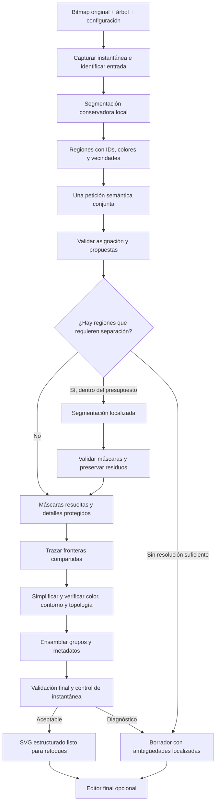
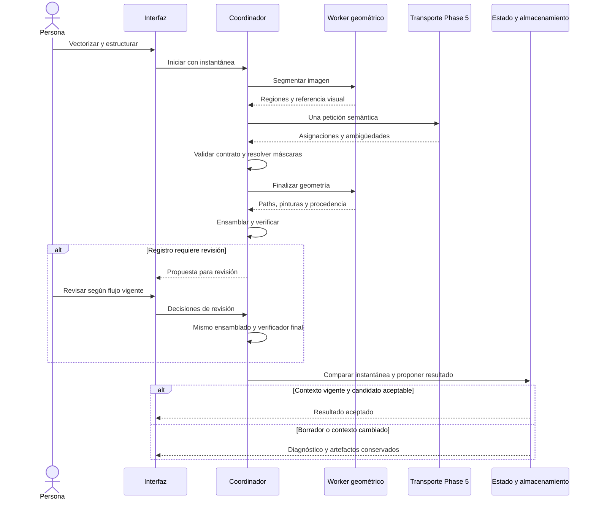
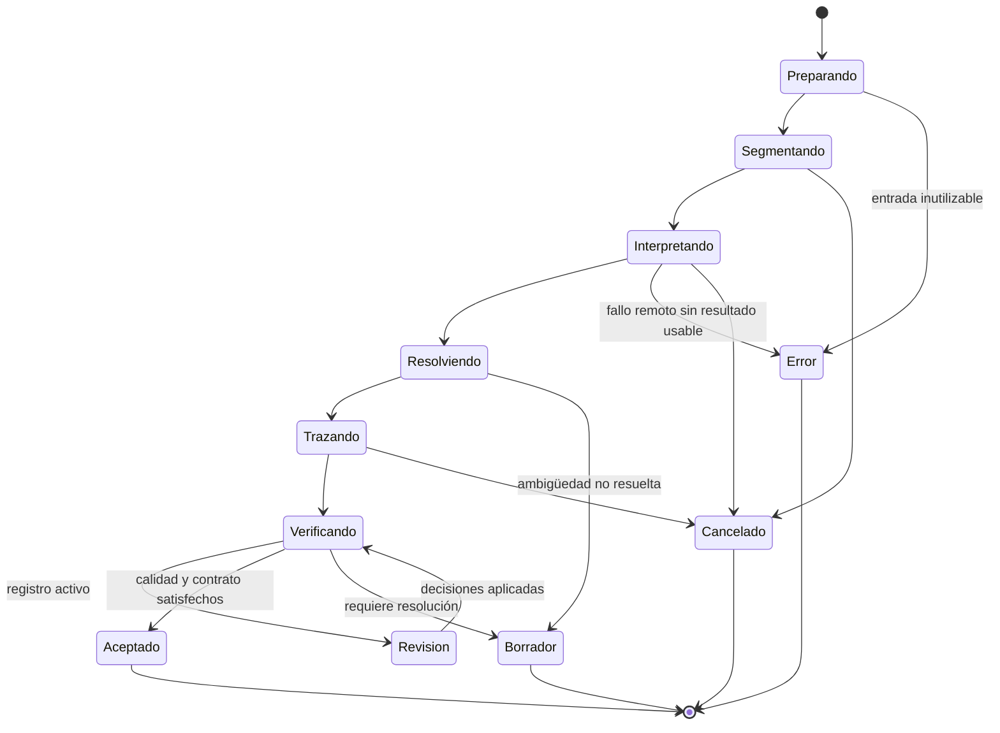

# Plan de optimización conjunta de VECTORIZAR y ESTRUCTURAR

**Estado:** propuesta de ingeniería documentada; implementación y evaluación pendientes.  
**Objetivo:** producir, desde un bitmap y el árbol de PICTOS, un SVG limpio, fiel y semánticamente organizado, dejando el editor para retoques finales.  
**Base examinada:** checkout `dev`, HEAD `a5b1058`, con cambios locales preexistentes del editor que quedan fuera de este trabajo.  
**Fecha de investigación:** 29 de octubre de 2026, America/Santiago.  
**Alcance de este documento:** diagnóstico, literatura, arquitectura, contratos propuestos, secuencia de implementación y protocolo de verificación. No acredita mejoras ya medidas.

## Estado de implementación — 30 de octubre de 2026

Rama `feat/vectorizar-estructurar`. Lo implementado declara qué se probó; nada de esto acredita todavía la mejora de producto (§12.5), que requiere VE0 completo y VE6.

| Entrega | Estado | Evidencia |
|---|---|---|
| VE0 | Parcial | Piloto de 10 casos de ICAP con manifiesto y resultados (ver abajo). Contratos expresados en `svg-structuring.allium` (`LocalGeometryAssembly`, `JointVectorizeStructure`) y `library-views.allium`. Fixtures sintéticos en tests. Pendiente: corpus de 50 casos (30/20), protocolo de tiempo humano y línea base. |
| VE1 | Hecho | D08, D09, D11, D12, D13 (parcial, ver nota), D15 y D16 corregidos. Tests: `svgMappingValidation`, `svgBooleanOps` (huecos), `svgMergeCandidates` (pintura). Casos de regresión §12.3 de merge, anillo, acentos, transformaciones e ids verificados en navegador. |
| VE2 | Hecho | Binding `lib/vtracer-web` sobre el núcleo fijado `2500df7`. Mosaico con procedencia exacta, cero rendijas, huecos reales. Comparación preliminar con 6 bitmaps: menos píxeles erróneos en los 6, la mitad de bytes, tiempo similar. |
| VE3 | Hecho | `vectorizeAndStructure` y contrato `restructure_regions` (`regionMapping` + tests). Dos filas reales con Claude Sonnet 4.6: una sola petición, 5,3–7,4 k tokens de entrada, 10–17 s, fidelidad geométrica 0,0–0,65 %, separación solicitada en el contacto persona+pastel. |
| VE4 | Parcial | Pase de curvas del núcleo (`simplify: 1`), fronteras compartidas del mosaico y color robusto por región. Pendiente: selección de candidatos de tolerancia contra el bitmap, protección de encuentros, ancho de líneas finas (≈1 px menor) y fusión de regiones de igual pintura y entidad. |
| VE5 | Parcial | La operación conjunta es la acción principal en filas con bitmap y árbol (decisión del 30 de octubre), con el nombre "Estructurar"; con trazado existente, "Estructurar trazado" y "Estructurar desde el bitmap". TRAZAR queda como "Solo trazar". Instantánea, borrador, promoción y revisión por las guardas existentes. Bibliotecas: plantillas sin modelos fijados, modelos retirados quitados al cargar, defaults no persistidos, estilos antiguos convertidos por rol (`libraryConfigMigration.js`). Pendiente: caché por dependencia, cancelación, diagnóstico de ambigüedades en la UI. |
| VE6–VE8 | Pendiente | Requieren el corpus de VE0 y evaluación con personas. |

Nota sobre D13: martinez ya trataba los anillos anidados de un mismo operando como par-impar, así que los huecos sobrevivían; lo incorrecto era `nonzero` con anillos de igual sentido (debían ser sólidos). Ahora la regla de relleno del path decide.

### Evaluación piloto: 10 casos de ICAP 50 V2

Manifiesto `docs/eval/icap-pilot-10.json` (casos elegidos por rasgos visuales medidos sobre las 50 imágenes: silueta simple, contacto del mismo color, detalle pequeño, árboles de 8 y 10 nodos, entidad multicolor, el caso más complejo, componentes desconectados). Resultados completos en `docs/eval/icap-pilot-10-results-2026-10-30.json`; arnés reproducible en `scripts/eval/vectorizarEstructurarEval.ts`. Mismo modelo (`claude-sonnet-4-6`) y configuración en ambas variantes; medidas contra el bitmap de origen a 256 px, con trazos de estilo neutralizados.

| Medida | A: trazado antiguo + ESTRUCTURAR | D: conjunto por regiones |
|---|---|---|
| Píxeles erróneos, media (mediana) | 4,68 % (2,16 %) | 1,02 % (1,04 %) |
| Casos donde la estructura empeora su propio trazado más del doble | 4 de 10 (1, 21, 26, 46) | 0 de 10 |
| Nodos del árbol con geometría | 51 de 57 | 55 de 57 |
| Tokens de entrada, media | 11 953 | 6 156 |
| Tokens de salida, media | 778 | 825 |
| Tiempo total, media | 11,4 s | 13,5 s |
| Tamaño del SVG, media | 103 KB | 37 KB |
| Paths sin asignar, media | 1,9 % | 3,7 % |
| Peor pérdida local, mediana | 12,7 % | 20,9 % |

Lectura:

- A falla por el orden de pintura (D17): al reagrupar un trazado apilado, capas que estaban debajo quedan encima. En "Quiero comer pizza" la persona y la pizza desaparecen bajo el halo; en "Te quiero" el corazón queda negro; en "No me gusta que me toquen" las personas quedan color salmón. La partición en mosaico de D no tiene orden que romper.
- La peor pérdida local de D (casos 34 y 11) ya está en el trazado de regiones: líneas finas y claras salen más claras porque el color de la región es la media de su clúster, que incluye el antialias. No es forma perdida. Afinar la segmentación (precisión de color 7) solo baja la mediana a 16 % con 41 % más regiones. Corrección prevista en VE4: color robusto tomado del interior de cada región.
- D pide separaciones donde hay contacto real (persona y pastel; "yo"+"tú" abrazados). En "Me duele la barriga" pidió separar `torso` de su propio padre `persona`; una región que abarca a un nodo y a su ancestro ahora se asigna al ancestro (con test). La segunda corrida de ese caso no repitió la solicitud: el modelo no es determinista y esa regla quedó cubierta solo por el test.
- Ningún caso se certificó en ninguna variante: los NLU y bindings de ICAP son históricos (`nluNeedsReview`, `bindingsNeedReview`).
- No mide tiempo humano de retoque. Este piloto no es el conjunto reservado: los ajustes hechos sobre él no pueden validarse con él.

### Corrección de color y segunda medición de D (D2)

Cambios, medidos sobre el mismo piloto (`docs/eval/icap-pilot-10-results-D2-2026-10-30.json`):

- **Color robusto por región** (binding): mediana de los píxeles interiores visibles; en regiones sin interior, mediana del cuarto de píxeles más alejado del color circundante. A nivel de trazado baja el error de color sobre la tinta en los 10 casos (p. ej. 44: 7,4 → 6,1; 26: 10,6 → 9,1; pizza: 22,9 → 19,6). Límite: un halo en degradado recibe un plano algo más oscuro, lo que sube sus píxeles erróneos (pizza 1,0 → 2,6 %).
- **La pérdida local de líneas finas era en buena parte un artefacto de medir a 256 px.** A 1024 px el color de la línea es correcto y su ancho es ≈1 px menor; a 256 esa línea cruza el umbral de tinta. El verificador de ensamblado pasa a 512 px (celdas de 32 px, misma proporción). A 512, la mediana de peor pérdida local de D2 es 11,8 % (a 256 seguía en 20,9 %).
- **Ningún descarte borra geometría en el camino conjunto.** En una partición en mosaico no hay nada debajo de una región: borrarla perfora el dibujo. En "No me gusta que me toquen" el modelo propuso descartar 78 paths reales y el gate de micro-manchas (0,15 % por caja) lo permitía; ahora el ruido propuesto se absorbe en la región asignada que lo contiene (`absorbDiscards`, con test). El caso volvió a 124 paths y su peor celda bajó de 40 % a 10 %.
- **Presupuesto de Claude para la fase 5: 50 s** (antes 30 s, límite síncrono 60 s). El caso más grande (158 regiones, ~1 900 tokens de salida) fallaba con 500 al cortar a 30 s; ahora completa en 25 s.

| Medida (D2) | Valor |
|---|---|
| Píxeles erróneos a 256, media (sin la pizza) | 1,18 % (1,02 %) |
| Píxeles erróneos a 512, media | 0,69 % |
| Peor pérdida local a 512, mediana | 11,8 % |
| Error de color sobre tinta a 512, media | 7,97 |
| Nodos con geometría | 51 de 57 |
| Paths sin asignar, media (mediana) | 12,4 % (4,4 %) |

**Variabilidad semántica.** Con el mismo prompt, la respuesta del modelo cambia mucho entre corridas: la cobertura pasó de 55/57 a 51/57 (en "Necesito tomar mi medicina" faltaron cuatro nodos que la corrida anterior sí asignó) y en "Hoy me siento sobrecargado" el modelo dejó 89 regiones sin resolver. Estos cambios no vienen de la corrección de color ni de los descartes. Una corrida por caso no basta para evaluar la semántica: VE6 necesita varias corridas por caso y reportar media y dispersión.

### Edición posterior de un SVG estructurado

Verificado sobre un SVG certificado por la operación conjunta: editar el dibujo dentro de los grupos (mover, escalar, guardar) conserva la validez y crea una revisión `manual_edit` con el hash del padre, sin tocar NLU, composición ni enlaces. Borrar toda la geometría de un grupo, una unión booleana entre grupos, sacar una forma de su grupo o desagrupar un grupo semántico invalidan el esquema: el guardado los deja como borrador y la revisión aceptada no cambia. Desde el mismo día el editor las bloquea antes de aplicarlas (guardián semántico en cada commit) y explica qué grupo rompería; mover formas entre grupos sigue permitido. Las booleanas ahora dejan el resultado en el ancestro común de los operandos, como pedía el spec, en vez de la raíz. Detalle en [ESTRUCTURAR.md](ESTRUCTURAR.md#edición-posterior-en-el-editor).

Hallazgos nuevos durante la implementación:

- Los borradores nunca pasaban por el verificador de fidelidad; ahora sí.
- Un trazo de estilo de librería (p. ej. contorno blanco de 3 pt en `.main`) se medía como pérdida de tinta; el verificador lo excluye cuando el trazado no tiene trazos propios.
- Entre 60 y 80 % de las regiones de un bitmap JPEG miden menos de 64 px (astillas de antialias): se adjuntan a la región que las contiene en vez de numerarse.
- Con el estilo de contorno blanco, cada frontera interna de una misma entidad muestra una costura blanca. Fusionar regiones de igual pintura y entidad antes de estilizar es trabajo de VE4.

## Índice

1. [Resultado que se busca](#1-resultado-que-se-busca)
2. [Contexto y documentación aplicable](#2-contexto-y-documentación-aplicable)
3. [Diagnóstico del recorrido actual](#3-diagnóstico-del-recorrido-actual)
4. [Literatura y decisión tecnológica](#4-literatura-y-decisión-tecnológica)
5. [Qué permite realmente VTracer 1.0](#5-qué-permite-realmente-vtracer-10)
6. [Arquitectura propuesta](#6-arquitectura-propuesta)
7. [Representación intermedia y contrato semántico](#7-representación-intermedia-y-contrato-semántico)
8. [Color, topología y simplificación](#8-color-topología-y-simplificación)
9. [Una operación visible y estados internos recuperables](#9-una-operación-visible-y-estados-internos-recuperables)
10. [Presupuesto de tiempo y coste](#10-presupuesto-de-tiempo-y-coste)
11. [Plan de implementación por entregas](#11-plan-de-implementación-por-entregas)
12. [Evaluación, métricas y criterios de aceptación](#12-evaluación-métricas-y-criterios-de-aceptación)
13. [Mapa de integración en el repositorio](#13-mapa-de-integración-en-el-repositorio)
14. [Riesgos y decisiones acotadas](#14-riesgos-y-decisiones-acotadas)
15. [Instrucciones de traspaso al agente programador](#15-instrucciones-de-traspaso-al-agente-programador)
16. [Referencias](#16-referencias)
17. [Fecha y firma](#17-fecha-y-firma)

## 1. Resultado que se busca

El problema de producto es el tiempo que la persona dedica a quitar ruido, corregir contornos y recomponer partes antes de poder estructurar el pictograma. El cambio debe reducir ese trabajo preparatorio y entregar un resultado que se pueda seleccionar, recolorear y retocar por entidades.

La propuesta es **una operación conjunta de vectorización y estructuración**, con una petición semántica por defecto, geometría calculada localmente y asistencia de segmentación limitada a casos ambiguos. Se mantienen artefactos intermedios para recuperar errores y repetir solo lo necesario.

El recorrido habitual pasaría de:

```text
bitmap → trazado → limpieza manual → ESTRUCTURAR → retoques
```

a:

```text
bitmap + árbol → regiones → decisión semántica → geometría limpia y agrupada → retoques
```

### 1.1 Prioridades, por orden

1. Conservar información visual significativa: entidades, detalles, colores, huecos y contactos.
2. Mejorar la correspondencia entre partes visibles y entidades del árbol.
3. Reducir el tiempo humano necesario para llegar a un pictograma utilizable.
4. Reducir complejidad geométrica sin degradar los tres puntos anteriores.
5. Mantener acotados el tiempo de máquina, las llamadas remotas y el coste del proveedor.

El número de nodos, el tamaño del SVG y la similitud global son medidas auxiliares. Un resultado pequeño que pierde un ojo, una flecha o un indicador de dolor no es una optimización aceptable.

### 1.2 Alcance inicial

- Bitmaps de pictogramas abstractos con colores predominantemente planos.
- Árbol `VisualElement[]` ya disponible, con identidad y jerarquía procedentes de COMPONER.
- Geometría visible fiel al bitmap, con partes agrupadas de manera editable.
- Conservación de la ruta de SVG nativo, sin rasterizarlo y volver a trazarlo innecesariamente.
- Borradores útiles cuando la semántica histórica o una correspondencia no permiten certificación.
- Editor final disponible, con problemas residuales localizados.

### 1.3 Fuera del recorrido normal

- Generar un SVG completo libremente con un modelo de lenguaje.
- Reconstruir automáticamente todas las superficies ocultas.
- Entrenar un modelo propio como condición para la primera mejora.
- Incorporar todos los motores de los artículos como alternativas de usuario.
- Añadir llamadas recursivas hasta obtener una respuesta que parezca satisfactoria.
- Cambiar el significado de los conceptos, renumerar fases persistidas o migrar librerías como efecto secundario.

La reconstrucción amodal —completar lo que está detrás de otro objeto— puede estudiarse después como modalidad explícita. No es necesaria para limpiar y organizar lo visible, y sus costes son distintos.

## 2. Contexto y documentación aplicable

Este plan desarrolla el frente bitmap → SVG semántico. Complementa el [plan general de generación de octubre](PLAN_GENERACION_2026-10.md) y los principios de [ESTRUCTURAR](ESTRUCTURAR.md). El [roadmap de marzo](ROADMAP_ESTRUCTURAR.md) es histórico: sus porcentajes esperados, modelos y propuestas no deben tomarse como resultados actuales.

La documentación de ESTRUCTURAR conserva descripciones de julio que no reflejan todas las restricciones posteriores de borradores y certificación. Para implementar, leer el código actual junto con:

| Documento | Autoridad o uso |
|---|---|
| [visual-reasoning.allium](../specs/visual-reasoning.allium) | Vectorización local, una petición de estructuración, evidencia enviada al modelo, revisión y estados de las fases. |
| [svg-structuring.allium](../specs/svg-structuring.allium) | Preservación geométrica, cobertura de paths, borradores, promoción y revisiones. |
| [element-tree.allium](../specs/element-tree.allium) | Árbol de COMPONER; no confundirlo con el árbol DOM del editor. |
| [library-views.allium](../specs/library-views.allium) | Acciones y presentación de bitmap, trazado, borrador y estructurado. |
| [intervention-recording.allium](../specs/intervention-recording.allium) | Registro de intervenciones, revisión y atribución de reemplazos de artefactos. |
| [svg-boolean-operations.allium](../specs/svg-boolean-operations.allium) | Contrato de las operaciones geométricas reutilizadas. |
| [README del esquema SVG](../schemas/pictos-svg-schema/README.md) | Perfil vigente `2.0.0-draft.1`, bindings, validación y hash de bytes finales. |

Los documentos bajo `schemas/pictos-svg-schema/docs/` describen el perfil histórico; el README del producto advierte que no son el contrato normativo v2. `lib/mf-schema` también es una copia histórica, no la fuente canónica para cambios nuevos.

### 2.1 Cambios de contrato que se deben expresar antes de programar

- La UI conjunta incorpora una etapa remota; no debe describirse toda la operación como vectorización local gratuita. La subetapa geométrica sigue siendo local.
- Conservar la fase interna 5 y `phase5Model` mientras existan configuraciones y registros que los utilizan; una acción conjunta no exige renumerarlos.
- Extender el contrato semántico desde IDs de paths hacia regiones, ambigüedades y propuestas de localización, sin autoría remota de `d`.
- Mantener la exclusión de NLU completo, enunciado, pragmática y prompt de composición del request de reagrupación. El árbol y la evidencia visual bastan para el primer diseño; la incorporación de otros datos requeriría una decisión explícita.
- La asamblea local sigue recibiendo los documentos semánticos completos para producir el artefacto portable.
- Reconciliar las precondiciones antiguas de `StartPhase5` con la admisión actual de borradores: semántica incompleta bloquea certificación, no toda operación geométrica.
- Precisar qué constituye una calidad insuficiente para reemplazar el resultado automático, manteniendo siempre disponible un borrador pasivo y la revisión aceptada anterior.

Este documento propone esas modificaciones; no declara que los contratos ya hayan cambiado.

## 3. Diagnóstico del recorrido actual

### 3.1 Vectorizar

[VectorizerModal.tsx](../components/VectorizerModal.tsx) recibe `bitmap`, `utterance` y configuración. El enunciado sirve para presentación y nombres; el árbol de entidades no participa en el trazado.

[vtracerService.ts](../services/vtracerService.ts) utiliza `ColorImageConverter` o `BinaryImageConverter` del WASM acoplado al DOM: lee un canvas por ID y escribe paths en un SVG por ID. `runConversion` ejecuta `tick()` en intervalos; `traceInteractive` lo utiliza desde el modal y `vectorizeBitmap` crea elementos ocultos.

Hallazgos estáticos:

| ID | Hallazgo | Lugar y efecto |
|---|---|---|
| D01 | El motor conoce píxeles y parámetros, no entidades. | `runConversion`, `buildWasmParams`: el agrupamiento cromático no equivale a agrupamiento semántico. |
| D02 | Preset `pictogram`: `colorPrecision: 6`, `layerDifference: 16`, `filterSpeckle: 4`. | El filtro se convierte a 16 píxeles de área; no distingue detalle funcional de ruido. Seis bits por canal no significa una paleta de seis colores. |
| D03 | `downscaleBitmapIfNeeded` limita el lado mayor a 1024. | Detalles pueden desaparecer antes del trazado. La resolución de inferencia y la resolución geométrica deben desacoplarse. |
| D04 | `pathPrecision` controla decimales; `lengthThreshold` interviene en subdivisión. | No constituyen un criterio global de mínima complejidad con error verificado. |
| D05 | Se serializa el SVG y se cuentan paths. | `layersTraced/layersTotal` no miden entidades, fidelidad, color o calidad de separación. |

### 3.2 ESTRUCTURAR

Las entradas activas son `App.processStep(..., 'structure')` y `SVGGenerator.handleFormat`. Ambas utilizan [svgStructureService.ts](../services/svgStructureService.ts). El ensamblado es del navegador; los workers remotos devuelven respuestas del proveedor, no el SVG final.

El servicio ya recibe `rawSvg`, `elements` y `referenceImage`. Construye inventario, marcas y candidatos de fusión; pide un `StructuringMapping`; ensambla grupos y aplica pulido. Es una base reutilizable.

| ID | Hallazgo | Implicación |
|---|---|---|
| D06 | `buildUserText` trunca el SVG a 10.000 caracteres. | Coste de coordenadas y evidencia incompleta; reemplazar por inventario compacto y completo. |
| D07 | `buildRestructureToolSchema` solo ofrece `keep`, `merge` y `discard`. | No expresa que un path contiene varias entidades ni permite mantener incertidumbre estructurada. |
| D08 | La descripción de grupos invita a asignar al nodo más cercano si existe incertidumbre. | Puede convertir una duda visual en una correspondencia falsa. |
| D09 | `extractToolUse` seguido de cast y defaults no valida una partición completa y exclusiva. | IDs desconocidos, cobertura y duplicación requieren validación específica. |
| D10 | El audit del backend valida COMPRENDER y COMPONER, no `restructure_svg`. | `contract_ok: null` no es aceptación semántica; éxito HTTP no implica mapping válido. |
| D11 | `renderGroup` usa `if (group.merge?.d) ... else ... keep`. | Una unión válida puede excluir paths adicionales de `keep` que no pertenecían a la unión. |
| D12 | Las fusiones se filtran por bbox/área y `fillRole`. | Dos colores distintos pueden ser `accent`; proximidad y categoría no prueban identidad ni igualdad de pintura. |
| D13 | `ringsToMultiPolygon` convierte cada anillo en un exterior independiente. | Huecos y reglas de relleno necesitan pruebas y representación correctas. |
| D14 | El pulido requiere ≥24 segmentos y ≥60 % de líneas. | Curvas Bézier muy redundantes pueden quedar intactas. |
| D15 | `verifyFidelity` compara máscaras de tinta de 256² contra `rawSvg`. | No mide fidelidad cromática, no vuelve al bitmap y puede ignorar detalles claros o pequeños. |
| D16 | La revisión llama directamente a `assembleFromMapping`. | No recorre el mismo control posterior de fidelidad y variante sin merges que el resultado inmediato. |
| D17 | Reagrupar modifica el orden DOM de pintura. | Una jerarquía semántica no equivale a un orden de oclusión; hay que conservar el render. |
| D18 | El descarte de micro-manchas se decide mediante área de una bbox aproximada. | El tamaño no prueba falta de significado, y los números de un path no son siempre coordenadas absolutas alternadas. |

Las referencias por símbolo son preferibles a números de línea duraderos: el checkout contiene trabajo concurrente. Estos hallazgos describen mecanismos de código; no son todavía una reproducción visual ni una medida de incidencia sobre las librerías.

### 3.3 Infraestructura que conviene conservar

- `canStructureSVG`: admisión operativa de trazado y árbol para un borrador.
- `canCertifySVG`: validación semántica más estricta para certificación.
- `prepareSvgDraft`: conservación de un resultado pasivo con diagnóstico.
- `captureSvgSource` y `applySvgSafeUpdate`: protección frente a cambios de contexto y resultados tardíos.
- `prepareSvgPromotion`: validación de bytes finales y referencia canónica.
- Persistencia separada de metadatos y medios en `libraryService`.
- Revisión obligatoria en modo de registro y sus eventos de intervención.

El esquema canónico verifica estructura, referencias y bindings. No prueba que cada path corresponda realmente a la entidad asignada, que la imagen sea fiel ni que el artefacto sea cognitivamente accesible.

## 4. Literatura y decisión tecnológica

### 4.1 Trabajos principales

| Ref. | Trabajo | Aporte transferible | Límite para esta implementación |
|---|---|---|---|
| R1 | AdaVec, CVPR 2025 | Descomposición en capas de color y complejidad geométrica adaptada a la forma. | Código con SAM/CUDA/DiffVG; tomar criterios y comparar antes de adoptar la infraestructura completa. |
| R2 | SemLayer, 2026 | Separación de partes de iconos abstractos, completado y orden de capas. | Dominio publicado principalmente monocromo; no asumir rendimiento equivalente en pictogramas coloreados. |
| R3 | Compositional SVG Generation, 2026 | Localizar entidades antes de vectorizar; evaluación de agrupación y edición. | Su recorrido recursivo y amodal es mucho más costoso que el presupuesto objetivo. |
| R4 | LayerPeeler, SIGGRAPH Asia 2025 | Descomponer oclusiones y recuperar formas completas. | Generación secuencial; pertinente para una modalidad futura de completado. |
| R5 | Vector Scaffolding, ECCV 2026 | Optimización jerárquica para evitar exceso de geometría desorganizada. | Referencia de refinamiento avanzado, no reemplazo directo de la asignación semántica. |
| R6 | SGLIVE, ECCV 2024 | Segmentación previa y optimización por capas; muestra que una mejora no exige un generador de SVG. | Su énfasis en gradientes es secundario para colores planos. |

### 4.2 Evidencia de coste y reproducibilidad

**Compositional SVG [R3].** Combina VLM, SAM 3, completado con FLUX y VTracer. En su benchmark de 203 imágenes reporta 16,3 llamadas al modelo y 255 s por imagen; 94,9 % del tiempo corresponde al completado secuencial. Mejora el error posterior a edición frente a VTracer, mientras este conserva mejores valores en algunas métricas globales. Es evidencia a favor de la organización semántica previa, no de que PICTOS deba reproducir todo el recorrido. Sus cifras no predicen nuestros costes.

**SemLayer [R2].** Reporta 14,56 s para segmentación y 16,83 s para completado en una A6000, sobre 48 ejemplos. Los autores identifican dificultades con entrelazados y estructuras completamente ocultas. No se localizó una descarga de código/pesos en la página oficial consultada; la disponibilidad debe volver a comprobarse antes de planificar una integración. Su reconstrucción de capas orienta la investigación, pero no constituye una dependencia lista para este frontend.

**AdaVec [R1, R7].** El código consultado utiliza SAM en CUDA y optimización diferenciable, con 200 iteraciones de reajuste por path y 100 conjuntas en el recorrido examinado. Presenta rutas y dependencias ligadas al entorno original; no se reprodujo la instalación ni se confirmó una licencia de distribución del código. La primera adopción será conceptual: asignar puntos donde hacen falta y aceptar simplificación por evidencia geométrica.

**LayerPeeler [R4, R8].** El repositorio incorpora GPU, difusión y una ruta con vectorización Recraft de pago. Su configuración publicada presenta diferencias respecto del artículo. La disponibilidad del código no demuestra que toda la cadena sea desplegable ni que sus licencias permitan el uso previsto; revisar las dependencias concretas solo si se decide evaluar completado.

### 4.3 Decisión recomendada

1. Corregir el ensamblado y medir el flujo actual.
2. Evaluar VTracer 1.0 como núcleo local.
3. Introducir el árbol antes del trazado definitivo mediante una asignación conjunta.
4. Resolver separaciones ambiguas de forma localizada y acotada.
5. Evaluar optimización GPU o completado solo si el beneficio residual lo justifica.

La literatura **no demuestra** que una única llamada VLM resuelva todos los contactos entre objetos del mismo color. El árbol conocido reduce trabajo semántico, pero no contiene la frontera espacial. La hipótesis PICTOS es que una llamada conjunta resuelve la mayoría de las asignaciones y señala explícitamente las regiones que necesitan asistencia.

## 5. Qué permite realmente VTracer 1.0

### 5.1 Versión de referencia

Se examinó `1.0.0-alpha.4`, commit `2500df76b5aea0ac22d15296b22722442f825c5b`, publicado el 29 de agosto de 2026 [V1]. Fijar la revisión en la prueba inicial, registrar toolchain y hash del WASM y volver a evaluar ante actualizaciones. Es una versión preliminar; no se ha compilado ni ejecutado aquí.

El workspace declara licencia `MIT OR Apache-2.0`. El wrapper Node no equivale a un binding de navegador listo para usar [V2, V3].

### 5.2 APIs verificadas y APIs que habrá que construir

| Superficie | API comprobada | Uso posible |
|---|---|---|
| Node | `convertBuffer(buffer, options?)`, `convertPixels(rgba, width, height, options?)` | Prueba comparativa fuera del navegador; devuelven SVG. |
| Binding WASM de Node | `vectorize_bytes`, `vectorize_rgba` | Referencia para construir un binding web; no exponen toda la representación intermedia. |
| Rust | `Pipeline::segment(&ColorImage)` | Obtener segmentación reutilizable. |
| Rust | `Pipeline::finish(&Segmentation)` | Recalcular color, ajuste y composición sin repetir segmentación. |
| Rust | `Frontend::segment` | Extender el origen de regiones, incluidas máscaras externas. |
| Rust | `RegionMask`, `Layer`, `Segmentation` | Construir regiones de PICTOS. |
| Rust | `CurvePass::open`, `CurvePass::ring` | Extender simplificación de fronteras respetando extremos/cierre. |
| Rust | `Session::new`, `render`, `render_svg` | Referencia de caché por imagen/configuración. |

Fuentes: [V3–V8]. Nombres como `convertMasks`, `exportRegions` o `segmentImage` serían APIs nuevas del adaptador PICTOS, no funciones ya publicadas. `Session::segmentation()` es privado; no planificar su invocación desde JavaScript.

### 5.3 Adaptador web

El paquete actual utiliza CommonJS, `fs` y `wasm-pack --target nodejs`; el antiguo `webapp` está excluido del nuevo workspace. Construir un binding explícito para navegador/Worker a partir del núcleo Rust [V2, V3].

El adaptador debe exponer solo las operaciones necesarias:

1. Inicializar una sesión de píxeles y dimensiones verificadas.
2. Obtener regiones y evidencia geométrica suficiente.
3. Aplicar máscaras/particiones resueltas sin perder procedencia.
4. Finalizar geometría con una configuración acotada.
5. Recuperar resultado, métricas, advertencias y correspondencias.
6. Liberar memoria y cancelar de forma comprobada.

No portar al mismo tiempo toda la aplicación desktop de VTracer ni todos sus parámetros a la UI de PICTOS.

### 5.4 Incompatibilidad de unidades

En el adaptador actual de PICTOS se elevan al cuadrado los valores de `filterSpeckle`, se invierte `colorPrecision` y se convierten grados a radianes. La nueva `Config` realiza esas transformaciones internamente [V4].

**No reutilizar `buildWasmParams` para el binding nuevo.** Definir unidades en el borde de la API y comprobar un caso conocido por parámetro. Mantener configuración antigua versionada si se conservan comparaciones o artefactos históricos.

### 5.5 Conservación de entidades

`Config::build` puede encadenar `FixedPalette`/`AutoQuantize` con `MergeAdjacent`. El compositor mosaic también puede unir regiones vecinas por color [V4, V9]. Para una partición semántica, construir el pipeline explícitamente, omitir las fusiones globales y utilizar `Compositing::Mosaic { fitter, merge_diff: -1 }`. El valor cero todavía permite fusionar colores idénticos [V10].

`Layer` y `Shape` no incluyen IDs semánticos. La salida puede omitir formas vacías o reconstruir caras; **no asumir correspondencia por índice** [V6, V11]. El adaptador debe devolver procedencia explícita. Si exige una pequeña extensión del núcleo, documentarla, fijarla y cubrirla con pruebas.

### 5.6 Simplificación y cancelación

`SimplifyCurves` reajusta cadenas suaves, mantiene extremos y acepta reducciones de cúbicas. Trabaja sobre muestras de geometría ajustada y no simplifica polilíneas; la tolerancia no certifica distancia al bitmap [V8]. Cualquier garantía de fidelidad de PICTOS requiere su propio verificador.

El núcleo nuevo no ofrece el antiguo `tick()`. Su progreso y `CancelToken` tampoco están exportados por el wrapper Node [V12]. Un Worker ocupado en WASM síncrono puede no procesar mensajes; terminarlo y recrearlo es una primera estrategia válida, con pérdida de caché. No añadir requisitos de memoria compartida o aislamiento del sitio sin demostrar que hacen falta.

## 6. Arquitectura propuesta



### 6.1 Semántica antes de fijar la geometría

Crear primero regiones candidatas conservadoras. Utilizar el modelo para decidir su pertenencia, señalar detalles y detectar particiones insuficientes. Ajustar y simplificar curvas después de esas decisiones.

Esto permite proteger una frontera entre entidades incluso cuando ambas tienen el mismo color. Una asignación de etiquetas por sí sola no crea esa frontera: los casos que requieren corte deben pasar por resolución de máscaras.

### 6.2 Partición visible como primera representación

Para bitmaps de colores planos, evaluar primero regiones visibles no superpuestas con fronteras compartidas. Una entidad puede poseer varias regiones, colores y componentes desconectados. El agrupamiento semántico de una partición visible puede conservar la imagen sin depender de ordenar superficies ocultas.

El dominio de cobertura incluye el contenido visible y su relación con fondo/alpha. El fondo no se elimina por ser grande; se clasifica explícitamente. Mantener huecos y transparencia, y comprobar bordes antialiased al recomponer el SVG.

Si se decide utilizar regiones superpuestas, conservar orden de pintura y relaciones de oclusión por separado del árbol. Un árbol de partes no es un orden de profundidad.

### 6.3 Ruta de SVG nativo

La entrada nativa reutiliza geometría y estilos existentes, normalizados de forma segura. Puede aprovechar el nuevo contrato de asignación y el verificador común sin volver a rasterizar y trazar su geometría. La rasterización de evidencia visual no reemplaza al original.

No aplicar simplificación propia de ruido raster indiscriminadamente a SVG editados o generados como vectores. Los originales con C2PA conservan su procedencia en el artefacto original; el derivado sigue la política existente de `svgForStructuring`.

## 7. Representación intermedia y contrato semántico

### 7.1 Identidad y procedencia

Mantener cuatro identidades diferentes:

| Identidad | Significado | Invariante |
|---|---|---|
| Entidad | Nodo existente de COMPONER. | ID y parentesco no se regeneran mediante visión. |
| Región | Máscara visible candidata/resuelta. | No se identifica únicamente por color ni posición en un array. |
| Pintura | Color y alpha observados o estilo explícitamente aplicado. | Una entidad puede tener varias pinturas; una pintura puede pertenecer a varias entidades. |
| Path | Geometría derivada de una o varias regiones compatibles. | Conserva procedencia verificable después de fusiones/separaciones. |

La relación puede ser uno-a-varios: una región se divide, varias regiones de la misma entidad se unen, y una región con huecos produce un path compuesto. Registrar relaciones, no solo el último nombre.

### 7.2 Datos locales propuestos

Los siguientes nombres son conceptos de diseño; el agente debe ajustarlos al código existente sin crear abstracciones innecesarias:

```text
RunSnapshot
  sourceHash, treeHash, configVersion, previousRevisionReference
  sourceDimensions, processingDimensions, coordinateTransform

RegionRecord
  regionId, sourceRegionIds
  maskRef, bbox, area, paintId, neighbourIds
  holeCount, boundaryRef, protectionFlags

SemanticDecision
  version, regionSetHash
  assignments, splitRequests, discardProposals, unresolved

GeometryResult
  paths, sourceRegionToPathBindings
  entityBindings, paints, qualityReport
  engineRevision, effectiveConfig
```

Las máscaras deben residir localmente como buffers o referencias, no como JSON expandido enviado al modelo. No incorporar automáticamente esta representación operativa al metadata cerrado del SVG canónico. Persistir solo lo necesario para repetición, diagnóstico y trazabilidad, con un contrato versionado propio si hace falta.

### 7.3 Entrada de la petición semántica

1. Bitmap limpio como evidencia visual.
2. Vista de regiones con marcas legibles, manteniendo coordenadas y escala conocidas.
3. Acercamientos de detalles pequeños cuando la resolución global no permita leerlos, dentro del presupuesto de imagen.
4. IDs, conceptos y parentesco del árbol ya conocido.
5. Inventario compacto de regiones: ID, posición, área, color y relaciones relevantes.
6. Candidatos locales a duplicación, separación o ruido; presentados como hipótesis.

Eliminar el fragmento de SVG truncado del request nuevo. No enviar toda la matriz de adyacencia si basta un subconjunto de vecinos relevantes. No convertir el inventario compacto en otro payload ilimitado.

La resolución de inferencia se elige por evaluación, conservando detalles mediante recortes; no afirmar que 512 píxeles sean suficientes para todos los casos. La geometría final usa su propia resolución y transforma las localizaciones al espacio original.

### 7.4 Salida propuesta

| Campo conceptual | Contenido | Validación |
|---|---|---|
| `assignments` | Región → entidad existente. | IDs válidos, propiedad exclusiva y coherencia con región actual. |
| `protectedRegions` | Regiones/detalles que no deben eliminarse. | Referencias existentes; protección propagada a descendientes geométricos. |
| `discardProposals` | Región y causa breve de posible ruido. | La propuesta no autoriza por sí sola el descarte. |
| `splitRequests` | Región que parece contener varias entidades; localizaciones orientativas. | Entidades válidas, coordenadas acotadas, evidencia espacial suficiente. |
| `unresolved` | Regiones o correspondencias ambiguas. | Geometría conservada y diagnóstico localizado. |

Las cajas o puntos son instrucciones para localizar y segmentar, no paths finales ni garantías de forma. Las confianzas del modelo son señales auxiliares, no probabilidades calibradas de éxito.

La ausencia de una entidad esperada no se resuelve fabricando un grupo vacío. Las acciones implícitas siguen el contrato vigente: no inferirlas como atajo para completar bindings. Si la evidencia es insuficiente, mantener el borrador.

### 7.5 Validación de la respuesta

- Validar JSON mediante un esquema versionado antes de ensamblar; un cast TypeScript no es validación.
- Validar referencias cruzadas, exclusividad y cobertura fuera del esquema estructural cuando corresponda.
- Comprobar que `regionSetHash` coincide con la instantánea usada para generar las marcas.
- Impedir asignaciones a IDs inexistentes, referencias duplicadas y propuestas incompatibles.
- Toda región visible tiene una disposición explícita: asignada, pendiente o propuesta para descarte.
- Tras una separación, los nuevos fragmentos sustituyen a la región padre conservando su procedencia; no deben quedar ambas representaciones pintadas.
- Una región no asignada conserva geometría en el borrador; no adquiere artificialmente el concepto Context.
- Malformaciones no desencadenan un bucle automático de reparación semántica. Conservar diagnóstico y permitir repetición explícita según el presupuesto definido.

### 7.6 Segmentación de excepciones

Un componente negro que contiene mano y vaso no se separa cambiándole el nombre. Resolver la máscara mediante propuestas locales guiadas por bordes y localizaciones; si no basta, evaluar un segmentador por recorte.

SAM 3 es un candidato, no una dependencia decidida. Su API oficial utiliza `Sam3Processor`, `set_image` y `set_text_prompt`, y devuelve `masks`, `boxes`, `scores` [R9]. Reutilizar el estado de imagen evita preparación redundante; no asumir una API que procese todo el árbol en una llamada. Un trabajo backend puede agrupar varias consultas, pero cada inferencia y su coste deben contarse.

El entorno oficial requiere GPU/CUDA. Si se adopta, definir un servicio compatible con esa ejecución; no intentar alojar el modelo dentro de las funciones Netlify actuales por simple adición de una dependencia. Evaluar rendimiento en pictogramas, acceso a pesos, licencia y operación antes de habilitarlo.

Aceptar una separación solo si conserva la unión visible dentro de tolerancia, no produce huecos/solapamientos no justificados y mantiene colores. Si no hay frontera visible, la atribución puede seguir siendo una hipótesis semántica aunque el render sea idéntico; reflejar esa incertidumbre.

## 8. Color, topología y simplificación

### 8.1 Color

- Separar extracción de paleta, segmentación semántica y simplificación geométrica.
- Un color poco frecuente puede ser importante; no eliminarlo por baja frecuencia global.
- Distinguir colores de superficie de mezclas de antialiasing en sus bordes.
- Conservar color y alpha por región mediante clases/reglas CSS específicas, sin asignar una sola pintura dominante a toda una entidad.
- Una paleta de estilo aplicada por el usuario es una transformación explícita distinta de conservar el bitmap.
- La igualdad de `fillRole` no autoriza una unión: comparar pintura real y pertenencia a entidad.
- No interpretar negro, blanco y acento como la paleta completa de cualquier pictograma.

La extracción inicial de paleta debe ser conservadora. Si se prueba cuantización perceptual, medir el efecto en interiores de regiones y detalles; el número máximo de colores no debe ser un presupuesto que borre significado automáticamente.

### 8.2 Huecos y fronteras

- Mantener máscaras con huecos y su relación exterior/interior.
- Respetar `evenodd`, `nonzero`, alpha y transformaciones al reutilizar SVG.
- No convertir todos los anillos a polígonos exteriores rellenos.
- No considerar que dos contornos concéntricos sean necesariamente ruido: pueden formar un anillo, un ojo o una pieza con interior significativo.
- Las booleans sobre curvas introducen una aproximación si se aplanan; verificar el error acumulado al reajustar.
- La frontera entre dos caras se ajusta una vez y se reutiliza con orientación inversa cuando corresponde.

### 8.3 Simplificación

Usar inicialmente el pase de curvas del núcleo nuevo. Completar únicamente los casos que no resuelva:

1. Eliminar puntos duplicados y segmentos degenerados conservando cierre y orientación.
2. Unir segmentos casi colineales con error perpendicular acotado y sin invertir el recorrido.
3. Sustituir curvas casi rectas por segmentos cuando la desviación verificada lo permita.
4. Reajustar cadenas de Bézier con menos segmentos.
5. Mantener esquinas y nodos de encuentro fijados.
6. Rechazar cambios que alteren componentes, huecos, contactos protegidos o fronteras semánticas.

No aplicar Ramer–Douglas–Peucker o refit ciegamente a los puntos de control de una Bézier como si fueran una polilínea muestreada. No reajustar por separado cada path después de construir fronteras compartidas.

### 8.4 Selección acotada de candidatos

Evaluar un conjunto pequeño de tolerancias, inicialmente 0,25 / 0,5 / 1 píxel normalizados a una escala de 1024, sujeto a calibración. No son valores ya validados para el corpus.

Elegir el candidato más simple que pase las restricciones de conservación. Si ninguno mejora de manera segura, conservar la geometría anterior. Volver a comprobar contra máscara y bitmap: una tolerancia respecto de una curva intermedia puede acumular errores anteriores.

Un objetivo conceptual de coste puede combinar número de segmentos y puntos, pero debe quedar subordinado a límites visuales y topológicos. Un mínimo global de error de píxeles puede sacrificar una región pequeña; los detalles protegidos requieren restricciones propias.

### 8.5 Verificador común

El reporte de calidad debe distinguir:

| Comprobación | Qué responde |
|---|---|
| Conformidad SVG | ¿El artefacto cumple el contrato estructural y de recursos? |
| Cobertura/procedencia | ¿Se contabilizó toda la geometría original y se emitió lo que se decidió conservar? |
| Fidelidad visual | ¿Se conservan color, contornos y composición respecto del bitmap? |
| Topología | ¿Se mantienen componentes, huecos y conexiones protegidas? |
| Correspondencia semántica | ¿Las máscaras/partes pertenecen a las entidades correctas? |
| Editabilidad | ¿Las operaciones por entidad funcionan con una cantidad razonable de retoque? |

Usar comparación por regiones y varias escalas, además de imagen completa. Diferenciar error de borde antialiased, cambio de color interior y desaparición de componente. Si una medición falla, devolver estado desconocido, no un falso `ok` con diferencia cero.

Una comprobación visual insuficiente no destruye el candidato: conserva borrador y revisión anterior. Precisar en el contrato la política de promoción automática, sin confundir conformidad del esquema con fidelidad visual demostrada.

## 9. Una operación visible y estados internos recuperables

### 9.1 Coordinación

Capturar una instantánea al iniciar y pasar los resultados directamente entre etapas. No encadenar el `onApply` actual del vectorizador y un `handleFormat` que vuelva a leer una fila React todavía antigua.



### 9.2 Estados



El diagrama expresa estados conceptuales, no propone sustituir todos los estados persistidos existentes. La revisión se aplica una vez por intento; una bandera/evento de revisión completada evita reabrirla al pasar de nuevo por verificación.

### 9.3 Artefactos y repetición

- Mantener bitmap original y última revisión aceptada.
- Conservar trazado/intermedio útil y mapping validados para repetir solo la etapa fallida.
- Una operación conjunta puede guardar dos artefactos técnicos; la UI no necesita exigir dos acciones.
- Si falla el proveedor, conservar trabajo local para reintentar estructura.
- Si falla promoción, conservar borrador con diagnóstico, sin sobrescribir el aceptado.
- No reenviar automáticamente una llamada remota completada al recargar o recuperar estado.
- Los trabajos remotos y los reintentos deben conservar IDs y deduplicación para evitar solicitudes duplicadas. Verificar las garantías existentes antes de ampliar el transporte.

### 9.4 Caché e invalidación

| Cambio | Invalida | Puede reutilizar |
|---|---|---|
| Píxeles/dimensiones | Regiones, semántica, geometría y calidad. | Inicialización del motor. |
| Árbol | Asignación semántica y bindings. | Segmentación de la misma imagen. |
| Configuración de segmentación | Regiones, asignaciones dependientes y geometría. | Jerarquía/píxeles cuando el motor lo permita. |
| Tolerancia de curvas | Geometría y reporte de calidad. | Regiones y decisiones semánticas. |
| Estilo de salida | Presentación y validación final. | Máscaras y asignaciones si no cambia la partición. |
| Edición manual | Referencia/revisión correspondiente. | Solo artefactos cuya identidad de entrada siga siendo válida. |

Separar caché en memoria de una persistencia durable; la primera entrega no necesita guardar toda jerarquía watershed en IndexedDB. No reutilizar un mapping si el conjunto de regiones cambió aunque la imagen parezca igual.

### 9.5 Revisión y editor

En modo `recording.enabled`, conservar la revisión requerida. El código actual calcula triple tiempo de lectura a 200 palabras/minuto, acotado a 10–90 segundos, y permite confirmación anticipada o por expiración. Registrar el modo de cierre real; la expiración no debe inventar una afirmación de revisión humana.

El recorrido normal llega al editor después de producir el SVG. Mantener acceso avanzado a trazado y borrador para recuperación, sin hacer de su limpieza una obligación sistemática. Las ambigüedades deben señalar entidades/regiones concretas, no obligar a inspeccionar todo el dibujo.

## 10. Presupuesto de tiempo y coste

### 10.1 Tres niveles de trabajo

| Nivel | Operaciones | Uso previsto |
|---|---|---|
| Normal | Trabajo local + una petición semántica + trabajo local. | Camino predeterminado. |
| Asistido | Normal + trabajo de segmentación limitado a zonas ambiguas. | Solo dentro de un presupuesto definido para ese modo. |
| Reconstrucción | Completado generativo de partes ocultas. | Investigación posterior; no requisito de entrega. |

Una petición semántica es una llamada a nivel de aplicación. Los reintentos HTTP y el número de inferencias internas de un segmentador se contabilizan aparte. No prometer coste de una llamada si el transporte puede ejecutar varios intentos facturables.

### 10.2 Situación actual que condiciona el presupuesto

- Los endpoints de Phase 5 examinados registran cero unidades internas para las rutas actuales; esto no equivale a coste externo cero.
- Claude utiliza la ruta síncrona; Gemini/OpenAI usan staging y trabajos en segundo plano mediante `callStructuringModel`.
- El staging admite cargas de visión menores a 5 MB y el worker recibe el ID del trabajo; no introducir máscaras expandidas en ese payload.
- El cliente consulta cada 2 segundos hasta aproximadamente 6 minutos. Ese techo de transporte no es un objetivo de experiencia de usuario.
- Las políticas de reintento y tiempo total difieren por proveedor; conservar atribución y medir intentos reales.

Referencias: [aiClient.ts](../services/aiClient.ts), [api-structure-stage.js](../netlify/functions/api-structure-stage.js), [api-claude.js](../netlify/functions/api-claude.js), [worker Gemini](../netlify/functions/api-gemini-structure-background.js), [worker OpenAI](../netlify/functions/api-openai-text-background.js).

### 10.3 Métricas por intento

Registrar por separado:

- Tiempo de preparación, segmentación, petición, espera de proveedor, geometría, validación y persistencia.
- Tiempo de revisión y tiempo de retoque humano.
- Modelo real, versión de prompt/contrato, motor/hash y configuración efectiva.
- Tokens de entrada/salida y demás unidades reportadas por el proveedor, intentos HTTP y trabajos de segmentación.
- Bytes y dimensiones de evidencia enviada; no confundir bytes base64 con tokens de imagen.
- Resultado: aceptado, borrador, fallo, cancelado o respuesta obsoleta.
- Aciertos de caché y razón de invalidación.

Respetar los límites de contenido de los registros existentes. No incorporar bitmaps, prompts completos o NLU a una nueva telemetría general para medir rendimiento.

### 10.4 Metas iniciales, pendientes de calibración

| Dimensión | Meta inicial |
|---|---|
| Peticiones semánticas normales | Una por intento; ninguna al cambiar solo tolerancia geométrica. |
| Tiempo local | p95 ≤5 s a 1024 en equipo de referencia declarado. |
| Coste normal | No superar el coste por resultado útil del recorrido base a calidad comparable. |
| Tiempo humano | Mediana de finalización ≤50 % de la línea base. |
| Detalles protegidos | Cero pérdidas en fixtures de aceptación. |
| Preservación | Cero pérdida de originales/revisiones aceptadas y cero reemplazos obsoletos. |

La calidad mínima tiene precedencia sobre reducir unos segundos de máquina. Si una llamada más corta produce muchos borradores, evaluar coste por pictograma terminado, no solo coste por request.

Para evaluar la vía asistida:

```text
coste medio esperado = coste normal + proporción asistida × coste adicional medio
```

Medir también p50/p95 de latencia: la media no describe la cola de casos difíciles. Si la mayoría necesita asistencia, la segmentación inicial o la petición conjunta no cumplen el objetivo y deben revisarse.

## 11. Plan de implementación por entregas


Cada entrega debe poder revisarse sin reconstruir conversaciones anteriores. Incluir objetivo, cambios de contrato, archivos afectados, versión de fuentes, pruebas y resultados. El tamaño indicado es esfuerzo relativo, no plazo prometido.

### VE0 — Contratos, corpus y línea base

**Esfuerzo:** medio. **Dependencias:** ninguna.

**Implementar/documentar:**

1. Revalidar el estado del checkout y los hallazgos D01–D18 sin revertir trabajo concurrente.
2. Leer los contratos listados en §2 y especificar las modificaciones propuestas.
3. Elegir 50 pictogramas reales: 30 para ajuste y 20 reservados; ampliar si la diversidad del corpus lo exige.
4. Añadir fixtures sintéticos con máscaras/entidades conocidas.
5. Definir el protocolo de tiempo humano y registrar la configuración de la línea base.
6. Fijar cómo se interpretan las ambigüedades, los detalles protegidos y los resultados no certificables.

**Referencias:** §2; R1–R3 para evaluación por geometría y partes; `intervention-recording.allium` para atribución.

**Verificación:** lista de casos, manifiesto con dimensiones/hashes, división de evaluación fija, métricas capturables y una ejecución de referencia reproducible.

**Guardas:** no confundir dataset de evaluación con autorización para entrenamiento; no afinar umbrales sobre los casos reservados; no reutilizar sin comprobar cifras del roadmap histórico.

**Salida:** benchmark y contratos propuestos, sin afirmar mejoras.

### VE1 — Corregir pérdidas y unificar verificación del ensamblado

**Esfuerzo:** medio. **Dependencias:** VE0.

**Implementar:**

1. Validación real de la respuesta y de la cobertura/exclusividad de paths.
2. Renderizar merge aceptado más los paths de `keep` que quedan fuera de sus fuentes.
3. Comprobar pintura real en fusiones; mantener colores por path.
4. Corregir representación de huecos y transformaciones en las booleans necesarias para esta ruta.
5. Eliminar la asignación forzada al nodo más cercano ante incertidumbre.
6. Hacer converger revisión e inmediato en un ensamblador/verificador común.
7. Añadir comparación cromática y pérdida localizada, manteniendo borradores y revisión aceptada.

**Archivos de referencia:** `svgStructureService`, `svgBooleanOps`, `svgGeometryUtils`, `svgMergeCandidates`, `svgCanonical`, `Phase5ReviewPanel` y `SVGGenerator`.

**Verificación:** merge de dos paths más un tercero conservado; anillo con hueco; red/blue clasificados ambos como accent; transformaciones; duplicación/ID desconocido; resultado revisado e inmediato equivalentes.

**Guardas:** no cambiar el motor en esta entrega; no tratar `assertValidSVG` como test de fidelidad; no borrar geometría sin disposición explícita; no reparar datos históricos inventando semántica.

**Salida:** comparación B frente a A que aísle la mejora del ensamblado.

### VE2 — Probar e integrar el núcleo VTracer fijado

**Esfuerzo:** alto. **Dependencias:** VE0 y base de preservación de VE1.

**Implementar:**

1. Prueba mínima de compilación web/Worker de la revisión fijada usando [V2, V3].
2. Adaptador de píxeles, configuración versionada y unidades correctas.
3. Separación `segment`/`finish` usando el patrón de [V5].
4. Retorno de regiones y procedencia estable, incluyendo regiones vacías y múltiples componentes.
5. Pipeline explícito que evite fusiones semánticamente destructivas [V9–V11].
6. Progreso por etapas, liberación de memoria y cancelación funcional.
7. Comparación con el motor antiguo bajo el mismo modelo/ensamblado.

**Verificación:** build reproducible del WASM, carga real en navegador, UI receptiva, equivalencia de unidades, colores/huecos y hash de versión reportado. Medir memoria y latencia en tamaños representativos.

**Guardas:** no importar el wrapper Node como si fuera browser; no inventar APIs JS de máscaras; no mapear paths por índice; no trasladar cifras de velocidad publicadas a PICTOS.

**Puerta de decisión:** si el adaptador no preserva identidad o no puede usarse de forma estable en navegador, mantener VE1 como mejora entregable y registrar el bloqueo técnico del motor. No continuar construyendo semántica sobre una interfaz no comprobada.

**Salida:** variante C medible y un binding pequeño, aislado y documentado.

### VE3 — Regiones y decisión semántica conjunta

**Esfuerzo:** alto. **Dependencias:** VE2.

**Implementar:**

1. Representación de §7 con IDs, máscaras, pinturas y procedencia.
2. Segmentación conservadora, preservando candidatos pequeños y fondo/alpha.
3. Evidencia visual legible y un inventario compacto sin SVG truncado.
4. Tool schema versionado para asignaciones, protección, descarte propuesto, separación y no resuelto.
5. Validación estructural y de referencias cruzadas al recibir la respuesta.
6. Reutilización del transporte Phase 5 y del modelo admitido, sin introducir una segunda petición de reagrupación después de trazar.
7. Compatibilidad explícita entre mapping antiguo y nuevo, evitando interpretar respuestas de una versión bajo la otra.

**Referencias:** `buildRestructureToolSchema`, `buildSystemPrompt`, `buildUserText`, `callStructuringModel`; R2/R3 para problemas de separación; §7 para el contrato nuevo.

**Verificación:** figura multicolor; entidades contiguas idénticas en color; región que necesita split; árbol con elemento ausente; acción implícita; región desconocida; respuesta duplicada o malformada.

**Guardas:** nombres correctos no equivalen a máscaras correctas; no asignar al vecino más parecido para satisfacer el esquema; no enviar NLU completo por conveniencia; no considerar una bbox como geometría final.

**Salida:** variante D y distribución de casos resueltos/ambiguos. La hipótesis de una llamada se evalúa aquí.

### VE4 — Simplificación y calidad común

**Esfuerzo:** medio/alto. **Dependencias:** VE3.

**Implementar:**

1. Pase de curvas del motor y los ajustes adicionales que el benchmark justifique.
2. Colinealidad, curvas casi rectas y protección de encuentros.
3. Presupuesto de error normalizado y conjunto pequeño de candidatos.
4. Fronteras compartidas ajustadas una sola vez.
5. Verificación por entidad/región, color, componentes y huecos.
6. Selección del candidato más simple que conserve calidad; fallback al anterior cuando no mejora.

**Referencias:** [V8], [V13], AdaVec [R1/R7], §8; reutilizar parsers geométricos existentes donde sean adecuados.

**Verificación:** reducción de nodos en rectas y curvas sin pérdida de detalles; coincidencia de fronteras; ningún hueco cerrado ni nueva intersección; resultados a varias escalas.

**Guardas:** no usar redondeo como sustituto de simplificación; no simplificar puntos de control como una polilínea; no sumar sucesivos errores sin volver a la referencia; no aplicar la misma agresividad a una mano y a un fondo amplio.

**Salida:** geometría optimizada con reporte de conservación y rendimiento, sin una llamada IA adicional.

### VE5 — Operación unificada, caché y persistencia

**Esfuerzo:** medio/alto. **Dependencias:** VE4.

**Implementar:**

1. Coordinador con instantánea única y transferencia directa de resultados.
2. Acceso desde entradas interactivas y procesamiento por pasos sin duplicar la lógica.
3. Estados y cancelación de §9 adaptados a los tipos persistidos existentes.
4. Caché e invalidación por dependencia; cambiar tolerancia no llama al modelo.
5. Persistencia de originales, intermedios útiles, borrador y aceptado.
6. Promoción por `prepareSvgPromotion` y gate central de actualización.
7. Revisión de registro con el mismo ensamblador/verificador; distinguir revisión automática por tiempo y confirmación humana.
8. UI con resultado listo para retocar y diagnóstico localizado si queda un borrador.

**Referencias:** `App.processStep`, `SVGGenerator.handleFormat`, `svgCanonical`, `libraryService`, `Phase5ReviewPanel`; §9.

**Verificación:** éxito, fallo remoto, fallo de validación, cancelación, recarga y respuesta tardía; repetir semántica sin retrazar; reajustar sin IA; comparar layouts e idiomas; registro de intervenciones correcto.

**Guardas:** no encadenar callbacks sobre estado viejo; no eliminar el artefacto aceptado al iniciar; no marcar completado por presencia de mapping; no cambiar el origen de un editor abierto silenciosamente.

**Salida:** recorrido completo utilizable detrás de una activación controlada de experimento.

### VE6 — Evaluación reservada y decisión de adopción

**Esfuerzo:** medio. **Dependencias:** VE5.

**Realizar:**

1. Ejecutar variantes A–D/E sobre el conjunto reservado con condiciones comparables.
2. Revisar calidad por entidad y detalles, además del render total.
3. Medir tiempo humano con orden de variantes alternado para reducir aprendizaje.
4. Contabilizar fallos, borradores y reintentos en el coste por resultado terminado.
5. Documentar casos donde el motor nuevo empeora el anterior.
6. Evaluar si los ambiguos justifican VE7 o si la primera versión ya cumple el objetivo.

**Verificación:** informe reproducible con corpus/hash, configuración, motor, modelo, medidas y ejemplos de fallos; ningún objetivo supuesto presentado como resultado.

**Guardas:** no excluir del informe los casos difíciles; no cambiar modelos entre variantes sin un experimento separado; no ajustar sobre el conjunto reservado y seguir llamándolo reservado.

**Salida:** decisión sustentada de adoptar, ajustar o mantener el experimento desactivado.

### VE7 — Segmentación localizada opcional

**Esfuerzo:** alto y condicionado. **Dependencias:** VE6 demuestra necesidad y beneficio plausible.

**Implementar:**

1. Evaluar SAM 3 u otro candidato con API y licencia comprobadas sobre los recortes fallidos.
2. Definir servicio de ejecución adecuado y presupuesto de inferencias/tiempo.
3. Reutilizar el estado de imagen cuando corresponda; contar cada consulta real.
4. Resolver solicitudes del mapping inicial sin otra llamada general de ESTRUCTURAR.
5. Ajustar las máscaras al contenido original, comprobar unión/cobertura y re-trazar solo lo afectado.
6. Mantener incertidumbre/borrador cuando el corte no sea justificable.

**Referencias:** R9 y ejemplos oficiales; §7.6; R3 como antecedente arquitectónico, no plantilla de coste.

**Verificación:** mejora estadísticamente interpretable de separación respecto de VE6 y coste adicional explícito; ningún cambio cromático ni invención de superficie oculta; cancelación y repetición sin duplicar trabajos.

**Guardas:** no tratar servicio GPU como función serverless ordinaria; no atribuir al modelo una API de lote que no existe; no extender el fallback a todas las imágenes sin medirlo.

**Salida:** variante asistida opcional con límites visibles y medidos.

### VE8 — Cierre, documentación y entrega

**Esfuerzo:** bajo/medio. **Dependencias:** VE6 y, si aplica, VE7.

1. Ejecutar comprobaciones finales del código y los contratos.
2. Actualizar documentación de ESTRUCTURAR y del flujo de biblioteca para describir lo realmente implementado.
3. Documentar motor fijado, adaptador, instrucciones de build y licencias efectivamente incorporadas.
4. Registrar límites conocidos y ejemplos de fallo; conservar artefactos de comparación.
5. Separar cambios en revisiones revisables: preservación, motor, contrato semántico, coordinador y evaluación.
6. Confirmar que el editor se usa para retoques finales en el protocolo de evaluación y no como limpieza obligatoria encubierta.

El cierre exige resultados y pruebas, no solamente una UI con un botón nuevo.

## 12. Evaluación, métricas y criterios de aceptación

### 12.1 Corpus

Usar una selección de casos reales que incluya:

- Siluetas monocromas simples y complejas.
- Entidades del mismo color que se tocan o se cruzan.
- Entidades con varios colores.
- Detalles pequeños funcionales: ojos, manos, botones, flechas, indicadores de dolor/movimiento.
- Colores minoritarios cercanos a colores dominantes.
- Huecos, anillos, piezas contenidas y espacios negativos.
- Rectas largas, curvas suaves, esquinas y trazos delgados.
- Componentes desconectados pertenecientes a la misma entidad.
- Transparencia y fondos claros.
- Imágenes mayores que 1024 y casos donde reducir resolución borra detalles.
- Árboles con acciones implícitas o entidades no representadas visiblemente.
- SVG nativo para comprobar que la nueva ruta no lo degrada.

Los fixtures sintéticos deben aportar verdad geométrica conocida. En casos reales, anotar máscaras visibles o regiones críticas suficientes para evaluar; el árbol por sí solo no es ground truth espacial.

### 12.2 Métricas

| Dimensión | Medida | Interpretación |
|---|---|---|
| Separación | IoU de máscaras visibles por entidad; mezclas/divisiones incorrectas. | Ponderar también entidades pequeñas, no solo área total. |
| Detalles | Conservación de una lista anotada de detalles protegidos. | Reportar cada pérdida, aunque el error global sea pequeño. |
| Contorno | Distancias simétricas de contorno, percentiles y máximos localizados. | Declarar muestreo/resolución; no llamarlo garantía exacta si es aproximado. |
| Color | Diferencia perceptual en interiores; colores significativos conservados. | Separar bordes antialiased y transformaciones de estilo solicitadas. |
| Topología | Componentes, huecos, conexiones y contactos protegidos. | Una forma visualmente parecida puede tener topología incorrecta. |
| Complejidad | Paths, comandos, puntos de control, bytes. | Comparar solo entre resultados que pasan calidad. |
| Edición | Seleccionar, recolorear, mover y eliminar entidades. | Evaluar correspondencia y esfuerzo; no exigir fondo reconstruido si no se ofrece completado. |
| Rendimiento | p50/p95, memoria, bloqueo UI, cancelación y caché. | Declarar hardware, tamaño y estado frío/caliente del motor. |
| Coste | Uso externo por intento y por resultado terminado. | Incluir reintentos y fallos; unidades internas por separado. |
| Humano | Tiempo hasta resultado utilizable y número/tipo de correcciones. | Principal indicador de mejora del problema original. |

La métrica PERE de R3 incluye efectos del completado amodal; adoptar la idea de probar ediciones, pero no copiar su comparación como si midiéramos el mismo alcance.

### 12.3 Casos obligatorios de regresión

| Caso | Resultado exigido |
|---|---|
| Unión de A y B, con C en `keep` | A∪B y C siguen presentes. |
| Anillo con interior vacío | El hueco permanece vacío después de fusionar/simplificar. |
| Dos entidades contiguas del mismo RGB | Permanecen seleccionables como entidades distintas. |
| Dos pinturas distintas clasificadas como `accent` | No se fusionan/recolorean por compartir categoría. |
| Región pequeña semántica y mota comparable | La primera se protege; el tamaño no decide ambas igual. |
| Una entidad multicolor | Todas sus pinturas sobreviven al agrupamiento. |
| Marca/ID desconocido o duplicado | Diagnóstico, sin pérdida ni duplicación del dibujo. |
| Región que se divide en varias máscaras | Procedencia correcta y ausencia de doble pintura de la región padre. |
| Grupo con transformación acumulada | Render conservado tras reparentar. |
| Frontera compartida simplificada | Ambas caras usan la misma frontera, sin rendija. |
| Cambio de árbol durante inferencia | Resultado tardío no reemplaza la revisión vigente. |
| Cambio solo de tolerancia | Ninguna nueva petición semántica. |
| Fallo de verificador | Calidad desconocida, no éxito ficticio. |
| Ruta revisada e inmediata | Mismas comprobaciones de calidad y preservación. |
| Semántica histórica incompleta | Geometría/borrador accesible; no se inventa certificación. |

### 12.4 Pruebas existentes y ejecución

Reutilizar y ampliar:

- [svgBooleanOps.test.ts](../services/svgBooleanOps.test.ts)
- [svgMergeCandidates.test.ts](../services/svgMergeCandidates.test.ts)
- [svgGeometryUtils.test.ts](../services/svgGeometryUtils.test.ts)
- [svgPathPolish.test.ts](../services/svgPathPolish.test.ts)
- [svgTreeUtils.test.ts](../services/svgTreeUtils.test.ts)
- [svgCanonical.test.ts](../services/svgCanonical.test.ts)
- [contratos SVG](../schemas/pictos-svg-schema/tests/contracts.test.mjs)
- [svg-generator-ui.test.mjs](../scripts/svg-generator-ui.test.mjs)

El script `npm test` cubre los tests de funciones Netlify y servicios, pero no el archivo de UI bajo `scripts`. Incorporar explícitamente esa ejecución al cierre. Revisar las precondiciones reales del harness antes de invocarlo.

```sh
npm run typecheck
npm test
npm run test:schemas
node --test scripts/svg-generator-ui.test.mjs
```

Añadir pruebas de render en navegador para color, huecos, correspondencias y fronteras; las pruebas que solo cuentan comandos no bastan. Ejecutar build y verificación de i18n cuando los cambios de integración los requieran. Las tareas de build existentes generan/copían recursos: inspeccionar su diff y no incluir ruido de datos en el cambio.

Si hay fallos preexistentes del checkout, identificarlos con evidencia antes de atribuirlos al plan; no reducir controles para declarar éxito.

### 12.5 Aceptación de producto

La adopción requiere:

1. Cero pérdidas de originales o revisiones aceptadas en las pruebas de recuperación.
2. Todos los casos obligatorios de preservación resueltos.
3. Mejora de separación medida por entidad, sin empeorar detalles protegidos.
4. Reducción de trabajo humano frente a la línea base; meta inicial del 50 % en mediana.
5. Coste y latencia publicados con casos fallidos y asistidos incluidos.
6. Estado de borrador y ambigüedades comprensibles cuando el sistema no resuelve el caso.
7. Ruta nativa, modo de registro y artefactos históricos conservados funcionalmente.

La elección final del motor y los umbrales depende de esos resultados. Si la mejora de un componente no compensa su coste, conservar la parte anterior que sí funciona.

## 13. Mapa de integración en el repositorio

| Área | Archivos actuales | Cambio previsto |
|---|---|---|
| Motor raster | [vtracerService.ts](../services/vtracerService.ts), [bindings actuales](../lib/vtracer-wasm/vtracer_webapp.js) | Adaptador nuevo y comparación versionada; no sustitución binaria ciega. |
| Controles actuales | [VectorizerModal.tsx](../components/VectorizerModal.tsx) | Reutilizar vista/comparación donde aporte; dejar parámetros técnicos en acceso avanzado. |
| Estructuración | [svgStructureService.ts](../services/svgStructureService.ts) | Contrato de regiones, ensamblador común, preservación y verificador. |
| Tipos | [types.ts](../types.ts) | Tipos versionados y compatibilidad explícita del mapping. |
| Geometría | [svgBooleanOps.ts](../services/svgBooleanOps.ts), [svgPathPolish.ts](../services/svgPathPolish.ts), [svgGeometryUtils.ts](../services/svgGeometryUtils.ts), [svgMergeCandidates.ts](../services/svgMergeCandidates.ts) | Corregir huecos/pintura y retirar heurísticas insuficientes del camino nuevo. |
| Entradas de usuario | [SVGGenerator.tsx](../components/SVGGenerator.tsx), [App.tsx](../App.tsx) | Invocar el mismo coordinador con instantánea. |
| Revisión | [Phase5ReviewPanel.tsx](../components/Phase5ReviewPanel.tsx) | Mantener registro y aplicar el mismo cierre geométrico. |
| Transporte | [aiClient.ts](../services/aiClient.ts), [api-structure-stage.js](../netlify/functions/api-structure-stage.js) | Reutilizar staging/routing y versionar herramienta si cambia el contrato. |
| Auditoría del proveedor | [pipelineContracts.js](../netlify/functions/_shared/pipelineContracts.js) | Distinguir respuesta remota, validez del mapping y resultado local. |
| Promoción | [svgCanonical.ts](../services/svgCanonical.ts) | Reutilizar guardas de contexto y validación final. |
| Persistencia | [libraryService.ts](../services/libraryService.ts) | Conservar medios y referencias; migrar solo si se demuestra necesidad. |
| Esquema portable | [pictos-svg-schema](../schemas/pictos-svg-schema/README.md) | Respetar bindings y metadata cerrado; cualquier extensión es versionada. |
| Specs | [visual-reasoning](../specs/visual-reasoning.allium), [svg-structuring](../specs/svg-structuring.allium), [library-views](../specs/library-views.allium), [intervention-recording](../specs/intervention-recording.allium) | Expresar las nuevas responsabilidades antes de declarar convergencia. |

Los módulos nuevos deben corresponder a responsabilidades reales: sesión geométrica, contrato de regiones, coordinación y verificación. No dividir por anticipado en múltiples servicios remotos ni duplicar el ensamblador.

## 14. Riesgos y decisiones acotadas

| Riesgo | Respuesta prevista | Evidencia que decide |
|---|---|---|
| VTracer alpha cambia o su binding web resulta costoso. | Fijar versión y probar integración mínima en VE2. | Build y comparación en navegador. |
| La nueva paleta recompone y fusiona entidades. | Pipeline explícito y fusión semánticamente restringida. | Fixture de entidades contiguas idénticas. |
| Un único VLM no separa entidades abstractas. | `splitRequests` y borradores; VE7 según incidencia. | Máscaras anotadas y proporción asistida. |
| Marcadores ocultan detalles. | Vista limpia más regiones y recortes acotados. | Exactitud en detalles pequeños. |
| Demasiadas regiones saturan el request. | Compactación conservadora y presupuesto de evidencia; nunca truncar IDs silenciosamente. | Tokens, cobertura y fallos por complejidad. |
| Reagrupar cambia la oclusión. | Partición visible para raster; orden preservado en nativos. | Render previo/posterior y edición. |
| Simplificar destruye huecos o esquinas. | Restricciones topológicas y comparación por frontera. | Fixtures y reporte de calidad. |
| Verificador global oculta pérdidas pequeñas. | Detalles protegidos y medidas por entidad. | Casos críticos anotados. |
| Una mejora visual aumenta demasiado el tiempo total. | Medir máquina + revisión + retoque, no solo inferencia. | Tiempo hasta resultado terminado. |
| Un borrador válido visualmente no cumple todos los bindings. | Mantener borrador, no inventar certificado. | Validación canónica separada. |

### 14.1 Decisiones fijadas por esta propuesta

- Una operación visible y una petición semántica normal.
- Identidad y jerarquía del árbol conservadas.
- Geometría local con procedencia y verificación.
- Preservación de color y detalles independiente de reducción de nodos.
- Completado amodal fuera del recorrido normal.
- VTracer alpha como candidato de base, condicionado a pruebas.
- Editor final disponible y diagnóstico localizado para casos residuales.

### 14.2 Decisiones que requieren resultados

- Umbrales de cuantización, ruido y simplificación.
- Mejor modelo admitido de Phase 5 para la nueva evidencia compacta.
- Necesidad y proveedor de segmentación especializada.
- Resolución óptima para evidencia remota y geometría.
- Persistencia durable del mapping/regiones frente a caché solo en memoria.
- Adopción de un refinador diferenciable si el pase geométrico local no alcanza calidad.

Ninguna de esas decisiones debe resolverse suponiendo que el método más reciente es automáticamente mejor sobre PICTOS.

## 15. Instrucciones de traspaso al agente programador

1. Leer este plan completo, los contratos de §2 y el estado real del repositorio.
2. Respetar los cambios concurrentes del editor. No revertirlos, incorporarlos incidentalmente ni atribuirlos a este trabajo.
3. Usar el grafo de código para localizar símbolos antes de explorar archivos de implementación, según las instrucciones del proyecto.
4. Comenzar por VE0 y VE1. Presentar evidencia de preservación antes de atribuir mejoras al motor.
5. Al usar APIs externas, leer la revisión fijada de las fuentes de §16. Copiar patrones existentes, no nombres inferidos de artículos.
6. Mantener separados los cambios de contrato, geometría, semántica y UI para que cada entrega sea revisable.
7. Cada entrega debe declarar qué está implementado, qué se probó y qué queda como hipótesis.
8. Para cada cambio de calidad, incluir al menos un caso de fallo original y su comparación posterior.
9. No marcar un mapping como SVG final; validar y promover los bytes efectivamente ensamblados.
10. No convertir el plan en una migración general de datos ni en una publicación del esquema.
11. No declarar alcanzada la optimización hasta medir reducción de trabajo humano y conservación de detalles en el conjunto reservado.

### Entregables esperados

- Contratos/specs actualizados con las decisiones implementadas.
- Motor/adaptador fijado y reproducible.
- Pruebas de preservación y casos visuales representativos.
- Operación conjunta con recuperación, cancelación y caché correctas.
- Informe de coste, latencia, calidad y tiempo humano por variante.
- Lista explícita de casos no resueltos y tratamiento de borradores.
- Documentación de operación y mantenimiento coherente con la implementación final.

## 16. Referencias

### Literatura y proyectos de investigación

- **R1 — Zhao et al., 2025.** *Less is More: Efficient Image Vectorization with Adaptive Parameterization* (AdaVec), CVPR 2025. [Proyecto y método](https://zhaokaibo830.github.io/adavec/). Consultar descomposición multicapa, simplificación de puntos y refinamiento diferenciable.
- **R2 — Xu et al., 2026.** *SemLayer: Semantic-aware Generative Segmentation and Layer Construction for Abstract Icons*. [Artículo, arXiv:2603.24039](https://arxiv.org/html/2603.24039v1), [proyecto](https://xxuhaiyang.github.io/SemLayer/). Consultar §§3–5, limitaciones y apéndices de posprocesado, tiempo y fallos.
- **R3 — Park et al., 2026.** *Compositional SVG Generation via VLM-Driven Hierarchical Semantic Parsing*. [Artículo, arXiv:2609.14657](https://arxiv.org/html/2609.14657v1). Consultar descomposición, grounding, completado, evaluación de edición y limitaciones de coste; el registro declara aceptación en EMNLP 2026 Main.
- **R4 — Wu, Su y Liao, 2025.** *LayerPeeler: Autoregressive Peeling for Layer-wise Image Vectorization*, SIGGRAPH Asia 2025. [Proyecto](https://layerpeeler.github.io/), [artículo](https://arxiv.org/abs/2505.23740).
- **R5 — Lee, Lee y Lee, 2026.** *Vector Scaffolding: Inter-Scale Orchestration for Differentiable Image Vectorization*. [arXiv:2605.11913v2](https://arxiv.org/abs/2605.11913v2), versión indicada como ECCV 2026 camera-ready. Referencia de optimización jerárquica; no se reprodujo.
- **R6 — Zhou, Zhang y Wang, 2024.** *Segmentation-guided Layer-wise Image Vectorization with Gradient Fills*, ECCV 2024. [Artículo oficial](https://www.ecva.net/papers/eccv_2024/papers_ECCV/papers/01546.pdf), [arXiv](https://arxiv.org/abs/2408.15741).
- **R7 — AdaVec, implementación oficial.** [Repositorio](https://github.com/IMU-Group/AdaVec), [main.py](https://github.com/IMU-Group/AdaVec/blob/main/main.py), [optimize_points.py](https://github.com/IMU-Group/AdaVec/blob/main/optimize_points.py), [requirements.txt](https://github.com/IMU-Group/AdaVec/blob/main/requirements.txt). Consultar `get_sam_seg`, `get_shapes`, `shapes_simple` y el bucle principal. Las URLs `main` son móviles: fijar commit antes de reproducir o reutilizar código.
- **R8 — LayerPeeler, implementación oficial.** [Repositorio](https://github.com/kingnobro/LayerPeeler), [merge_pretrain.py](https://github.com/kingnobro/LayerPeeler/blob/main/merge_pretrain.py), [pesos](https://huggingface.co/kingno/LayerPeeler). Comprobar dependencias, diferencias respecto del artículo y licencias antes de uso.
- **R9 — Meta, SAM 3.** [Repositorio oficial y ejemplos](https://github.com/facebookresearch/sam3), [artículo](https://arxiv.org/abs/2511.16719), [licencia](https://github.com/facebookresearch/sam3/blob/main/LICENSE). Consultar `Basic Usage`, `Prerequisites` y notebooks de prompts visuales. Fijar commit/modelo si se evalúa.

### VTracer: fuentes primarias fijadas

- **V1 — Versión base.** [Release 1.0.0-alpha.4](https://github.com/visioncortex/vtracer/releases/tag/1.0.0-alpha.4), [commit 2500df7](https://github.com/visioncortex/vtracer/commit/2500df76b5aea0ac22d15296b22722442f825c5b).
- **V2 — Workspace y soporte del núcleo.** [Cargo.toml](https://github.com/visioncortex/vtracer/blob/1.0.0-alpha.4/Cargo.toml), [crates/vtracer/src/lib.rs](https://github.com/visioncortex/vtracer/blob/1.0.0-alpha.4/crates/vtracer/src/lib.rs).
- **V3 — Binding existente.** [nodejs/README.md](https://github.com/visioncortex/vtracer/blob/1.0.0-alpha.4/nodejs/README.md), [package.json](https://github.com/visioncortex/vtracer/blob/1.0.0-alpha.4/nodejs/package.json), [index.js](https://github.com/visioncortex/vtracer/blob/1.0.0-alpha.4/nodejs/index.js), [src/lib.rs](https://github.com/visioncortex/vtracer/blob/1.0.0-alpha.4/nodejs/src/lib.rs).
- **V4 — Configuración y conversiones.** [config.rs](https://github.com/visioncortex/vtracer/blob/1.0.0-alpha.4/crates/vtracer/src/config.rs). Revisar conversión de unidades, construcción de pipeline y fusión posterior a paleta.
- **V5 — Segmentación y finalización.** [pipeline.rs](https://github.com/visioncortex/vtracer/blob/1.0.0-alpha.4/crates/vtracer/src/pipeline.rs), [frontend.rs](https://github.com/visioncortex/vtracer/blob/1.0.0-alpha.4/crates/vtracer/src/frontend.rs).
- **V6 — Máscaras y regiones.** [ir/region.rs](https://github.com/visioncortex/vtracer/blob/1.0.0-alpha.4/crates/vtracer/src/ir/region.rs).
- **V7 — Caché.** [session.rs](https://github.com/visioncortex/vtracer/blob/1.0.0-alpha.4/crates/vtracer/src/session.rs). Revisar claves de invalidación y métodos públicos frente a privados.
- **V8 — Simplificación.** [simplify.rs](https://github.com/visioncortex/vtracer/blob/1.0.0-alpha.4/crates/vtracer/src/simplify.rs). Revisar `SimplifyCurves`, muestreo y contrato `CurvePass`.
- **V9 — Pintura y fusiones.** [colorfit.rs](https://github.com/visioncortex/vtracer/blob/1.0.0-alpha.4/crates/vtracer/src/colorfit.rs).
- **V10 — Composición y fusión de caras.** [compose.rs](https://github.com/visioncortex/vtracer/blob/1.0.0-alpha.4/crates/vtracer/src/compose.rs), [mosaic.rs](https://github.com/visioncortex/vtracer/blob/1.0.0-alpha.4/crates/vtracer/src/mosaic.rs).
- **V11 — Salida y procedencia.** [ir/vector.rs](https://github.com/visioncortex/vtracer/blob/1.0.0-alpha.4/crates/vtracer/src/ir/vector.rs), [mosaic/compose.rs](https://github.com/visioncortex/vtracer/blob/1.0.0-alpha.4/crates/vtracer/src/mosaic/compose.rs).
- **V12 — Progreso y cancelación.** [progress.rs](https://github.com/visioncortex/vtracer/blob/1.0.0-alpha.4/crates/vtracer/src/progress.rs).
- **V13 — Ajuste de fronteras compartidas.** [mosaic/fit.rs](https://github.com/visioncortex/vtracer/blob/1.0.0-alpha.4/crates/vtracer/src/mosaic/fit.rs).

### Alcance de la comprobación de fuentes

Se leyeron código local, contratos, pruebas existentes y fuentes primarias de publicaciones/implementaciones. No se ejecutaron modelos, benchmarks, instalaciones, compilación del WASM ni inferencias de pago durante la investigación. Las cifras de los artículos pertenecen a sus respectivos protocolos; las metas de este documento son propuestas para PICTOS.

Las APIs de VTracer se comprobaron sobre la revisión fijada. La reproducibilidad completa y las licencias de cada dependencia de los proyectos de investigación deben resolverse antes de incorporar su código; una referencia bibliográfica no supone una decisión de integración.

## 17. Fecha y firma

Documento elaborado a partir de la revisión técnica y bibliográfica de esta conversación. Se publica en el repositorio como plan de trabajo; no afirma que las optimizaciones estén implementadas ni validadas sobre el corpus.

**Preparado para:** Herbert Spencer González y el agente responsable de implementar la optimización de PICTOS.

**Fecha:** 29 de octubre de 2026 — America/Santiago.  
**Firma:** Codex — GPT-6 Astra.
